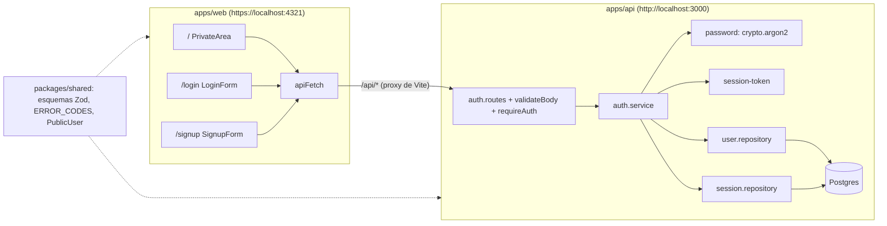

# Plan técnico · Spec 001 · Cuentas de usuario

> CÓMO se cumple `spec.md`. Cada decisión se justifica contra la spec y la constitución. Las incógnitas técnicas están en [research.md](research.md).

## 1. Resumen

Se monta el esqueleto del monorepo (C-2), que todavía no existe, y sobre él la autenticación. La API Express guarda usuarios y sesiones en Postgres. La sesión es un token aleatorio que va en una cookie `httpOnly; Secure; SameSite=Lax`; en la base de datos solo se guarda su hash. La sesión caduca tras 7 días sin uso y cada petición autenticada renueva el plazo. El front Astro tiene tres páginas estáticas (`/`, `/login`, `/signup`), cada una con una isla React que pregunta a `GET /api/auth/me` quién es el usuario y redirige según la respuesta. Los esquemas Zod de entrada y el catálogo de códigos de error viven en `packages/shared` y los usan las dos partes. En desarrollo el front se sirve por HTTPS para que Safari acepte la cookie `Secure` (D-1).

## 2. Contexto técnico

- **Código existente relevante:** ninguno. El repositorio solo tiene el kit SDD, la constitución, el roadmap y esta spec. Esta spec crea el esqueleto que reutilizarán 002 y 003. En concreto: el middleware `requireAuth`, el cliente `apiFetch`, el catálogo `ERROR_CODES`, la infraestructura de tests contra Postgres y el `QueryClient` de la zona privada.
- **Patrones del proyecto que se siguen:** capas `routes → services → repositories` (C-8), formato de error único (C-9), esquemas compartidos en `shared` (C-10, C-14) y datos de servidor solo con TanStack Query (C-4).
- **Dependencias nuevas** (todas nuevas porque el repo está vacío; versiones en research R-3):

| Paquete | Dónde | Por qué | Alternativa nativa descartada |
|---------|-------|---------|-------------------------------|
| astro, @astrojs/react, react, react-dom, @tanstack/react-query, tailwindcss, @tailwindcss/vite | web | Stack de C-4 | — |
| express, @prisma/client, @prisma/adapter-pg, prisma (dev) | api | Stack de C-5. Prisma 7 necesita el adaptador `pg` | — |
| zod | shared, api | C-10 y C-14; la API también lo usa para validar el entorno (C-15) | — |
| typescript 6.0.3, eslint, @eslint/js, typescript-eslint, eslint-plugin-astro, eslint-plugin-react-hooks, prettier, prettier-plugin-astro | raíz (dev) | C-1 y C-25. TS 6.0 y no 7 por compatibilidad con typescript-eslint (R-3) | — |
| vitest, jsdom, @testing-library/react, @testing-library/user-event, supertest, @types/supertest, @playwright/test | dev | C-18. `user-event` simula el teclado de verdad (RNF-001); `jsdom` es el DOM que necesita Testing Library | `fireEvent`: no reproduce el foco ni el tabulador |
| tsx | api (dev) | Ejecuta la API en TypeScript con recarga en caliente | Quitar tipos con el Node nativo: no hay garantías con el cliente generado de Prisma ni con fuentes TS de un paquete del workspace (D-6) |
| @astrojs/check | web (dev) | Comprobar los tipos de los `.astro` (C-1). Es la herramienta oficial | `tsc` no entiende `.astro` |
| @vitejs/plugin-basic-ssl | web (dev) | HTTPS en desarrollo con certificado autofirmado (D-1) | mkcert (lo descartó el usuario) |
| @types/node, @types/express, @types/react, @types/react-dom | dev | Tipos para C-1 | — |

No se añaden: `dotenv` (se usa `--env-file` / `process.loadEnvFile()` de Node), `argon2` (se usa `crypto.argon2` nativo, D-4), `cookie-parser` (basta un lector de cookies de 5 líneas, D-5) ni `react-hook-form` (solo hay dos formularios de dos campos).

## 3. Comprobación de constitución

| Artículo | Cumple | Nota |
|----------|--------|------|
| C-1 | ✅ | `tsconfig.base.json` con `strict`, `noUncheckedIndexedAccess` y `verbatimModuleSyntax`. Regla ESLint `no-explicit-any` en `error` |
| C-2 | ✅ | `pnpm-workspace.yaml` con `apps/*` y `packages/*`. Dependencias justificadas en §2 |
| C-3 | ✅ | `.nvmrc` = `24`; `engines.node` = `^24.19.0`; `packageManager` = `pnpm@11.20.0`; `.npmrc` con `engine-strict=true` |
| C-4 | ✅ | Astro estático + Tailwind; tres islas React `client:only="react"`. La zona privada es una sola isla, que en 002 pasará a ser el tablero. Sin `fetch` en `useEffect`: todo pasa por `useQuery`/`useMutation` |
| C-5 | ✅ | Express 5 + Prisma 7 + Postgres 18 en `docker compose`. Una migración inicial commiteada |
| C-6 | ✅ | Solo local; no hay despliegue. El HTTPS de desarrollo (D-1) no es un despliegue |
| C-7 | ✅ | El front llama a `/api/...` con rutas relativas; el proxy de Astro (Vite) redirige a `http://localhost:3000`. Sin CORS |
| C-8 | ✅ | Solo `apps/api/src/repositories/*` importa Prisma. Los middlewares viven en la capa routes y llaman a services |
| C-9 | ✅ | Manejador de errores único: respuestas 4xx/5xx, JSON mal formado y rutas desconocidas responden `{ error: { code, message } }`. El catálogo está en `shared/errors.ts` |
| C-10 | ✅ | `shared` solo depende de `zod` |
| C-11 | ✅ | No aplica: esta spec no tiene fechas sin hora. `expiresAt` es un instante con hora y no viaja por la API |
| C-12 | ✅ | Sesiones en BD; cookie `httpOnly`, `secure` y `sameSite=lax`. argon2id nativo (D-4). Las respuestas solo devuelven `{ id, email }`. El token de sesión solo viaja en `Set-Cookie`, nunca en el cuerpo, y en BD se guarda su SHA-256. CSRF: `SameSite=Lax` + la API solo acepta `application/json` en métodos que modifican (D-13) |
| C-13 | ✅ | `requireAuth` deja el usuario en `res.locals`. En esta spec no hay tareas, pero el patrón queda listo para 002 |
| C-14 | ✅ | `validateBody(schema)` en routes, con los esquemas de `shared` |
| C-15 | ✅ | `apps/api/src/config/env.ts` valida `DATABASE_URL`, `PORT` y `NODE_ENV` con Zod al arrancar. `.env` está en `.gitignore`; se commitea `.env.example` sin valores reales. `docker-compose.yml` lee la contraseña de `.env` |
| C-16 | ✅ | `User` solo tiene `id`, `email` y `passwordHash`; `Session` solo `id`, `tokenHash`, `userId` y `expiresAt`. Sin `createdAt`. `onDelete: Cascade`. Caducidad de 7 días; las sesiones caducadas del usuario se borran al detectarlas y al iniciar sesión (D-3) |
| C-17 | ✅ | Cada RF tiene al menos un test (§6) |
| C-18 | ✅ | Vitest + Testing Library (web), Supertest contra un Postgres de test real (api) y Playwright para el flujo registro → zona privada → cerrar sesión → iniciar sesión |
| C-19 | ⚠️ | Scripts `pnpm test`, `pnpm lint` y `pnpm typecheck` en la raíz. **Excepción temporal:** de T-013 a T-035 (`tasks.md`), `pnpm test` puede tener en rojo los tests de tareas aún no hechas, porque la fase de contratos y tests los escribe antes que el código (test primero). Límites: `pnpm lint` y `pnpm typecheck` siempre en verde, gracias a los stubs de T-011 y T-012; cada tarea del núcleo o de UI pone en verde sus tests; ningún test que ya estaba en verde puede pasar a rojo; desde T-036, `pnpm test` pasa entero y C-19 se cumple sin excepción. *Por qué:* escribir los tests primero obliga a que fallen antes de que exista el código, y la alternativa (escribir cada test justo antes de su tarea) rompe la fase de contratos y tests del flujo SDD |
| C-20 | ✅ | Etiquetas visibles, `aria-invalid`, `aria-describedby`, `role="alert"`, foco en el primer campo con error y `focus-visible`. No hay arrastre en esta spec |
| C-21 | ✅ | Ninguna funcionalidad fuera de la spec. "Recordarme", limitar intentos y similares siguen fuera |
| C-22 | ✅ | Abstracciones con ≥ 2 usos: `validateBody` (signup, login), `FormField` (4 campos), `withQueryClient` (3 islas), `apiFetch` (4 llamadas) |
| C-23 | ✅ | Código en inglés; textos de la interfaz en castellano |
| C-24 | ✅ | Rama `feat/001-cuentas-de-usuario`; commits con el ID de la tarea |
| C-25 | ✅ | `eslint.config.js` (flat) con typescript-eslint, plugin de Astro y reglas de hooks; Prettier con el plugin de Astro |

Una excepción temporal: C-19 (ver la fila de la tabla).

## 4. Diseño

### 4.1 Arquitectura y flujo



**Redirecciones del front** (todas con `location.replace`, para no dejar entradas en el historial):

| Página | `GET /api/auth/me` responde | Resultado |
|--------|-----------------------------|-----------|
| `/` | 200 | Muestra la zona privada |
| `/` | 401 `UNAUTHENTICATED` | → `/login` |
| `/` | 401 `SESSION_EXPIRED` | → `/login?expired=1` (aviso de RF-013) |
| `/login`, `/signup` | 200 | → `/` (CA-4.3) |
| `/login`, `/signup` | 401 o error de red | Muestra el formulario |

Mientras `me` está pendiente, la isla no pinta nada visible salvo un texto "Cargando…" para lectores de pantalla. Así no aparece ni un instante la pantalla que no toca.

**Sesión** (D-3): `authenticate(token)` busca la sesión por `sha256(token)`.
- Si no existe → `UNAUTHENTICATED`.
- Si `expiresAt ≤ ahora` → se borra la sesión y responde `SESSION_EXPIRED`.
- Si es válida → `expiresAt = ahora + 7 días` (RF-018), se vuelve a emitir la cookie y se devuelve el usuario.

### 4.2 Modelo de datos

```prisma
model User {
  id           String    @id @default(uuid())
  email        String    @unique          // ya normalizado: sin espacios y en minúsculas (RF-003)
  passwordHash String                     // formato PHC de argon2id
  sessions     Session[]
}

model Session {
  id        String   @id @default(uuid())
  tokenHash String   @unique              // SHA-256 en hex del token de la cookie
  userId    String
  user      User     @relation(fields: [userId], references: [id], onDelete: Cascade)
  expiresAt DateTime
  @@index([userId])
}
```

Migración `prisma/migrations/<timestamp>_auth_init`. Cliente generado con el generador `prisma-client` en `apps/api/src/generated/prisma` (en `.gitignore`; se regenera en `postinstall`).

```ts
// packages/shared/src/auth.ts
export const emailSchema: z.ZodType<string>;     // trim → minúsculas → obligatorio → máx. 254 → z.email()
export const passwordSchema: z.ZodType<string>;  // sin recortar; solo espacios = obligatorio; 8–128 puntos de código
export const signupInputSchema = z.object({ email: emailSchema, password: passwordSchema });
export const loginInputSchema = z.object({ email: requiredEmail, password: requiredPassword }); // solo obligatorios
export type SignupInput = z.infer<typeof signupInputSchema>;
export type LoginInput = z.infer<typeof loginInputSchema>;
export type PublicUser = { id: string; email: string };

// packages/shared/src/errors.ts
export const ERROR_CODES = {
  VALIDATION_ERROR: 'VALIDATION_ERROR',
  EMAIL_ALREADY_REGISTERED: 'EMAIL_ALREADY_REGISTERED',
  INVALID_CREDENTIALS: 'INVALID_CREDENTIALS',
  UNSUPPORTED_MEDIA_TYPE: 'UNSUPPORTED_MEDIA_TYPE',
  UNAUTHENTICATED: 'UNAUTHENTICATED',
  SESSION_EXPIRED: 'SESSION_EXPIRED',
  NOT_FOUND: 'NOT_FOUND',
  INTERNAL_ERROR: 'INTERNAL_ERROR',
} as const;
export type ErrorCode = keyof typeof ERROR_CODES;
export type ApiErrorBody = { error: { code: ErrorCode; message: string } };
```

Los mensajes de validación de los esquemas están en castellano, en `shared`, para que el front los muestre tal cual (D-7):

| Situación | Mensaje |
|-----------|---------|
| Campo vacío o solo con espacios | "Este campo es obligatorio" |
| Email con formato no válido | "Introduce un email válido" |
| Email de más de 254 caracteres | "El email no puede tener más de 254 caracteres" |
| Contraseña fuera de límites | "La contraseña debe tener entre 8 y 128 caracteres" |

### 4.3 Contratos

Todas las rutas aceptan y devuelven JSON (límite de cuerpo de 100 kB, el de Express por defecto). Toda petición `POST`, `PUT`, `PATCH` o `DELETE` a `/api/*` cuyo `Content-Type` no sea `application/json` (incluida la que no lo lleva) responde 415 `UNSUPPORTED_MEDIA_TYPE` antes de llegar a la ruta (D-13). `apiFetch` envía siempre `Content-Type: application/json` en `POST`, con cuerpo `{}` si no hay datos. Cookie: `sid=<token base64url de 32 bytes>; HttpOnly; Secure; SameSite=Lax; Path=/; Max-Age=2592000` (30 días, D-3).

| Contrato | Entrada | Salida | Errores |
|----------|---------|--------|---------|
| `POST /api/auth/signup` | `SignupInput` | 201 `{ user: PublicUser }` + `Set-Cookie` | 400 `VALIDATION_ERROR`, 409 `EMAIL_ALREADY_REGISTERED` |
| `POST /api/auth/login` | `LoginInput` | 200 `{ user: PublicUser }` + `Set-Cookie` | 400 `VALIDATION_ERROR`, 401 `INVALID_CREDENTIALS` |
| `POST /api/auth/logout` | cookie (opcional), cuerpo `{}` | 204 + borrado de la cookie (idempotente) | 415 `UNSUPPORTED_MEDIA_TYPE` |
| `GET /api/auth/me` | cookie | 200 `{ user: PublicUser }` + `Set-Cookie` renovada | 401 `UNAUTHENTICATED`, 401 `SESSION_EXPIRED` |
| Cualquier otra `/api/*` | — | — | 404 `NOT_FOUND` |
| JSON mal formado / error no controlado | — | — | 400 `VALIDATION_ERROR` / 500 `INTERNAL_ERROR` |
| Método que modifica sin `application/json` | — | — | 415 `UNSUPPORTED_MEDIA_TYPE` (también en signup y login) |

Firmas internas:

```ts
// apps/api/src/services/auth.service.ts
signup(input: SignupInput): Promise<{ user: PublicUser; token: string }>;   // lanza AppError EMAIL_ALREADY_REGISTERED
login(input: LoginInput): Promise<{ user: PublicUser; token: string }>;     // lanza AppError INVALID_CREDENTIALS
logout(token: string | undefined): Promise<void>;
authenticate(token: string | undefined): Promise<PublicUser>;               // lanza UNAUTHENTICATED | SESSION_EXPIRED; renueva

// apps/api/src/services/password.ts
hashPassword(plain: string): Promise<string>;                 // PHC argon2id m=19456,t=2,p=1, sal de 16 bytes
verifyPassword(plain: string, phc: string): Promise<boolean>; // timingSafeEqual

// apps/api/src/repositories/user.repository.ts
createUser(email: string, passwordHash: string): Promise<PublicUser | null>; // null si el email ya existe (P2002)
findUserByEmail(email: string): Promise<{ id: string; email: string; passwordHash: string } | null>;

// apps/api/src/repositories/session.repository.ts
createSession(userId: string, tokenHash: string, expiresAt: Date): Promise<void>;
findSessionByTokenHash(tokenHash: string): Promise<{ id: string; expiresAt: Date; user: PublicUser } | null>;
extendSession(id: string, expiresAt: Date): Promise<void>;
deleteSessionByTokenHash(tokenHash: string): Promise<void>;
deleteExpiredSessions(userId: string, now: Date): Promise<void>;

// apps/web/src/lib/api.ts
class ApiError extends Error { code: ErrorCode; status: number }
class NetworkError extends Error {}
apiFetch<T>(path: `/api/${string}`, init?: { method?: 'GET' | 'POST'; body?: unknown }): Promise<T>;
```

Props: `FormField({ id, label, type, autoComplete, value, onChange, error })`. `PrivateArea`, `LoginForm` y `SignupForm` no reciben props.

### 4.4 Componentes / módulos

| Módulo | Ruta | Responsabilidad | Nuevo/Modificado |
|--------|------|-----------------|------------------|
| Raíz del monorepo | `package.json`, `pnpm-workspace.yaml`, `.npmrc`, `.nvmrc`, `tsconfig.base.json`, `eslint.config.js`, `.prettierrc`, `.gitignore`, `.env.example`, `vitest.config.ts`, `playwright.config.ts` | Configuración común y scripts `dev`, `test`, `test:e2e`, `lint`, `typecheck`, `db:up`, `db:migrate` | Nuevo |
| Postgres local | `docker-compose.yml`, `docker/init-test-db.sql` | Postgres 18 con las bases `todo` y `todo_test` | Nuevo |
| Shared | `packages/shared/src/{index,auth,errors}.ts` | Esquemas, tipos y catálogo de errores | Nuevo |
| Arranque de la API | `apps/api/src/{server,app}.ts`, `src/config/env.ts` | `createApp()` (lo usa Supertest) y `listen` | Nuevo |
| Routes | `apps/api/src/routes/auth.routes.ts`, `routes/session-cookie.ts`, `routes/middleware/{require-json,validate-body,require-auth,error-handler}.ts` | HTTP, cookies, protección CSRF (D-13), validación y formato de error | Nuevo |
| Services | `apps/api/src/services/{auth.service,password,session-token}.ts`, `src/errors.ts` (`AppError`) | Reglas de registro, inicio de sesión y caducidad | Nuevo |
| Repositories | `apps/api/src/repositories/{prisma,user.repository,session.repository}.ts` | Acceso a datos; los únicos que importan Prisma | Nuevo |
| Prisma | `apps/api/prisma/schema.prisma`, `prisma/migrations/`, `apps/api/prisma.config.ts` | Esquema y migración | Nuevo |
| Páginas | `apps/web/src/pages/{index,login,signup}.astro`, `src/layouts/Layout.astro` (`lang="es"`), `src/styles/global.css` | Montan cada isla | Nuevo |
| Islas | `apps/web/src/components/{PrivateArea,LoginForm,SignupForm,FormField,withQueryClient}.tsx` | UI y redirecciones | Nuevo |
| Cliente | `apps/web/src/lib/{api,auth-queries,messages}.ts` | `apiFetch`, hooks `useMe`/`useLogin`/`useSignup`/`useLogout` y textos por `code` (C-9) | Nuevo |
| Config web | `apps/web/astro.config.mjs` | React, Tailwind, `basicSsl()` y proxy de `/api` | Nuevo |
| Tests de la API | `apps/api/test/{global-setup,setup,helpers}.ts` | `migrate deploy` sobre `todo_test`, vaciado entre tests y extracción de la cookie | Nuevo |
| E2E | `e2e/auth.spec.ts` | Flujo principal | Nuevo |
| README | `README.md` | Requisitos y arranque (`corepack enable`, `pnpm i`, `cp .env.example .env`, `pnpm db:up`, `pnpm db:migrate`, `pnpm dev`) y aviso del certificado autofirmado | Nuevo |

## 5. Decisiones

- **D-1** En desarrollo, el front se sirve por `https://localhost:4321` con `@vitejs/plugin-basic-ssl`. La API sigue en `http://localhost:3000`, solo accesible a través del proxy.
  - *Por qué:* Safari no guarda cookies `Secure` en `http://localhost` (R-1), y C-12 y RNF-004 lo exigen. Lo eligió el usuario.
  - *Alternativas descartadas:* mkcert (requiere instalar algo fuera del repo); quitar Safari de RNF-004 (recorta la spec); excepción a C-12 (debilita la seguridad).
  - *Consecuencia:* cada navegador muestra una vez el aviso del certificado. Playwright usa `ignoreHTTPSErrors: true`. Ver [ADR-0001](../../docs/adr/0001-https-en-desarrollo-local.md).
- **D-2** La autenticación la hace el código del proyecto: un token aleatorio de 32 bytes (`crypto.randomBytes`) en la cookie y su SHA-256 en BD.
  - *Por qué:* C-12 pide sesiones en BD. El hash evita que alguien con acceso a la BD pueda usar sesiones vivas, y cuesta una línea.
  - *Alternativas descartadas:* `express-session` + store de Postgres (dos dependencias, y su store accede a la BD fuera de los repositories, contra C-8); JWT (no hay sesión en BD y no se puede revocar al cerrar sesión).
- **D-3** La sesión del servidor caduca a los 7 días sin uso y se renueva en cada petición autenticada. La cookie dura 30 días y se vuelve a emitir con cada renovación. Las sesiones caducadas se borran al detectarlas y, para ese usuario, al iniciar sesión o registrarse.
  - *Por qué:* RF-017 y RF-018. Con la cookie más larga que la sesión, el servidor puede distinguir una sesión caducada y mostrar el aviso de RF-013 (R-5).
  - *Alternativas descartadas:* cookie de 7 días (el aviso no se vería nunca); cookie de sesión sin `Max-Age` (se pierde al cerrar el navegador y no cumple RF-016); un proceso periódico de limpieza (infraestructura extra para algo que la spec no pide).
  - *Deuda aceptada:* las sesiones caducadas de usuarios que no vuelven nunca se quedan en BD. Son pocas y sin valor; si algún día hay despliegue, se revisa.
- **D-4** argon2id con `crypto.argon2` nativo de Node (m=19456 KiB, t=2, p=1), guardado en formato PHC.
  - *Por qué:* C-12 y C-2 (alternativa nativa, sin dependencias) (R-2).
  - *Alternativas descartadas:* `@node-rs/argon2` y `argon2` (dependencia nativa innecesaria; queda como plan B detrás de la misma interfaz).
- **D-5** Las cookies se leen con un helper propio, `readCookie(header, name)`, y se escriben con `res.cookie()` de Express.
  - *Por qué:* solo hay una cookie, con un valor base64url que no necesita decodificarse.
  - *Alternativas descartadas:* `cookie-parser` / `cookie` (dependencia para 5 líneas).
- **D-6** `packages/shared` se consume como código TypeScript sin compilar (`"exports": { ".": "./src/index.ts" }`). La API se ejecuta con `tsx` y el front lo compila Vite.
  - *Por qué:* no hace falta ningún paso de build ni de vigilancia de cambios para `shared`.
  - *Alternativas descartadas:* compilar `shared` a `dist` (más scripts y riesgo de usar un `dist` desactualizado); quitar tipos con el Node nativo (riesgo con el código generado de Prisma, R-3). Ver [ADR-0002](../../docs/adr/0002-shared-como-codigo-typescript-sin-compilar.md).
- **D-7** Validación en el front con los mismos esquemas de `shared`, al enviar el formulario. El servidor vuelve a validar (C-14) pero solo devuelve `VALIDATION_ERROR`, sin detalle por campo.
  - *Por qué:* C-9 fija el formato del error sin detalles por campo. Como el front valida antes con el mismo esquema, el servidor solo rechaza peticiones que no pasaron por el formulario.
  - *Alternativas descartadas:* añadir `details` al formato de error (contradice C-9); validar mientras se escribe (la spec no lo pide).
- **D-8** El inicio de sesión no iguala tiempos de respuesta cuando el email no existe.
  - *Por qué:* el registro ya revela qué emails existen (decisión de la spec en CA-1.2), así que igualar tiempos no protegería nada. RF-009 solo exige el mismo mensaje.
- **D-9** El registro inserta directamente y deja que el índice único de `email` detecte el duplicado (P2002 → `null` → `EMAIL_ALREADY_REGISTERED`), sin consultar antes.
  - *Por qué:* un solo punto de verdad que también cubre la carrera de E-8.
- **D-10** En la zona privada, un `QueryCache`/`MutationCache` con `onError` redirige ante `UNAUTHENTICATED` o `SESSION_EXPIRED`. Un listener de `pageshow` con `persisted` recarga la página.
  - *Por qué:* RF-012, RF-013 y CA-3.2 (R-6). 002 reutilizará el mismo `QueryClient` para las tareas.
- **D-11** Si cerrar sesión falla por red o por un error inesperado, se muestra el mensaje de RF-010 y el usuario sigue en la zona privada.
  - *Por qué:* redirigir sin haber cerrado la sesión haría creer al usuario que ha salido cuando no es así. Es la misma regla de RF-010 aplicada al botón.
- **D-12** Los formularios usan `noValidate` y `<input type="email">` con `autocomplete` (`email`, `new-password`, `current-password`).
  - *Por qué:* que el navegador no muestre sus propios globos de validación, que no se pueden leer igual en todos los navegadores, y que los mensajes sean los de la spec (RNF-001).
- **D-13** Protección CSRF con dos barreras: (1) la cookie `SameSite=Lax`, que el navegador no envía en `POST` entre sitios; (2) el middleware `requireJson`, que rechaza con 415 `UNSUPPORTED_MEDIA_TYPE` cualquier `POST`/`PUT`/`PATCH`/`DELETE` a `/api/*` cuyo `Content-Type` no sea `application/json`. `express.json()` solo procesa JSON.
  - *Por qué:* C-12. Un formulario HTML de otro sitio solo puede enviar `application/x-www-form-urlencoded`, `multipart/form-data` o `text/plain`; enviar `application/json` desde otro origen obliga a una comprobación previa (preflight) que la API no autoriza, porque no hay CORS (C-7). Hace falta el middleware explícito porque `express.json()` por sí solo no basta: `POST /api/auth/logout` no lleva cuerpo, así que con `Content-Type` de formulario la ruta se ejecutaría igual y cerraría la sesión.
  - *Alternativas descartadas:* token CSRF (estado y código extra que no aportan nada si se cumplen las dos barreras); comprobar la cabecera `Origin` (redundante con lo anterior, y el proxy de desarrollo la complica).

## 6. Trazabilidad

U = unitario (Vitest), I = integración de la API (Supertest + Postgres de test), C = componente (Testing Library), E = E2E (Playwright).

| Requisito | Cómo se cumple (decisión / módulo) | Cómo se prueba |
|-----------|------------------------------------|----------------|
| RF-001 | `auth.service.signup` + `user.repository.createUser` | I: signup válido → 201 y el usuario existe en BD |
| RF-002 | `signup` crea la sesión; `SignupForm` redirige a `/` | I: el 201 trae `Set-Cookie` y `/me` con esa cookie → 200. E: registro → ve su email |
| RF-003 | `emailSchema` (trim + minúsculas) | U: `"  ANA@Example.com "` → `ana@example.com`. I: signup con mayúsculas y login con otra combinación → 200 (CA-2.2) |
| RF-004 | D-9; `messages.ts` asocia el código al campo email | I: email duplicado → 409 `EMAIL_ALREADY_REGISTERED` y solo 1 usuario en BD. C: muestra "Ya existe una cuenta con ese email" junto al email |
| RF-005 | `emailSchema` | U: `ana@`, 254 vs 255 caracteres, `ñandú@correo.es`. C: mensaje junto al email. I: 400 `VALIDATION_ERROR` |
| RF-006 | `passwordSchema` | U: 7/8/128/129 caracteres y emoji contados como 1. C: mensaje junto a la contraseña. I: 400 |
| RF-007 | Esquemas: vacío o solo espacios → obligatorio | U: `""` y `"   "` en los dos campos. C: los dos mensajes a la vez (CA-1.5) |
| RF-008 | `auth.service.login` + `verifyPassword` | I: login correcto → 200 + cookie. E: login tras cerrar sesión |
| RF-009 | `login` lanza `INVALID_CREDENTIALS` en los dos casos | I: contraseña mala y email inexistente → mismo status y `code`. C: muestra "Email o contraseña incorrectos" |
| RF-010 | `apiFetch` lanza `NetworkError` en el `fetch` y trata un 5xx como error inesperado; los formularios muestran el mensaje, conservan el email y vacían la contraseña | C: `fetch` simulado que rechaza y otro que responde 500, en los dos formularios. U: `apiFetch` distingue red, 5xx y `ApiError` |
| RF-011 | `logout` borra la sesión; el borrado de cookie lo hace la ruta; `PrivateArea` → `/login` | I: tras el logout, `/me` con la misma cookie → 401. E: botón "Cerrar sesión" |
| RF-012 | `requireAuth` + redirección de `PrivateArea` | I: `/me` sin cookie → 401 `UNAUTHENTICATED`. C: con 401 se llama a `location.replace('/login')`. E: abrir `/` sin sesión → ve el login |
| RF-013 | `SESSION_EXPIRED` + D-10 + aviso en `LoginForm` con `?expired=1` | I: sesión con `expiresAt` pasado → 401 `SESSION_EXPIRED` y la sesión se borra. C: login con `?expired=1` muestra el aviso; `PrivateArea` con `SESSION_EXPIRED` redirige a `?expired=1` |
| RF-014 | `LoginForm`/`SignupForm` redirigen si `me` → 200 | C: `me` 200 → `location.replace('/')`. E: con sesión, abrir `/login` → zona privada |
| RF-015 | `PrivateArea` | C: muestra el email y el botón "Cerrar sesión" |
| RF-016 | Cookie con `Max-Age` (D-3) | I: `Set-Cookie` lleva `Max-Age=2592000`. E: contexto nuevo con el `storageState` guardado → entra directo |
| RF-017 | `authenticate` compara `expiresAt` | I: `expiresAt` = ahora − 1 día (último uso hace 8 días) → 401 `SESSION_EXPIRED` (CA-5.2) |
| RF-018 | `authenticate` → `extendSession` | I: `expiresAt` = ahora + 1 día (último uso hace 6 días) → 200 y `expiresAt` ≈ ahora + 7 días (CA-5.3) |
| C-12 · CSRF | D-13: `SameSite=Lax` + `requireJson` | I: `POST /api/auth/logout` con la cookie válida y `Content-Type: application/x-www-form-urlencoded` → 415 `UNSUPPORTED_MEDIA_TYPE`, y después `/me` con la misma cookie → 200 (la sesión no se ha cerrado). I: el `Set-Cookie` lleva `SameSite=Lax`, `HttpOnly` y `Secure` |
| RNF-001 | `FormField` (etiqueta, `aria-invalid`, `aria-describedby`), mensaje del formulario con `role="alert"`, foco en el primer campo con error, `focus-visible` de Tailwind | C: consultas por rol y etiqueta; tras un envío inválido el foco está en el primer campo con error. E: registro e inicio de sesión solo con teclado (Tab/Enter). Manual: contraste ≥ 4.5:1 con la herramienta del navegador |
| RNF-002 | D-4; `PublicUser` como única forma de salida | U: `hashPassword` no contiene la contraseña y `verifyPassword` acierta y falla. I: los cuerpos de signup, login y me tienen exactamente las claves `id` y `email` |
| RNF-003 | Modelo de §4.2 | Revisión del esquema en `/sdd-verificar` (manual). I: borrar un `User` borra sus `Session` (cascada, C-16) |
| RNF-004 | Playwright con proyectos `chromium`, `firefox` y `webkit`; D-1 | E: el flujo completo en los tres motores. Edge usa Chromium: queda cubierto por `chromium` |
| E-1 | Esquemas (RF-007) | U + C (como RF-007) |
| E-2 | `emailSchema` | U: 254 válido, 255 no válido |
| E-3 | `passwordSchema` | U: 8 y 128 válidos, 129 no válido |
| E-4 | `passwordSchema` cuenta puntos de código y no recorta | U: `"  a ñ 😀 b  "` de longitud válida → se acepta sin cambios. I: login con esa misma contraseña → 200 |
| E-5 | D-10 | Como RF-013 |
| E-6 | Una sesión por cookie; la otra pestaña recibe 401 en su siguiente petición | I: logout con la cookie A → `/me` con A → 401. E: dos páginas del mismo contexto; cerrar sesión en una y recargar la otra → login |
| E-7 | RF-010 | Como RF-010 |
| E-8 | D-9 + botón deshabilitado mientras la mutación está en curso | I: dos signup en paralelo (`Promise.all`) → uno 201 y otro 409; 1 usuario en BD. C: el botón queda `disabled` mientras se envía |
| E-9 | Una fila `Session` por inicio de sesión; logout borra solo la suya | I: dos logins (A y B), logout con A → `/me` con B → 200 |
| E-10 | `z.email()` | U: `ñandú@correo.es` → "Introduce un email válido" |

## 7. Estrategia de pruebas

- **Unitarias** (`packages/shared`, `apps/api/src/services/{password,session-token}`, `apps/web/src/lib/api`): esquemas con todos los valores límite de la spec, hash y verificación de contraseñas, generación y hash de tokens, `readCookie`, y cómo `apiFetch` clasifica los errores.
- **Integración** (`apps/api/**/*.test.ts`): Supertest contra `createApp()` y el Postgres `todo_test`. El `globalSetup` ejecuta `prisma migrate deploy` y antes de cada test se vacían las tablas (`TRUNCATE "Session", "User"`). Los archivos de test van en serie (`fileParallelism: false`) porque comparten base de datos. Como Supertest no envía cookies `Secure` por HTTP, `helpers.ts` saca `sid` de `Set-Cookie` y la manda en la cabecera `Cookie` a mano. La caducidad se prueba modificando `expiresAt` directamente en la BD, sin simular relojes.
- **Componentes** (`apps/web/**/*.test.tsx`, jsdom): formularios y `PrivateArea` con `fetch` simulado vía `vi.stubGlobal`, y `location.replace` espiado.
- **E2E** (`e2e/auth.spec.ts`, script `pnpm test:e2e`): Playwright arranca `pnpm dev` con `DATABASE_URL` apuntando a `todo_test` y `ignoreHTTPSErrors`. El flujo: registro → zona privada → recargar → cerrar sesión → "atrás" → login con mayúsculas → abrir `/login` con sesión. Todo con teclado y en los tres motores. Los emails son únicos por ejecución.
- `pnpm test` ejecuta Vitest con proyectos `shared`, `api` y `web`. Necesita Postgres levantado (`pnpm db:up`). El E2E va aparte porque arranca servidores; se ejecuta en cada tarea que toque el flujo y en `/sdd-verificar`.
- **Manual:** contraste de colores (RNF-001) y revisión del esquema de datos (RNF-003): no merece la pena una dependencia extra para algo que se revisa una vez.

## 8. Riesgos y mitigaciones

| Riesgo | Probabilidad | Impacto | Mitigación |
|--------|--------------|---------|------------|
| `crypto.argon2` cambia de API, porque no está claro si es estable en Node 24 | Baja | Medio | Aislado en `password.ts` con tests; plan B: `@node-rs/argon2` (R-2) |
| El certificado autofirmado molesta o WebKit en Playwright lo rechaza | Media | Medio | `ignoreHTTPSErrors`. Si fallara, se cambia a mkcert sin tocar el código de la app (solo `astro.config.mjs`) |
| El proxy de Vite no reenvía bien `Set-Cookie` o la cabecera de origen | Baja | Alto | La primera tarea de integración front-back es un E2E mínimo (registro → `/me`), antes de pulir la UI |
| Incompatibilidades entre versiones recientes (Astro 7, Vitest 5, ESLint 10, Prisma 7) | Media | Medio | Versiones de R-3 ya cruzadas; el esqueleto se monta y se pone en verde (`test`/`lint`/`typecheck`) antes de cualquier funcionalidad |
| Postgres no levantado al ejecutar `pnpm test` | Media | Bajo | El `globalSetup` falla con un mensaje claro ("ejecuta `pnpm db:up`") |
| Sesiones caducadas acumuladas (D-3) | Baja | Bajo | Deuda aceptada; se revisa con el ADR de despliegue |

## 9. Despliegue y operación

- **Feature flag:** no. Es la primera funcionalidad y no hay despliegue (C-6).
- **Migraciones / datos:** una migración inicial (`auth_init`). Para `todo_test` se aplica con `migrate deploy` desde los tests.
- **Observabilidad:** los errores no controlados se escriben con `console.error` en el manejador de errores, con método, ruta y stack, nunca con el cuerpo de la petición (podría contener la contraseña). No hay métricas: es uso local.
- **Rollback:** `git revert` de la rama. En local, `docker compose down -v` borra los datos.

## 10. Preguntas abiertas

Ninguna. Las tres que salieron durante la planificación ya están resueltas: HTTPS en local → D-1; error 5xx → RF-010 en la spec v1.1; email no ASCII → E-10 en la spec v1.1.

### ADR

- [ADR-0001](../../docs/adr/0001-https-en-desarrollo-local.md) · HTTPS en desarrollo local con certificado autofirmado (D-1). Aceptada.
- [ADR-0002](../../docs/adr/0002-shared-como-codigo-typescript-sin-compilar.md) · `packages/shared` se consume como código TypeScript sin compilar (D-6). Aceptada.
