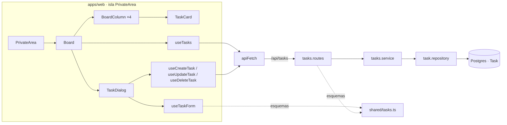

# Plan técnico · Spec 002 · Tablero de tareas

> CÓMO se cumple `spec.md`. Cada decisión se justifica contra la spec y la constitución.
> «§n» remite a `DESIGN.md`; «R-n», a `research.md`.

## 1. Resumen

- **API:** una entidad nueva, `Task`, con su migración, y cuatro rutas REST en `/api/tasks`, todas protegidas por `requireAuth`. Siguen las capas de la 001: routes, services, repositories. Cada operación filtra por el usuario de la sesión, y una tarea ajena responde igual que una inexistente (C-13).
- **Reglas compartidas:** los esquemas Zod de la tarea, con sus mensajes en castellano, viven en `packages/shared` y los usan el formulario y la API.
- **Front:** la zona privada pasa a pintar el tablero dentro de la misma isla (C-4). Lleva una consulta TanStack Query para la lista y tres mutaciones que, al terminar, vuelven a pedirla.
- **Diálogo:** crear y editar usan el mismo `<dialog>` nativo. Las preguntas de confirmación se muestran dentro de ese diálogo, nunca en uno nuevo.
- **Visual:** se usa el catálogo de la 004. Las superficies nuevas se miden en el test de contraste, y donde `DESIGN.md` propone `--text-3` se usa `--text-2` (R-1).

## 2. Contexto técnico

- **Código existente que se reutiliza:**
  - API:
    - `apps/api/src/app.ts`: montaje de routers, `requireJson`, 404 y errores.
    - `routes/middleware/require-auth.ts`: deja el usuario en `res.locals.user` y renueva la sesión.
    - `routes/middleware/validate-body.ts`: valida el cuerpo con un esquema de `shared`.
    - `errors.ts` (`AppError`) y `routes/middleware/error-handler.ts`: formato C-9.
    - `repositories/prisma.ts` y el patrón «error de Prisma → `null`» de `user.repository.ts` (P2002, 001 D-9), aquí con P2025.
  - `packages/shared/src/errors.ts` (catálogo `ERROR_CODES`) y `auth.ts`: patrón de esquema con mensajes, `abort` y longitud en puntos de código.
  - Web:
    - `lib/api.ts`: `apiFetch`, `ApiError` y `NetworkError`.
    - `components/withQueryClient.tsx`: redirige ante `UNAUTHENTICATED` o `SESSION_EXPIRED`, también en las mutaciones; reintenta solo los errores de red.
    - `lib/messages.ts`: el código de error decide el texto.
    - `lib/credentials-form.ts`: patrón de validación al enviar con el foco en el primer error.
  - Componentes de la 004:
    - `Button`: `loading` y `loadingLabel` con el ancho fijo.
    - `FormField`: etiqueta, `aria-invalid`, `aria-describedby` y anillo de error.
    - `Alert`, `Icon`, `Spinner` y `AppHeader`.
    - `PrivateArea.tsx`: patrón de zona `role="alert"` siempre presente.
  - Tests:
    - `apps/api/test/setup.ts` (TRUNCATE) y `test/helpers.ts` (`sidCookie`).
    - `apps/web/src/components/test-utils.tsx` (`mockBrowser`, `renderWithClient`, `expectFieldError`, `emptyAlert`).
    - `design-rules.test.ts`, que revisa solo los componentes nuevos.
    - `styles/tokens.test.ts`: tabla `TEXT_PAIRS` y `catalog().surfaces`.
    - `e2e/helpers.ts` (`signup`, `tabTo`, `uniqueEmail`).
- **Patrones que se siguen:**
  - Capas C-8.
  - Validación en el front con el esquema de `shared` y la API sin detalle por campo (001 D-7).
  - CSRF con `Content-Type: application/json` en toda petición que modifica (001 D-13).
  - Una zona de alerta presente desde el principio (004 D-14).
  - Solo tokens del catálogo (ADR-0003).
  - Clases escritas completas, nunca concatenadas.
- **Dependencias nuevas:** ninguna. Los iconos necesarios (`CircleDashed`, `Circle`, `CircleDot`, `CircleCheck`, `ClockAlert`, `CalendarDays`, `CalendarCheck`, `Plus`, `Trash2`, `CloudOff`, `RotateCw`) están en `lucide-react` 1.62.0. El diálogo es el `<dialog>` nativo.

## 3. Comprobación de constitución

| Artículo | Cumple | Nota |
|----------|--------|------|
| C-1 | ✅ | `strict`, sin `any`. El estado viaja como unión literal de `shared` |
| C-2 | ✅ | Sin dependencias nuevas |
| C-3 | ✅ | Sin cambios |
| C-4 | ✅ | El tablero vive en la isla existente (`PrivateArea`, `client:only="react"`), sin otra isla. Los datos de servidor van con TanStack Query, sin `fetch` en efectos. El formulario del diálogo guarda un **borrador** local, que se crea al abrirlo a partir de la tarea; no es una copia sincronizada de los datos de servidor (D-13). Los efectos que hay solo sincronizan con el DOM: el foco (D-14) y `showModal` (D-12) |
| C-5 | ✅ | Migración nueva versionada (`tasks_init`); la de la 001 no se toca |
| C-6 | ✅ | Solo local |
| C-7 | ✅ | `/api/tasks…` relativas, por el proxy |
| C-8 | ✅ | `tasks.routes.ts` → `tasks.service.ts` → `task.repository.ts`; solo el repository importa Prisma |
| C-9 | ✅ | Nuevo `TASK_NOT_FOUND` en `ERROR_CODES`; el front decide el texto (D-19) |
| C-10 | ✅ | Esquemas, tipos, estados, límites y la regla «fin real no posterior a…» en `shared/tasks.ts`; ni web ni api los duplican |
| C-11 | ✅ | Las fechas son `@db.Date` en BD y `YYYY-MM-DD` en la API y en `shared` (D-5) |
| C-12 | ✅ | Sin cambios en la sesión |
| C-13 | ✅ | Toda consulta lleva `userId` de `res.locals.user`. Una tarea ajena, inexistente o con id mal formado responde 404 `TASK_NOT_FOUND`. Hay un test de tarea ajena por operación: GET (no aparece), PUT y DELETE (D-3) |
| C-14 | ✅ | Cuerpo con `validateBody` y esquema de `shared`; el `:id` con `taskIdSchema` (D-3) |
| C-15 | ✅ | Sin variables nuevas |
| C-16 | ✅ | La tarea solo guarda los datos del glosario de la spec. `onDelete: Cascade` desde `User` |
| C-17 | ✅ | Cada RF tiene al menos un test (§6) |
| C-18 | ✅ | Vitest y Testing Library; Supertest contra Postgres real; Playwright para el flujo principal del tablero |
| C-19 | ✅ | DoD de cada tarea |
| C-20 | ✅ | El estado se cambia sin arrastrar, con radios nativos y flechas (D-15). Diálogo modal con el foco atrapado. Contraste del texto en AAA, medido (R-1) |
| C-21 | ✅ | Nada fuera de la spec. Los avisos de éxito, «Deshacer», el selector de calendario y el deslizar en móvil siguen fuera |
| C-22 | ✅ | Abstracciones nuevas con dos usos o más: `SegmentedControl` (estado en el diálogo y columna en móvil), `FolderCard` («Datos» y «Fechas») y `tasksCount` (recuento total y nombre de cada columna). El resto amplía lo que ya hay (`FormField`, `Button`, `AppHeader`, `apiFetch`) |
| C-23 | ✅ | Identificadores en inglés (`Task`, `estimatedStartDate`, `in_progress`…); los textos visibles, en castellano |
| C-24 | ✅ | Rama `feat/002-tablero-de-tareas` |
| C-25 | ✅ | Sin cambios |
| C-26 | ⚠️ | Desviaciones de `DESIGN.md` justificadas en §4.5, la mayoría por contraste (R-1). Los cambios en `DESIGN.md` van en la misma rama (§4.6) |

## 4. Diseño

### 4.1 Arquitectura y flujo



1. **Carga:** `PrivateArea` pide `me` y, con sesión, `tasks`. Mientras alguna de las dos está pendiente, solo hay «Cargando…» para lectores de pantalla, como en la 001.
   - Si cualquiera de las dos falla por red o con un error inesperado (después de los 3 reintentos de `withQueryClient`), se muestra el error de página de RF-008 (D-8).
   - `UNAUTHENTICATED` o `SESSION_EXPIRED` redirigen, como hoy.
2. **Tablero:** `Board` agrupa las tareas por estado, conservando el orden del servidor, y pinta las cuatro columnas, el recuento y el botón «Crear tarea».
   - Si no hay ninguna tarea, muestra el estado vacío en lugar de las columnas.
3. **Detalle:** al activar una tarjeta se abre `TaskDialog` en modo edición, con un borrador del formulario creado a partir de la tarea. «Crear tarea» lo abre en modo creación.
4. **Guardar:**
   - `useTaskForm` valida con el esquema de `shared` y la fecha local de hoy.
   - Si hay errores, el foco va al primero (RF-019).
   - Si el formulario es válido, la mutación hace POST o PUT. Al acabar, espera a que se vuelva a pedir `['tasks']` (D-7), cierra el diálogo y mueve el foco (D-14).
5. **Errores al guardar o borrar:**
   - Error de red o inesperado: alerta dentro del diálogo, que sigue abierto (RF-028, RF-029).
   - `TASK_NOT_FOUND`: el diálogo se cierra, el mensaje sale en la zona de alerta del tablero y se vuelve a pedir la lista (RF-030).
   - Sesión no válida: la redirección de siempre (E-12).
6. **Confirmaciones:** descartar cambios y borrar sustituyen el contenido del mismo diálogo. El borrador del formulario se conserva para «Seguir editando» y para «Cancelar» (D-12).

### 4.2 Modelo de datos

`apps/api/prisma/schema.prisma` y la migración `apps/api/prisma/migrations/<timestamp>_tasks_init/`:

```prisma
enum TaskStatus {
  backlog
  todo
  in_progress
  done
}

model Task {
  id                 String     @id @default(uuid())
  userId             String
  user               User       @relation(fields: [userId], references: [id], onDelete: Cascade)
  title              String     @db.VarChar(200)  // RF-015; Postgres cuenta caracteres, no bytes
  description        String     @default("") @db.VarChar(5000) // RF-016; "" = sin descripción
  status             TaskStatus @default(backlog)
  estimatedStartDate DateTime?  @db.Date // C-11
  estimatedEndDate   DateTime?  @db.Date
  actualEndDate      DateTime?  @db.Date // solo con status = done (RF-041)
  createdAt          DateTime   @default(now()) // RF-002: orden; no se expone

  @@index([userId, createdAt])
}
// En User: tasks Task[]
```

`packages/shared/src/tasks.ts` (contrato):

```ts
export const TASK_STATUSES = ['backlog', 'todo', 'in_progress', 'done'] as const;
export type TaskStatus = (typeof TASK_STATUSES)[number];
export const TASK_TITLE_MAX_LENGTH = 200;        // puntos de código (E-3)
export const TASK_DESCRIPTION_MAX_LENGTH = 5000; // E-6

export type IsoDate = string; // 'YYYY-MM-DD' (C-11)

// Lo único que la API devuelve de una tarea (sin userId ni createdAt).
export type Task = {
  id: string;
  title: string;
  description: string;
  status: TaskStatus;
  estimatedStartDate: IsoDate | null;
  estimatedEndDate: IsoDate | null;
  actualEndDate: IsoDate | null;
};

export const taskIdSchema: z.ZodType<string>;            // uuid
export const createTaskInputSchema: z.ZodType<CreateTaskInput>;
export const updateTaskInputSchema: z.ZodType<UpdateTaskInput>;
export type CreateTaskInput = Pick<Task, 'title' | 'description' | 'estimatedStartDate' | 'estimatedEndDate'>;
export type UpdateTaskInput = CreateTaskInput & Pick<Task, 'status' | 'actualEndDate'>;

// RF-039: regla pura; el front la llama con la fecha local de hoy y la API con «hoy UTC + 1» (D-6).
export function isActualEndDateAllowed(actualEndDate: IsoDate, latestAllowed: IsoDate): boolean;
```

Reglas de los esquemas. Cada campo da un solo mensaje, con `abort`, como en `auth.ts`:

| Campo | Regla | Mensaje |
|---|---|---|
| `title` | `trim()`; vacío → error; más de 200 puntos de código → error | «Escribe un título para la tarea.» / «El título puede tener hasta 200 caracteres. Acórtalo un poco.» |
| `description` | sin recortar; más de 5000 puntos de código → error | «La descripción puede tener hasta 5000 caracteres. Acórtala un poco.» |
| fechas | `z.iso.date()` o `null` | «Esa fecha no existe. Escríbela como 14/11/2026.» (el front ya lo detecta al leer «dd/mm/aaaa», D-17) |
| `estimatedEndDate` | si las dos existen, `end >= start` (cadenas ISO, comparación de texto) | «La fecha de fin no puede ser anterior a la de inicio. Cambia una de las dos.» (`path: ['estimatedEndDate']`) |
| `status` | `z.enum(TASK_STATUSES)` | — |
| `actualEndDate` | con `status = 'done'` y `null` → error; con otro estado se transforma a `null` (RF-041, E-23) | «Escribe el día en que terminaste la tarea.» |

El mensaje de RF-039 («La fecha real de fin no puede ser posterior a hoy. Cambia la fecha.») lo pone el formulario del front con `isActualEndDateAllowed`, porque depende de la fecha del navegador (R-4). La API comprueba la misma regla en el service con su propio límite (D-6).

### 4.3 Contratos

**API** (todas con `requireAuth`; las que modifican, con `Content-Type: application/json`, 001 D-13):

| Contrato | Entrada | Salida | Errores |
|----------|---------|--------|---------|
| `GET /api/tasks` | — | `200 { tasks: Task[] }`, de la más reciente a la más antigua (`createdAt desc, id desc`) | 401 `UNAUTHENTICATED` / `SESSION_EXPIRED` |
| `POST /api/tasks` | `CreateTaskInput` (si el cuerpo trae `status`, se descarta) | `201 { task: Task }` con `status: 'backlog'` | 400 `VALIDATION_ERROR`, 401, 415 |
| `PUT /api/tasks/:id` | `UpdateTaskInput` (sustitución completa) | `200 { task: Task }` | 400 `VALIDATION_ERROR` (incluido el fin real posterior a «hoy UTC + 1»), 401, 404 `TASK_NOT_FOUND` (inexistente, ajena o id mal formado), 415 |
| `DELETE /api/tasks/:id` | `{}` | `204` | 401, 404 `TASK_NOT_FOUND`, 415 |

**Service** (`apps/api/src/services/tasks.service.ts`):

```ts
listTasks(userId: string): Promise<Task[]>
createTask(userId: string, input: CreateTaskInput): Promise<Task>
updateTask(userId: string, id: string, input: UpdateTaskInput, now?: Date): Promise<Task>   // lanza TASK_NOT_FOUND | VALIDATION_ERROR
deleteTask(userId: string, id: string): Promise<void>                                        // lanza TASK_NOT_FOUND
```

**Repository** (`apps/api/src/repositories/task.repository.ts`): `findTasksByUser`, `createTask`, `updateTaskOfUser` (`null` si no existe o no es suya, P2025) y `deleteTaskOfUser` (`false` si no). Convierte `Date` ↔ `YYYY-MM-DD` (D-5).

**Web, datos** (`apps/web/src/lib/task-queries.ts`):

```ts
useTasks(options: { enabled: boolean }): UseQueryResult<Task[]>
useCreateTask(): UseMutationResult<Task, Error, CreateTaskInput>
useUpdateTask(): UseMutationResult<Task, Error, { id: string; input: UpdateTaskInput }>
useDeleteTask(): UseMutationResult<void, Error, string>
```

**Web, formato** (`apps/web/src/lib/dates.ts`):

```ts
todayLocal(now?: Date): IsoDate                       // fecha local del navegador (E-10)
parseDisplayDate(text: string): IsoDate | null | 'invalid' // '' → null; '14/11/2026' → '2026-11-14'
formatDisplayDate(date: IsoDate): string               // '14/11/2026' (campo)
formatShortDate(date: IsoDate, today: IsoDate): string // '14 nov' o '14 nov 2027' si no es del año en curso
formatLongDate(date: IsoDate): string                  // '28 oct 2026' (detalle)
isOverdue(task: Task, today: IsoDate): boolean         // RF-032: status ≠ done y estimatedEndDate < today
tasksCount(count: number): string                      // '1 tarea' / '6 tareas' (Intl.PluralRules)
```

**Web, componentes** (props principales):

```ts
// Nuevos
Board            { tasks: Task[] }
BoardColumn      { status: TaskStatus; tasks: Task[]; today: IsoDate; hiddenOnMobile: boolean; onOpen(task): void }
TaskCard         { task: Task; today: IsoDate; onOpen(): void }       // <button data-task-id>
TaskDialog       { mode: { kind: 'create' } | { kind: 'edit'; task: Task }; onClose(result: DialogResult): void }
SegmentedControl { name: string; legend: string; options: { value: string; label: string; selectedTone?: StatusTone }[];
                   value: string; onChange(value): void }                 // radios nativos (D-15)
FolderCard       { title: string; children: ReactNode }
// Modificados
FormField  + type 'text', multiline?: boolean, optional?: boolean, help?: string, inputMode?: 'numeric',
           autoComplete + 'off'
Button     + variant 'destructive' (--pill-rose + --text-on-pill)
AppHeader  email?: string: sin email (no se pudo comprobar la sesión, D-8) solo muestra el nombre
apiFetch   method + 'PUT' | 'DELETE' (cuerpo JSON, `{}` si no hay datos)
```

### 4.4 Componentes / módulos

| Módulo | Ruta | Responsabilidad | Nuevo/Modificado |
|--------|------|-----------------|------------------|
| Esquema y migración | `apps/api/prisma/schema.prisma`, `migrations/*_tasks_init/` | `Task`, `TaskStatus` y relación con `User` | Modificado / Nuevo |
| Rutas | `apps/api/src/routes/tasks.routes.ts` | HTTP, `validateBody`, `:id` con `taskIdSchema` | Nuevo |
| App | `apps/api/src/app.ts` | `app.use('/api/tasks', tasksRouter)` antes del 404 | Modificado |
| Service | `apps/api/src/services/tasks.service.ts` | Autorización por usuario, límite del fin real, `TASK_NOT_FOUND` | Nuevo |
| Repository | `apps/api/src/repositories/task.repository.ts` | Prisma y conversión de fechas | Nuevo |
| Setup de tests | `apps/api/test/setup.ts` | `TRUNCATE "Task", "Session", "User"` | Modificado |
| Shared | `packages/shared/src/tasks.ts`, `errors.ts`, `index.ts` | Esquemas, tipos, regla del fin real, `TASK_NOT_FOUND` | Nuevo / Modificado |
| Cliente API | `apps/web/src/lib/api.ts` | PUT y DELETE | Modificado |
| Consultas | `apps/web/src/lib/task-queries.ts` | Consulta y mutaciones (D-7) | Nuevo |
| Formulario | `apps/web/src/lib/task-form.ts` | Borrador, lectura de fechas, validación, foco y «sin cambios» (D-13) | Nuevo |
| Fechas y recuentos | `apps/web/src/lib/dates.ts` | `Intl`, hoy local, retrasada, plurales (R-3) | Nuevo |
| Mensajes | `apps/web/src/lib/messages.ts`, `lib/task-messages.ts` | `TASK_NOT_FOUND` en el mapa de la 001; textos de cargar, guardar y borrar (D-19) | Modificado / Nuevo |
| Zona privada | `apps/web/src/components/PrivateArea.tsx` | Pide las tareas, error de página, título «Tablero» (RF-037) y alto de página (D-16) | Modificado |
| Cabecera | `apps/web/src/components/AppHeader.tsx` | `email` opcional (D-8) | Modificado |
| Tablero | `apps/web/src/components/Board.tsx` | Título y recuento, «Crear tarea», columnas, estado vacío, selector móvil, zona de alerta, foco (D-14) | Nuevo |
| Columna | `apps/web/src/components/BoardColumn.tsx` | Región con nombre, cabecera, lista y hueco vacío | Nuevo |
| Tarjeta | `apps/web/src/components/TaskCard.tsx` | Botón con título, fechas e insignia | Nuevo |
| Diálogo | `apps/web/src/components/TaskDialog.tsx` | `<dialog>`, vistas formulario / descartar / borrar, Esc y clic fuera (D-12) | Nuevo |
| Selector | `apps/web/src/components/SegmentedControl.tsx` | Radios nativos con aspecto segmentado (D-15) | Nuevo |
| Carpeta | `apps/web/src/components/FolderCard.tsx` | Tarjeta carpeta de §5 | Nuevo |
| Campo | `apps/web/src/components/FormField.tsx` | Texto, área de texto, «(opcional)» y ayuda | Modificado |
| Botón | `apps/web/src/components/Button.tsx` | Variante `destructive` | Modificado |
| Estilos | `apps/web/src/styles/tokens.css`, `global.css` | Tokens nuevos (§4.6), `::backdrop` y utilidades de rejilla (D-16) | Modificado |
| Tests de diseño | `apps/web/src/styles/tokens.test.ts` | Superficies y parejas nuevas (R-1); renombrar la pareja del título | Modificado |
| E2E | `e2e/board.spec.ts`, `e2e/helpers.ts`, `e2e/design-system.spec.ts` | Flujo del tablero; ayudas de tareas; el título pasa a «Tablero» (D-23) | Nuevo / Modificado |

### 4.5 Desviaciones de `DESIGN.md` (C-26)

| # | `DESIGN.md` dice | Este plan hace | Por qué |
|---|---|---|---|
| X-1 | §11.3: recuento total y frase de la columna vacía en `--text-3`; §2.3: el valor de «Etiqueta: valor» en `--text-3` | `--text-2` en el recuento, la frase del hueco vacío, las fechas de la tarjeta y la pista de los selectores | `--text-3` da 5.79:1 sobre el lienzo con punto, 6.50–6.96 en el hueco y 6.44 en la tarjeta oscura sin blur (R-1) |
| X-2 | §8: con hover o foco, la superficie sube un nivel | La tarjeta no cambia de superficie: con hover pasa a `--shadow-glass` y `motion-safe:-translate-y-px`; el foco es el contorno global | Con `--surface-raised-hover`, el `--text-2` de la tarjeta cae a 5.80 en oscuro (R-1) |
| X-3 | §1.3: los iconos de estado en el tono del acento | Los iconos de estado van en `--text-2`; el tono solo aparece en la opción elegida del selector de estado (D-15) y en la insignia «Retrasada» (fondo `--amber-soft`) | Los acentos dan 2.41–2.76:1 sobre la columna clara y los iconos de estado necesitan 3:1 (§1.6); además, un solo acento por vista |
| X-4 | §14 Segmentado: items de 38 px | 44 px | Objetivo táctil de §4 (≥ 44 px), como hizo la 004 con el menú |
| X-5 | §12 Error de página: código técnico en mono pequeño | Sin código técnico | La spec no lo pide y Geist Mono no está instalada (004 D-7) |
| X-6 | §14 Dialog: título Light 28 | `--text-h2` (30 / 26 px), el token de §2.2 para «título de diálogo» | §2.2 y §14 no coinciden; se usa el token, que tiene nombre |
| X-7 | §11.4: «Borrar tarea» con confirmación (nuevo diálogo) | La confirmación sustituye el contenido del mismo diálogo | §7: «Solo puede haber un diálogo abierto a la vez» |
| X-8 | §11.3: «Crear tarea» junto al título | En el estado vacío (RF-006), el botón está dentro del bloque vacío y no en la cabecera del tablero; en móvil, fijo abajo (RF-036) | Un solo primario por vista (§14) |
| X-9 *(añadida en T-012)* | §14 Textarea: radio 24 | `--radius-md` (26) | El 24 no está en el catálogo de §5 (ADR-0003); 26 es el radio más cercano |

### 4.6 Cambios en `DESIGN.md` (§19, MINOR → `1.3.0-todo.1`)

- **Tokens nuevos**:
  - `--surface-veil` (`rgba(6,20,27,.32)` en los dos temas) y `--veil-filter` (`blur(8px)`), para el velo de §6.3.
  - `--board-column-min` (`280px`, §3.2).

  Van en `tokens.css`, en los valores esperados de `tokens.test.ts` y en §1.4, §6.3 y §3.2.
- **§1.3:** el mapa de estados queda confirmado tal cual, añadiendo dónde se usa el tono (X-3). Sale de «Pendiente de decidir» (punto 1).
- **§11.3 y §11.4:** dejan de ser orientativos y recogen lo que fija la spec 002 (título «Tablero», orden, Backlog al crear, fecha real de fin) y las desviaciones X-1, X-2, X-4, X-6, X-7 y X-8.
- **Historial:** una fila nueva.

## 5. Decisiones

- **D-1** Una tabla `Task` con un enum `TaskStatus` de Postgres. El orden es `createdAt desc, id desc`: la segunda clave desempata dos tareas creadas en el mismo milisegundo (E-24). Índice `(userId, createdAt)`.
  - *Por qué:* RF-002 ordena por el momento de creación. El enum impide estados fuera de los cuatro.
  - *Alternativas descartadas:* un campo `position` (es para el orden manual de la 003); un texto con `CHECK` (lo mismo que el enum, sin el tipo en Prisma).
- **D-2** API REST con `PUT` de sustitución completa. El diálogo guarda todos los campos juntos y el último en guardar gana (E-13). `POST` no admite `status`: siempre `backlog` (RF-011).
  - *Por qué:* coincide con «Guardar cambios», que guarda todo el diálogo (RF-013), y no hay que fusionar campos.
  - *Alternativas descartadas:* `PATCH` por campos (no hay ningún caso que lo pida y obliga a definir qué falta); control de versiones contra la edición simultánea (la spec acepta «gana el último», E-13).
- **D-3** Autorización en el service: toda llamada al repository lleva el `userId` de la sesión. Actualizar y borrar usan `where: { id, userId }`; si Prisma lanza P2025 (no hay fila), el resultado es `null`/`false` y el service lanza `TASK_NOT_FOUND` (404). Un `:id` que no es un UUID también da `TASK_NOT_FOUND`, desde la ruta, con `taskIdSchema` (C-14).
  - *Por qué:* C-13. Una tarea ajena, una inexistente y un id inventado son indistinguibles desde fuera, y la comprobación de propiedad va en la misma sentencia (sin la carrera de comprobar primero y escribir después).
  - *Alternativas descartadas:* `findFirst` y después `update` (dos consultas y una ventana de carrera); 400 para el id mal formado (permitiría distinguir los casos, contra el espíritu de C-13).
- **D-4** Los esquemas y sus mensajes en castellano van en `shared/tasks.ts`, como `auth.ts`. La API valida y responde `VALIDATION_ERROR` sin detalle por campo (001 D-7).
  - *Por qué:* C-10. Los mensajes de la spec salen de un solo sitio.
  - *Alternativas descartadas:* los mensajes en el front y el esquema sin textos (rompería el patrón de la 001 y duplicaría las reglas).
- **D-5** Fechas: Prisma devuelve las `@db.Date` como `Date` a medianoche UTC. El repository las convierte con `toISOString().slice(0, 10)` y, al guardar, con `new Date(\`${iso}T00:00:00.000Z\`)`. Fuera del repository solo viajan cadenas `YYYY-MM-DD` (C-11).
  - *Alternativas descartadas:* convertirlas en el service (le haría conocer el tipo de Prisma, contra C-8).
- **D-6** El servicio acepta como `actualEndDate` hasta «hoy UTC + 1 día» y rechaza lo posterior con `VALIDATION_ERROR` (R-4). Usa `isActualEndDateAllowed` de `shared`, que el front llama con la fecha local exacta.
  - *Por qué:* ningún navegador va más de un día por delante de UTC. Así el servidor nunca rechaza un «hoy» legítimo y tampoco acepta fechas claramente futuras.
  - *Alternativas descartadas:* que el front envíe su «hoy» (se podría falsear y no aporta nada); no comprobarlo en el servidor (C-14 pide validar la entrada).
- **D-7** Datos en el front:
  - Clave `['tasks']`.
  - Cada mutación hace `await queryClient.invalidateQueries({ queryKey: ['tasks'] })` en su `onSuccess`, así que el botón sigue en «Guardando…» hasta tener la lista nueva. Después se cierra el diálogo.
  - Sin actualizaciones optimistas. `TASK_NOT_FOUND` también invalida la lista.
  - *Por qué:* el orden y los recuentos siempre salen del servidor (RF-002, RF-024), sin ordenar ni fusionar en el cliente. En uso local, volver a pedir 500 tareas no se nota (RNF-004).
  - *Alternativas descartadas:* `setQueryData` con la tarea devuelta (obliga a reordenar en el cliente y a exponer `createdAt`); actualización optimista (la spec pide que la tarjeta no se mueva si falla, CA-4.4).
- **D-8** Error al cargar (RF-008, CA-1.6). Si `me` o `tasks` fallan por red o con un error inesperado:
  - `PrivateArea` muestra la cabecera, sin email si `me` no llegó (no se sabe quién es el usuario).
  - Debajo, el error de página de §12: círculo glass con `CloudOff`, el mensaje de la spec en `--text-1` y el botón glass «Reintentar», dentro de una zona `role="alert"` siempre presente.
  - «Reintentar» vuelve a pedir las consultas que fallaron.
  - Resuelve la idea M-3 del roadmap, que esta spec absorbió.
  - *Alternativas descartadas:* no mostrar cabecera (CA-1.6 pide el mensaje «debajo de la cabecera»); un esqueleto (fuera de alcance).
- **D-9** Colores de texto del tablero según R-1:
  - `--text-1`: títulos, tarjeta, insignia, alertas, opción elegida de los selectores y todo lo que va directamente sobre el diálogo.
  - `--text-2`: recuentos, fechas de la tarjeta, frase del hueco vacío, etiquetas de los campos, opciones no elegidas e iconos de estado.
  - `--text-3`: solo «(opcional)» y la ayuda de los campos, dentro de una carpeta (8.00 y 8.36).
  - *Por qué:* C-26 y AAA en el texto.
- **D-10** La tarjeta (`TaskCard`) es un `<button type="button">` con `data-task-id`:
  - Superficie raised, radio `--radius-lg` y padding 16–20.
  - Contenido:
    - El título, con `wrap-anywhere` para E-4.
    - Las fechas, con `CalendarDays`: «14 nov → 28 nov»; solo el fin, «Fin estimado: 28 nov»; solo el inicio, «Inicio estimado: 14 nov».
    - En Done, la fecha real con `CalendarCheck`. Su nombre accesible empieza por «Fecha real de fin:» (`sr-only`).
    - Si está retrasada, la insignia «Retrasada»: 28 px, `--amber-soft`, `ClockAlert` y punto de 7 px, texto en `--text-1`.
  - Con hover, X-2.
  - *Por qué:* §14 TaskCard («es un botón accesible»); E-8; patrón «Etiqueta: valor» de §2.3 cuando solo hay una fecha.
- **D-11** Estructura del tablero:
  - `<h1>` «Tablero» (`--text-display`) y el recuento `tasksCount(n)` en `--text-2`.
  - Cuatro `<section aria-label="In progress, 3 tareas">`, cada una con un `<h2>` (estilo `--text-h3`): icono, nombre y «· 3».
  - Las tarjetas en una `<ul>`.
  - El hueco vacío es un bloque `--surface-sunken` con la frase de RF-005.
  - *Por qué:* RF-009 y §17; jerarquía de encabezados h1 → h2.
- **D-12** El diálogo es un `<dialog>` nativo abierto con `showModal()` en un efecto al montar `TaskDialog`. Lo pinta `Board` cuando hay uno abierto.
  - **Esc:** un `onKeyDown` en el diálogo intercepta Escape con `preventDefault()` y aplica la regla de RF-021:
    - sin cambios: cerrar;
    - con cambios: vista «¿Descartar los cambios?»;
    - en una vista de confirmación: volver al formulario.

    El evento `cancel` también se cancela, como segunda red.
  - **Clic fuera:** `pointerdown` con `target === dialog` (el contenido llena el diálogo, que no tiene padding), con la misma regla.
  - **Vistas** del mismo diálogo (X-7): `form`, `discard` y `confirmDelete`.
  - **Una tarea primero** (D-24): comprobar en Chromium y WebKit que dos Esc seguidos con cambios no cierran el diálogo (R-2). Si no se cumple, el diálogo pasa a ser un `role="dialog" aria-modal` propio, con `inert` en el resto de la isla. Sería un cambio de este plan, que se avisaría antes.
  - *Por qué:* el `<dialog>` nativo ya trae la capa superior, el fondo inerte, la trampa de foco y `::backdrop` para el velo. Es mucho menos código que hacerlo a mano.
  - *Alternativas descartadas:* un diálogo propio desde el principio (más código, y solo hace falta si falla la verificación); un diálogo de confirmación encima del primero (§7).
- **D-13** `useTaskForm(mode)` en `lib/task-form.ts`, con el patrón de `credentials-form.ts`:
  - **Borrador:**
    - Textos de los campos: título, descripción, tres fechas «dd/mm/aaaa» y estado.
    - Se crea una vez al abrir; `TaskDialog` lleva `key` = id de la tarea o `'new'`.
    - «Sin cambios» = borrador igual al inicial (RF-021, CA-3.4).
  - **Al enviar:**
    1. Lee las fechas con `parseDisplayDate`. Si alguna es inválida, da el error de RF-017.
    2. Valida con el esquema de `shared`.
    3. Añade la comprobación de RF-039 con `todayLocal()`.
    4. Si hay errores, deja el primer error de cada campo y lleva el foco al primero en el orden del formulario (RF-019).
  - **Estado Done** (RF-025, RF-038, RF-041):
    - Al elegir Done, si la tarea guardada no está en Done, rellena el fin real con hoy. Si ya lo estaba, restaura su fecha guardada.
    - El campo solo existe mientras el estado elegido es Done.
  - *Por qué:* C-4, porque el borrador no es estado de servidor. `credentials-form.ts` es específico de email y contraseña y no se generaliza (C-22: cambiaría código de la 001 sin necesidad).
- **D-14** Foco tras cerrar (RF-022, RF-027, RF-030). `Board` guarda un `focusTarget`:
  - el id de una tarjeta;
  - o `'create'`.

  Lo aplica un efecto después de pintar la lista nueva, buscando `[data-task-id="…"]` o el botón «Crear tarea» (que puede ser el del estado vacío).
  - **Tras guardar:** su tarjeta, que puede estar en otra columna.
  - **Tras crear:** la tarjeta nueva.
  - **Tras borrar o `TASK_NOT_FOUND`:** «Crear tarea».
  - **Cerrar sin guardar:** la tarjeta o «Crear tarea».
  - En móvil, si la tarjeta queda en otra columna, el selector cambia a esa columna antes de enfocarla.
  - *Por qué:* la restauración nativa del `<dialog>` vuelve a un elemento que puede haber desaparecido (R-2).
  - *Alternativas descartadas:* confiar en la restauración nativa.
- **D-15** `SegmentedControl` es un `<fieldset>` con `<legend>` y radios nativos `<input type="radio">` dentro de `<label>` de 44 px (X-4). Las flechas, el foco y el anuncio los da el navegador (CA-4.2).
  - **Opción elegida del selector de estado**, con el tono de §1.3:
    - Backlog: `--surface-raised-hover` + `--text-1`.
    - To do: `--pill-lilac` + `--text-on-pill`.
    - In progress: `--pill-ink` + `--text-on-accent`.
    - Done: `--pill-sage` + `--text-on-pill`.
  - **Selector de columna en móvil:** neutro (raised-hover + `--text-1`); sus etiquetas llevan el recuento («Done · 0»).
  - *Por qué:* C-20, sin JavaScript de teclado. Un solo acento por vista: en el diálogo, la opción elegida.
  - *Alternativas descartadas:* el `Select` de §14 (un panel flotante dentro del diálogo, con más código y más capas); pestañas ARIA para el selector móvil (más código que los radios, para el mismo resultado).
- **D-16** Disposición:
  - `PrivateArea` pasa a `flex h-dvh flex-col`. Debajo de la cabecera, `main` es `flex-1 min-h-0`, y desde 768 px cada lista de columna hace `overflow-y-auto` (E-2, §3.2).
  - **Columnas**, en dos utilidades de `global.css` con `--board-column-min`, porque las clases con corchetes están prohibidas (ADR-0003):
    - `board-columns`: 4 × `minmax(280px, 1fr)`, con scroll horizontal si no caben (≥ 1024 px).
    - `board-columns-two`: dos visibles (768–1023 px).
  - **Por debajo de 768 px:** las columnas no elegidas llevan `max-md:hidden`, el selector se ve con `md:hidden` y «Crear tarea» pasa a `max-md:fixed max-md:inset-x-4 max-md:bottom-4`, con un relleno inferior en la lista para que no tape la última tarjeta (RF-034, RF-036).
  - Todo con CSS: E-16 y E-17 no necesitan código.
  - **Diálogo:** en escritorio, máximo 460 px (`max-w-115`) y radio `--radius-xl`. Por debajo de 768 px, panel inferior a todo el ancho, radio arriba, asa de 36 × 4 y altura máxima del 92 % (otra utilidad, `sheet-max-height`) (RF-035).
  - *Alternativas descartadas:* una `matchMedia` en JavaScript para elegir el diseño (duplica lo que ya hace el CSS y complica E-16).
- **D-17** Las fechas se escriben en `<input type="text" inputMode="numeric" autoComplete="off">`, con la ayuda «Ejemplo: 14/11/2026» en `--text-3` (§13: ejemplos en la ayuda, no en el placeholder). `parseDisplayDate` acepta `d/m/aaaa` con uno o dos dígitos en el día y el mes, y exige el año con cuatro cifras (E-7 rechaza «14/11/26» y «2026-11-14»).
  - *Alternativas descartadas:* `<input type="date">` (el aspecto y el formato dependen del navegador y la spec pide escribirlas como «14/11/2026»; el selector de calendario está fuera de alcance).
- **D-18** Formatos con `Intl` (`dates.ts`, R-3):
  - **Tarjeta:**
    - Una sola fecha: «Fin estimado: 28 nov» o «Inicio estimado: 14 nov».
    - Las dos: «14 nov → 28 nov».
    - El año aparece si la fecha no es del año en curso.
  - **Detalle:** siempre con año.
  - **Aviso de retrasada:** «Esta tarea tenía que terminar el 28 oct.», sin año si es del año en curso (como en CA-6.2).
  - **«Hoy»:** `todayLocal()` en cada render del tablero (E-10). No hay temporizador a medianoche (E-11, fuera de alcance).
  - **Septiembre:** sale «sept», la salida de `Intl` (R-3).
- **D-19** Textos y errores:
  - **`lib/task-messages.ts`** (nuevo):
    - `loadErrorText`, `saveErrorText` y `deleteErrorText`, con los textos de RF-008, RF-028 y RF-029.
    - `TASK_NOT_FOUND` → «Esta tarea ya no existe.».
    - Cualquier otro `ApiError` que no sea de sesión (p. ej., `VALIDATION_ERROR` si el servidor discrepa) se trata como inesperado.
  - **`messages.ts`:** recibe `TASK_NOT_FOUND` con el texto genérico de la 001, porque su `Record<ErrorCode, …>` exige todos los códigos y en los formularios de acceso no puede darse.
  - **Gerundios de los botones:** «Creando tarea…», «Guardando…» y «Borrando…».
  - **Confirmaciones:**
    - Descartar: «Descartar cambios» (glass) y «Seguir editando» (primario, la opción segura).
    - Borrar: «Borrar tarea» (destructive) y «Cancelar» (glass).
- **D-20** Zonas de alerta, siempre presentes y vacías hasta que hay mensaje (004 D-14):
  - una en el tablero, debajo de la cabecera, para `TASK_NOT_FOUND`, que se vacía al abrir otro diálogo;
  - otra dentro del diálogo, encima de las carpetas, para los errores de guardar y de borrar.
- **D-21** `apiFetch` acepta `PUT` y `DELETE` y los envía como `POST`: `Content-Type: application/json` y cuerpo JSON (`{}` en `DELETE`), porque `requireJson` los exige (001 D-13). Sigue el mismo tratamiento de errores.
- **D-22** El velo es `dialog::backdrop { background: var(--surface-veil); backdrop-filter: var(--veil-filter) }` en `global.css`. La superficie del diálogo es `--surface-raised` + `backdrop-glass` + `--shadow-float`. Las carpetas usan `--surface-folder` (opaca), y los campos dentro de ellas, `--surface-raised`. La forma de carpeta de §5 (pestaña con radio 26 y hombro curvo de 72 × 52) se dibuja con un SVG en línea con `fill-folder`; sin corchetes ni `style=`.
- **D-23** El título de la vista cambia de «Mis tareas» a «Tablero» (RF-037). Se actualizan:
  - el test de `PrivateArea` (CA-2.1 de la 004);
  - `viewTitle` y la medida del título en `e2e/design-system.spec.ts`;
  - el nombre de la pareja del título en `tokens.test.ts`.

  Los textos «Mis tareas» de la cabecera y de la pestaña no cambian.
- **D-24** Orden de implementación con riesgo primero: la verificación del Esc (D-12) es la primera tarea del diálogo.
- **D-25** `GET /api/tasks` devuelve todas las tareas del usuario, sin paginar.
  - *Por qué:* RNF-004 se mide con 500 tareas y la spec no tiene límite. Una sola consulta indexada con unas 500 filas es inmediata en local.
  - *Alternativas descartadas:* paginar (la spec muestra todas las tareas y los recuentos; añadiría complejidad sin ningún caso que la pida).

## 6. Trazabilidad

| Requisito | Cómo se cumple (decisión / módulo) | Cómo se prueba |
|-----------|------------------------------------|----------------|
| RF-001 | `Board` con 4 `BoardColumn` en el orden de `TASK_STATUSES` (D-11) | unit `Board.test` (orden de las columnas); e2e |
| RF-002 | `createdAt desc, id desc` en el repository; el front conserva el orden (D-1, D-7) | api `tasks.list.test` (orden con fechas de creación forzadas); unit `Board.test` (CA-1.8) |
| RF-003 | `tasksCount` y «Nombre · n» en cada `<h2>` (D-11) | unit `dates.test` (plural), `Board.test` (CA-1.1) |
| RF-004 | `findTasksByUser(userId)` (D-3) | api: Ana no ve las tareas de Luis (CA-1.4, C-13); e2e con dos cuentas |
| RF-005 | Hueco vacío en `BoardColumn` con las cuatro frases | unit `BoardColumn.test` |
| RF-006 | Estado vacío de §12 en `Board` con su «Crear tarea» (X-8) | unit `Board.test` (CA-1.3, CA-5.5) |
| RF-007 | `TaskCard` (D-10, D-18) | unit `TaskCard.test` (CA-1.5, E-8, Done) |
| RF-008 | Error de página y «Reintentar» (D-8) | unit `PrivateArea.test` (tasks y me con NetworkError, reintento con éxito) |
| RF-009 | `aria-label` de la sección (D-11) | unit `BoardColumn.test` (CA-1.7); axe |
| RF-010 | `TaskDialog` en modo creación: campos y «(opcional)» | unit `TaskDialog.test` |
| RF-011 | `POST` sin `status` → `backlog` (D-2); tarjeta en Backlog | api `tasks.create.test` (también con `status: 'done'` en el cuerpo); unit; e2e |
| RF-012 | `TaskCard` como botón; `TaskDialog` en edición (D-10, D-12) | unit (clic y Enter); e2e con teclado |
| RF-013 | `PUT` completo; invalidar y cerrar (D-2, D-7) | api `tasks.update.test`; unit `TaskDialog.test` (CA-3.2) |
| RF-014 | `title` en `shared` (§4.2) | shared `tasks.test`; unit (CA-2.3, CA-3.5) |
| RF-015 | ídem, en puntos de código | shared (200 / 201, emoji); unit (CA-2.4) |
| RF-016 | `description` en `shared` | shared (5000 / 5001) |
| RF-017 | `parseDisplayDate` (D-17) + `z.iso.date()` | unit `dates.test` (E-7); unit `TaskDialog.test` (CA-2.6); shared (ISO inválida) |
| RF-018 | `refine` de `end >= start` | shared; unit (CA-2.5) |
| RF-019 | Foco al primer error en `useTaskForm` (D-13) | unit `TaskDialog.test` |
| RF-020 | `trim()` del título; descripción sin tocar | shared (E-5, saltos de línea) |
| RF-021 | Vista `discard`, «sin cambios» y Esc, clic fuera y «Cancelar» (D-12, D-13) | unit (CA-3.3, CA-3.4); e2e del doble Esc (D-24) |
| RF-022 | `focusTarget` (D-14) | unit `Board.test`; e2e |
| RF-023 | `SegmentedControl` con radios (D-15) | unit; e2e solo con teclado (CA-4.2) |
| RF-024 | La lista vuelve a pedirse al guardar (D-7) | unit `Board.test` (CA-4.1); e2e |
| RF-025 | Al elegir Done se rellena hoy, o la fecha guardada si ya estaba en Done (D-13) | unit `TaskDialog.test` (CA-4.3, CA-4.8) con la hora simulada |
| RF-026 | Vista `confirmDelete` (D-12) | unit (CA-5.1, CA-5.3) |
| RF-027 | `DELETE`; foco en «Crear tarea» (D-14) | api `tasks.delete.test`; unit (CA-5.2); e2e |
| RF-028 | Alerta en el diálogo con `saveErrorText` (D-19, D-20) | unit (CA-2.7, CA-4.4) |
| RF-029 | Alerta en el diálogo con `deleteErrorText` | unit (CA-5.4) |
| RF-030 | 404 `TASK_NOT_FOUND` (D-3); cerrar, alerta del tablero e invalidar (D-19, D-20) | api (inexistente, ajena, id mal formado, por operación); unit (CA-3.6) |
| RF-031 | `Button` `loading` (004 D-9) | unit (doble clic → una sola petición, E-15) |
| RF-032 | `isOverdue` + insignia (D-10) | unit `dates.test` (CA-6.1, CA-6.3–6.5, E-10); `TaskCard.test` |
| RF-033 | Aviso en el detalle (D-18) | unit `TaskDialog.test` (CA-6.2) |
| RF-034 | Selector móvil y `max-md:hidden` (D-15, D-16) | unit (el selector cambia la columna visible); e2e a 375 px |
| RF-035 | Panel inferior por debajo de 768 px (D-16) | e2e a 375 px (posición y ancho) |
| RF-036 | «Crear tarea» fijo abajo (D-16) | e2e a 375 px (a la vista sin scroll) |
| RF-037 | `<h1>Tablero</h1>` en `Board`; la cabecera y la pestaña siguen con «Mis tareas» (D-23) | unit `PrivateArea.test`; e2e `design-system.spec` |
| RF-038 | El campo solo existe con Done elegido (D-13) | unit (CA-4.9) |
| RF-039 | `isActualEndDateAllowed` con `todayLocal` (front) y «hoy UTC + 1» (api) (D-6) | shared; unit (CA-4.6); api (pasado mañana UTC → 400) |
| RF-040 | `superRefine` de `status = done` sin fecha | shared; unit (CA-4.7); api |
| RF-041 | Transformación a `null` con otro estado | shared (E-23); api (CA-4.8) |
| RNF-001 | D-9, D-11, D-12, D-15; foco global; R-1 en `tokens.test` | `tokens.test` (parejas nuevas en N, SB y C+, claro y oscuro); axe en el tablero y en el diálogo, en los dos temas; e2e solo con teclado; checklist §21 |
| RNF-002 | D-16 | e2e: sin scroll horizontal de la página a 320, 375, 768, 1024, 1280 y 1600 px y con zoom al 200 %; a 768 y 1024, el scroll está dentro del tablero |
| RNF-003 | D-3 | api: test de tarea ajena por operación (C-13); un listado nunca cuenta las tareas ajenas |
| RNF-004 | D-7, D-25 | e2e (solo `chromium`): con 500 tareas creadas por la API, las cuatro columnas a la vista en ≤ 2 s desde `goto` |
| RNF-005 | Sin cambios de navegadores | proyectos `chromium`, `chrome` y `webkit` |
| RNF-006 | ADR-0003; tokens nuevos (§4.6) | `design-rules.test` (revisa los componentes nuevos sin tocarlo); `tokens.test` (valores esperados y parejas) |
| E-1 | RF-006 | unit |
| E-2 | Scroll por columna (D-16) | e2e (500 tareas, 200 en una columna: la cabecera sigue visible al hacer scroll en la columna) |
| E-3 | Puntos de código (§4.2) | shared |
| E-4 | `wrap-anywhere` en el título (D-10) | e2e (la tarjeta no desborda la columna) |
| E-5 | `trim()` | shared; api (se guarda recortado) |
| E-6 | Límite 5000 | shared |
| E-7 | `parseDisplayDate` (D-17) | unit `dates.test` |
| E-8 | Formato de una sola fecha (D-18) | unit `TaskCard.test`; shared (una sin la otra es válida) |
| E-9 | `end >= start` | shared |
| E-10 | `todayLocal` con fecha local (R-3) | unit `dates.test` con la hora simulada a las 00:30 locales |
| E-11 | «Hoy» calculado en cada render (D-18) | unit (al cambiar la hora simulada y volver a pintar, cambia la insignia) |
| E-12 | `MutationCache` → `/login?expired=1` (sin cambios) | unit `TaskDialog.test` (PUT con 401 `SESSION_EXPIRED` → `location.replace`) |
| E-13 | `PUT` completo, gana el último (D-2) | api (dos PUT seguidos: queda el segundo) |
| E-14 | RF-030 | api (PUT o DELETE tras DELETE → 404); unit |
| E-15 | `Button` `loading` | unit |
| E-16 | Diálogo y panel inferior con CSS (D-16) | e2e (cambiar el tamaño con el diálogo abierto: sigue abierto con lo escrito) |
| E-17 | Columnas con CSS (D-16) | e2e (de 375 con Done elegido a 1280: cuatro columnas) |
| E-18 | D-3 | api por operación |
| E-19 | `Intl` `es-ES` y `tasksCount` | unit `dates.test` |
| E-20 | Sin relación entre el fin real y las fechas estimadas | shared |
| E-21 | El fin real solo se rellena al pasar a Done (D-13) | unit (editar el título de una tarea en Done conserva su fecha) |
| E-22 | El orden es del servidor (D-7) | api (cambiar de estado no cambia el orden) |
| E-23 | Transformación a `null` (§4.2) | shared; unit |
| E-24 | `id desc` de desempate (D-1) | api (mismo `createdAt` forzado: orden estable) |

## 7. Estrategia de pruebas

- **Unitarias (Vitest):**
  - `packages/shared/src/tasks.test.ts`: todos los límites, mensajes y reglas de §4.2.
  - `apps/web/src/lib/dates.test.ts`: lectura, formato, hoy local, retrasada y plurales, con `vi.setSystemTime` y la zona horaria del proceso (`TZ`) para E-10.
  - Componentes con Testing Library y `mockBrowser`, al que se añaden rutas para `/api/tasks`: `Board`, `BoardColumn`, `TaskCard`, `TaskDialog`, `SegmentedControl`, `FormField` (variantes nuevas), `Button` (`destructive`) y `PrivateArea` (error de carga y título).
  - jsdom no aplica el CSS ni las media queries: lo visual y lo responsive van en E2E.
- **Diálogo en jsdom:** en la versión de jsdom del proyecto, `HTMLDialogElement.showModal` puede no existir. Si falta, `test-utils` añade un doble mínimo que pone `open` y lanza `close`. El comportamiento real del diálogo (Esc, foco atrapado, `::backdrop`) se prueba en E2E.
- **Contraste:** `tokens.test.ts` gana las superficies de R-1 (`column`, `card`, `emptySlot`, `badgeLate`, `dialog`, `folder`, `folderField`, `segTrack*`, `segOn*`, `alertInDialog*` y la píldora destructiva) y una pareja por cada uso de D-9, con los números de R-1 como valores esperados.

  Parejas de elementos no textuales:
  - icono de estado en `--text-2` sobre la columna;
  - anillo de error sobre `folderField`;
  - contorno de foco sobre las superficies nuevas.

  La pareja del título pasa a llamarse «título «Tablero»».
- **Integración (Supertest + Postgres de test):** `apps/api/test/tasks.*.test.ts`:
  - GET, POST, PUT y DELETE: éxito, 400, 401 y 415.
  - 404 por tarea inexistente, **ajena** y con id mal formado en PUT y DELETE, y GET sin las ajenas (C-13).
  - Orden y desempate.
  - Fin real: futuro, Done sin fecha y limpieza al salir de Done.
  - Cascada al borrar el usuario (C-16).
  - Para el límite de D-6, `updateTask` recibe `now`.
- **E2E (Playwright):** `e2e/board.spec.ts`, en los tres proyectos salvo donde se indica.
  - **Flujo principal**, solo con teclado:
    1. registro;
    2. estado vacío;
    3. crear;
    4. abrir;
    5. editar;
    6. pasar a In progress y después a Done con fecha;
    7. borrar.
  - **Doble Esc con cambios** sin cerrar el diálogo (D-24): es lo primero que se escribe.
  - **Móvil a 375 px:** selector de columna, panel inferior y «Crear tarea» abajo.
  - **Responsive** a los seis anchos y con zoom al 200 %.
  - **axe** en el tablero y en el diálogo, en claro y oscuro.
  - **Aislamiento** entre dos cuentas.
  - **RNF-004 y E-2**, solo en `chromium`: 500 tareas creadas con `page.request` contra `/api/tasks` usando la cookie de la sesión.
  - Las ayudas nuevas (`createTaskViaApi`, `boardColumn`, `taskCard`) van a `e2e/helpers.ts`.
- **Manual:**
  - La checklist de `DESIGN.md` §21 sobre el tablero y el diálogo, en los dos temas.
  - La forma de la tarjeta carpeta (D-22), que no merece una comparación de capturas.

## 8. Riesgos y mitigaciones

| Riesgo | Probabilidad | Impacto | Mitigación |
|--------|--------------|---------|------------|
| Chromium cierra el `<dialog>` con un segundo Esc aunque haya cambios (R-2) | Media | Alto: se pierden cambios en contra de RF-021 | `keydown` con `preventDefault` (D-12) y verificación E2E como primera tarea del diálogo (D-24). Si falla, diálogo propio con `inert`, avisando antes como cambio de plan |
| jsdom sin `showModal` | Media | Bajo | Doble mínimo en `test-utils` (§7) |
| La forma de carpeta con SVG queda mal en algún ancho o tema | Media | Bajo | Probar a 375 y 1280 en los dos temas; si da problemas, plantear en el plan una carpeta simplificada (pestaña con radios, sin hombro) como desviación justificada |
| El cambio a `h-dvh` y scroll por columna rompe los E2E de la 004 (medidas de la cabecera, zoom al 200 %) | Media | Medio | `pnpm test:e2e` completo al cerrar la tarea de disposición; la cabecera no cambia de altura |
| Deuda de la 004 (roadmap): WebKit intermitente con el servidor de desarrollo (M-7) | Alta | Bajo | Se mantiene `retries: 1` (004 D-20); no se añaden más reintentos |
| Deuda de la 004 (I-1): el test de contraste no mide lo que hay debajo de un panel sin blur | — | Medio | R-1 mide el diálogo en el peor caso sin blur; por eso sobre el diálogo solo va `--text-1` (D-9). El resto de la deuda de la 004 no la toca esta spec |
| La UTC del servidor y la fecha local discrepan en el límite del fin real | Baja | Bajo | Margen de +1 día (D-6, R-4) |

## 9. Despliegue y operación

- **Feature flag:** no. Solo uso local (C-6).
- **Migraciones / datos:**
  - `tasks_init` solo añade el enum y la tabla, sin tocar datos existentes. La crea `pnpm db:migrate` y los tests la aplican con `prisma migrate deploy` (`global-setup.ts`).
  - `apps/api/test/setup.ts` vacía también `"Task"`.
- **Observabilidad:** la de la 001. Los errores no controlados se registran con método, ruta y traza, nunca con el cuerpo (puede llevar la descripción de la tarea).
- **Rollback:** revertir la rama. En una base local ya migrada, `prisma migrate reset` en desarrollo; la migración no se edita una vez aplicada (C-5).

## 10. Preguntas abiertas

Ninguna. La única incógnita (el doble Esc, R-2) tiene verificación y plan alternativo (D-12, D-24). Si el plan alternativo hace falta, se avisa antes como cambio del plan.
