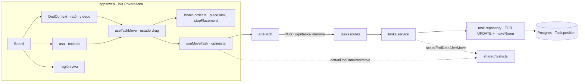

# Plan técnico · Spec 003 · Arrastrar y soltar

> CÓMO se cumple `spec.md`. Cada decisión se justifica contra la spec y la constitución.
> «§n» remite a `DESIGN.md`; «R-n», a `research.md`; «002/D-n», al plan de la spec 002.

## 1. Resumen

- **Orden guardado:** cada tarea gana un entero `position` dentro de su columna. Colocar una tarea en un sitio desplaza una posición las de debajo. Crear (RF-009), cambiar de estado desde el detalle (RF-010) y mover (RF-001, RF-007) usan la misma operación, dentro de una transacción con el usuario bloqueado (D-1, D-2). Una migración guarda el orden actual de las tareas existentes (E-19).
- **API:** una ruta nueva, `POST /api/tasks/:id/move`, con `{ status, index, today }`. La regla de la fecha real de fin al mover está en `shared` (D-3, D-4).
- **Ratón y dedo:** `@dnd-kit/core`, la única dependencia nueva. Se usan sus sensores con umbral y retardo, la capa que sigue al puntero y el scroll automático (D-6, R-1).
- **Teclado:** propio, desde un asa en cada tarjeta. Una máquina de estados pura y una región viva para los anuncios (D-7, R-2).
- **Pantalla:** la tarjeta se ve en su sitio nuevo al soltarla, gracias a una actualización optimista de la caché. Si el servidor falla, solo esa tarjeta vuelve atrás y sale el aviso en la zona de alerta del tablero (D-12, R-7).

## 2. Contexto técnico

- **Código existente que se reutiliza:**
  - API:
    - `apps/api/src/routes/tasks.routes.ts`: `requireAuth`, `validateTaskId` (id mal formado → `TASK_NOT_FOUND`) y `validateBody`.
    - `apps/api/src/services/tasks.service.ts`: `taskNotFound`, `latestActualEndDate` (límite «hoy UTC + 1», 002/D-6).
    - `apps/api/src/repositories/task.repository.ts`: `taskFields`, `toTask`, `toData`, `isNotFound` (P2025) y la conversión de fechas (002/D-5).
    - `apps/api/test/helpers.ts`: `signupCookie`, `createTaskFor`, `utcIsoDate`. `apps/api/test/setup.ts` no cambia (`TRUNCATE "Task"` ya está).
  - `packages/shared/src/tasks.ts`: `TASK_STATUSES`, `Task`, `IsoDate`, `taskIdSchema`, `isActualEndDateAllowed`.
  - Web:
    - `apps/web/src/lib/task-queries.ts`: clave `['tasks']` y `apiFetch` (`POST` ya admite cuerpo JSON).
    - `apps/web/src/lib/task-messages.ts`: `isTaskNotFound` y el texto «Esta tarea ya no existe.».
    - `apps/web/src/lib/dates.ts`: `todayLocal` (E-16) e `isOverdue` (E-13, E-14).
    - `apps/web/src/components/withQueryClient.tsx`: la `MutationCache` ya redirige con `SESSION_EXPIRED` (E-8).
    - `apps/web/src/components/Board.tsx`: `groupByStatus`, `mobileColumn`, `notice` y su zona `role="alert"` (002/D-20), y el foco por `data-task-id` (002/D-14).
    - `BoardColumn.tsx` (`STATUS_NAMES`, hueco vacío), `TaskCard.tsx`, `Icon.tsx` y `Alert.tsx` (tonos `offline` e `info`).
  - Tests:
    - `apps/web/src/components/test-utils.tsx`: `mockBrowser`, `renderWithClient`, `taskFixture`, `emptyAlert`.
    - `apps/web/src/lib/task-queries.test.tsx`.
    - `apps/web/src/design-rules.test.ts`, que revisa solo los componentes nuevos.
    - `apps/web/src/styles/tokens.test.ts`: superficies `column` y `taskCard`, y las parejas no textuales de 002.
    - `e2e/helpers.ts` (`signup`, `tabTo`, `createTaskViaApi`) y el test de 500 tareas de `e2e/board.spec.ts`.
- **Patrones que se siguen:**
  - Capas C-8: el service decide y el repository ejecuta en una transacción.
  - «Error de Prisma → `null`» (002/D-3).
  - Esquemas y reglas puras en `shared` (C-10).
  - Zonas de alerta y región viva presentes desde el principio (004/D-14).
  - Solo tokens del catálogo y clases escritas completas, sin `style=` (ADR-0003).
  - Riesgo primero (002/D-24).
- **Dependencias nuevas:** `@dnd-kit/core` **6.3.1**, fijada, en `apps/web`. Trae `@dnd-kit/utilities` 3.2.2, `@dnd-kit/accessibility` 3.1.1 y `tslib`. Su justificación (C-2) está en R-1:
  - **Qué aporta:** sensores de ratón y táctil con umbral y retardo, capa que sigue al puntero, colisiones y scroll automático en los dos ejes. También cancela con Esc y al redimensionar.
  - **Alternativa nativa:** el DnD de HTML5 no tiene táctil ni capa con estilo. Hacerlo a mano con eventos de puntero son unas 300–400 líneas en la parte de más riesgo.
  - **Tamaño:** unos 25 KB con gzip sin minificar, y menos al compilar.
  - **Mantenimiento:** estable desde 2024-12 y sin dependencias de terceros.

  No se usan ni `@dnd-kit/sortable` ni `@dnd-kit/react` (R-1).

## 3. Comprobación de constitución

| Artículo | Cumple | Nota |
|----------|--------|------|
| C-1 | ✅ | `strict`, sin `any`. `Placement` y `MoveTaskInput` tipados en `shared` y en `web` |
| C-2 | ✅ | Una dependencia nueva, justificada en §2 y R-1 |
| C-3 | ✅ | Sin cambios |
| C-4 | ✅ | Todo sigue en la isla `PrivateArea`. El estado del arrastre (`drag`, D-8) es estado de interfaz: un id y dos posiciones, no una copia de los datos del servidor. La vista previa se calcula en cada render a partir de la caché. La actualización optimista va **en la caché de TanStack Query** (`setQueryData`), no en estado local. Los únicos efectos sincronizan con el DOM: devolver el foco al asa (D-7) |
| C-5 | ✅ | Migración nueva `task_position`, creada con `--create-only` y completada con el relleno de E-19 antes de aplicarla por primera vez. No se toca ninguna migración ya aplicada |
| C-6 | ✅ | Solo local |
| C-7 | ✅ | `/api/tasks/:id/move`, relativa |
| C-8 | ✅ | `tasks.routes` → `tasks.service` (decide: ¿cambia de estado?, fecha real de fin) → `task.repository` (transacción, bloqueo y desplazamiento). Solo el repository importa Prisma, también para el `FOR UPDATE` |
| C-9 | ✅ | Sin códigos nuevos: `TASK_NOT_FOUND` y `VALIDATION_ERROR`. El front decide el texto (D-14) |
| C-10 | ✅ | `moveTaskInputSchema` y `actualEndDateAfterMove` en `shared/tasks.ts`, que usan la API y la actualización optimista |
| C-11 | ✅ | `today` viaja como `YYYY-MM-DD` |
| C-12 | ✅ | Sin cambios |
| C-13 | ✅ | `move` filtra por el usuario de la sesión en la lectura, el desplazamiento y la escritura. Una tarea ajena, inexistente o con id mal formado da 404 `TASK_NOT_FOUND`. Test de tarea ajena para `move`, y otro que comprueba que mover no cambia el orden de otro usuario (RNF-003) |
| C-14 | ✅ | Cuerpo con `validateBody(moveTaskInputSchema)` y `:id` con `validateTaskId` |
| C-15 | ✅ | Sin variables nuevas |
| C-16 | ✅ | Un dato nuevo, `position`, que es parte de la tarea (glosario de la spec) |
| C-17 | ✅ | Cada RF tiene al menos un test (§6) |
| C-18 | ✅ | Vitest y Testing Library (teclado completo en jsdom); Supertest contra Postgres real; Playwright para arrastrar con ratón y con el dedo y para el flujo de teclado |
| C-19 | ✅ | DoD de cada tarea |
| C-20 | ✅ | Alternativa sin arrastre usable con teclado: el asa (HU-3), con anuncios. El detalle de la 002 sigue permitiendo cambiar de estado |
| C-21 | ✅ | Nada fuera de la spec. La animación de las tarjetas al reordenar queda fuera (X-2) y pasa a «Ideas sin priorizar» |
| C-22 | ✅ | Abstracciones nuevas con dos usos o más: `placeTask` (vista previa, actualización optimista y deshacer), `makeRoom` en el repository (crear, cambiar de estado y mover) y `TaskCard` con variantes (lista y capa que sigue al puntero) |
| C-23 | ✅ | Identificadores en inglés (`position`, `move`, `Placement`); textos en castellano |
| C-24 | ✅ | Rama `feat/003-arrastrar-y-soltar` |
| C-25 | ✅ | Sin cambios |
| C-26 | ⚠️ | Desviaciones de `DESIGN.md` justificadas en §4.5. Los cambios en `DESIGN.md` van en esta rama (§4.6) |

## 4. Diseño

### 4.1 Arquitectura y flujo



1. **Carga:** `GET /api/tasks` ordena por `position asc, createdAt desc, id desc`. `Board` agrupa por estado sin reordenar (002/D-7).
2. **Arrastre con ratón o dedo:**
   - **Empieza:** con el ratón, cuando el puntero se desplaza 5 px; con el dedo, al mantenerlo 250 ms sin moverlo más de 5 px. `drag` guarda la tarea, su sitio de origen y su sitio actual, y la capa muestra la tarjeta levantada.
   - **Mientras se mueve:** cada vez que cambia el destino, `drag.current` pasa a ese sitio y la lista se vuelve a pintar con la tarjeta en él, convertida en el hueco. Fuera de toda columna, `current` vuelve al origen (D-9).
   - **Al soltar:** sobre una columna, se guarda (paso 4); si es el mismo sitio, no se hace nada (RF-011). Fuera, con Esc o al cambiar el tamaño de la ventana, `drag` se borra sin guardar.
3. **Teclado:**
   1. **Coger:** el asa (Espacio o Enter, que en un botón son un `click`) coge la tarjeta, que se levanta en su sitio, y se anuncia.
   2. **Mover:** las flechas cambian `drag.current` con `stepPlacement`, el foco vuelve al asa y se anuncia. En móvil, la columna visible pasa a ser la de `current`.
   3. **Soltar:** otro `click` en el asa guarda (paso 4) y se anuncia.
   4. **Cancelar:** Esc, o que el foco salga del asa (comprobación en diferido), borra `drag`, devuelve la columna móvil a la de origen y se anuncia.
4. **Guardar:** `useMoveTask` aplica `placeTask` a la caché (la tarjeta queda en su sitio nuevo, RF-020) y hace `POST /api/tasks/:id/move`.
   - Si va bien, se vuelve a pedir la lista cuando no queda ningún otro movimiento pendiente (R-7).
   - Si falla por red o con un error inesperado, la tarjeta vuelve a su origen y sale el aviso de RF-021.
   - Con `TASK_NOT_FOUND`, la tarjeta se quita y sale «Esta tarea ya no existe.».
   - Con la sesión caducada, redirige, como hasta ahora (E-8).
5. **API:**
   - La ruta valida el cuerpo y el id.
   - El service lee la tarea del usuario (404 si no es suya) y calcula la fecha real de fin con `actualEndDateAfterMove`. Si la fecha entra nueva y pasa de «hoy UTC + 1», responde 400.
   - El repository, en una transacción: bloquea la fila del usuario, hace sitio en la columna de destino y actualiza `status`, `position` y `actualEndDate`.
6. **Crear y detalle:**
   - `POST /api/tasks` coloca la tarea la primera de Backlog (RF-009).
   - `PUT /api/tasks/:id` la coloca la primera de la columna nueva solo si cambia el estado (RF-010); si no, conserva su posición. El diálogo no cambia: sigue sin actualización optimista (002/D-7).

### 4.2 Modelo de datos

`apps/api/prisma/schema.prisma`:

```prisma
model Task {
  // … campos de la 002 sin cambios …
  position  Int      // Spec 003, D-1: orden dentro de su columna (ascendente, con huecos)
  createdAt DateTime @default(now()) // desempate de `position` (D-1)

  @@index([userId, status, position])   // sustituye a @@index([userId, createdAt])
}
```

Migración `apps/api/prisma/migrations/<timestamp>_task_position/migration.sql`, creada con `prisma migrate dev --create-only` y completada a mano **antes** de aplicarla (C-5):

```sql
ALTER TABLE "Task" ADD COLUMN "position" INTEGER NOT NULL DEFAULT 0;
-- E-19: las tareas existentes conservan el orden de 002/RF-002 (la más reciente arriba).
UPDATE "Task" t SET "position" = r.rn
FROM (SELECT id, ROW_NUMBER() OVER (PARTITION BY "userId", status ORDER BY "createdAt" DESC, id DESC) - 1 AS rn
      FROM "Task") r
WHERE t.id = r.id;
ALTER TABLE "Task" ALTER COLUMN "position" DROP DEFAULT;
DROP INDEX "Task_userId_createdAt_idx";
CREATE INDEX "Task_userId_status_position_idx" ON "Task"("userId", "status", "position");
```

`position` no se expone: el tipo `Task` de `shared` no cambia, y el orden de la lista es el contrato.

`packages/shared/src/tasks.ts` (añadidos):

```ts
// D-3: el sitio de destino. `index` es la posición (desde 0) en la columna de destino sin contar la tarea;
// la API la recorta al final si se pasa. `today` es la fecha local del navegador (RF-003, E-16).
export type MoveTaskInput = { status: TaskStatus; index: number; today: IsoDate };
export const moveTaskInputSchema: z.ZodType<MoveTaskInput>; // status: z.enum, index: z.number().int().min(0), today: z.iso.date()

// D-4: RF-003 (entra en Done → hoy), RF-004 (sale de Done → null), E-15 (dentro de Done → la que tenía).
export function actualEndDateAfterMove(
  task: Pick<Task, 'status' | 'actualEndDate'>,
  toStatus: TaskStatus,
  today: IsoDate,
): IsoDate | null;
```

### 4.3 Contratos

**API** (`requireAuth`; `Content-Type: application/json`, 001/D-13):

| Contrato | Entrada | Salida | Errores |
|----------|---------|--------|---------|
| `POST /api/tasks/:id/move` *(nuevo)* | `MoveTaskInput` | `200 { task: Task }` con su estado y fecha real de fin nuevos | 400 `VALIDATION_ERROR` (cuerpo no válido; `today` posterior a «hoy UTC + 1» cuando entra en Done), 401, 404 `TASK_NOT_FOUND` (inexistente, ajena o id mal formado), 415 |
| `GET /api/tasks` *(cambia el orden)* | — | `200 { tasks }` por `position asc, createdAt desc, id desc` | Sin cambios |
| `POST /api/tasks` *(cambia dónde entra)* | Sin cambios | La tarea entra la primera de Backlog (RF-009) | Sin cambios |
| `PUT /api/tasks/:id` *(cambia dónde entra)* | Sin cambios | Si cambia `status`, la primera de la columna nueva (RF-010); si no, la misma posición | Sin cambios |

**Service** (`apps/api/src/services/tasks.service.ts`):

```ts
// Nuevo. Lanza TASK_NOT_FOUND | VALIDATION_ERROR.
moveTask(userId: string, id: string, input: MoveTaskInput, now?: Date): Promise<Task>
// Cambia: lee la tarea antes (404 si no es suya) y pide al repository `toTop` si cambia de estado.
updateTask(userId, id, input, now?): Promise<Task>
```

**Repository** (`apps/api/src/repositories/task.repository.ts`):

```ts
findTaskOfUser(userId: string, id: string): Promise<Task | null>                         // nuevo
moveTaskOfUser(userId: string, id: string,
  target: { status: TaskStatus; index: number; actualEndDate: IsoDate | null }): Promise<Task | null> // nuevo
updateTaskOfUser(userId, id, input, options: { toTop: boolean }): Promise<Task | null>   // + toTop
createTask(userId, input): Promise<Task>                                                 // entra con makeRoom(backlog, 0)
// Internas, dentro de prisma.$transaction:
lockUser(tx, userId): Promise<void>        // SELECT 1 FROM "User" WHERE id = $1 FOR UPDATE (R-3)
makeRoom(tx, userId, status, index, excludeId?): Promise<number> // D-2: devuelve la `position` que hay que ocupar
```

**Web, datos y orden:**

```ts
// apps/web/src/lib/board-order.ts (nuevo; funciones puras)
export type Placement = { status: TaskStatus; index: number };            // index desde 0
export function groupByStatus(tasks: Task[]): Record<TaskStatus, Task[]>; // se mueve aquí desde Board.tsx
export function placementOf(tasks: Task[], id: string): Placement | undefined;
export function placeTask(tasks: Task[], task: Task, to: Placement): Task[]; // quita la tarea por id y la pone en `to`
export function samePlacement(a: Placement, b: Placement): boolean;
export type MoveKey = 'ArrowUp' | 'ArrowDown' | 'ArrowLeft' | 'ArrowRight';
export function stepPlacement(groups: Record<TaskStatus, Task[]>, at: Placement, key: MoveKey): Placement | undefined; // RF-014, RF-015
export function placementFromOver(groups, activeId: string,
  over: { kind: 'card'; id: string } | { kind: 'column'; status: TaskStatus }, below: boolean): Placement; // D-9

// apps/web/src/lib/task-queries.ts (añadido)
export type MoveVariables = { task: Task; from: Placement; to: Placement; today: IsoDate };
export function useMoveTask(): UseMutationResult<Task, Error, MoveVariables>; // mutationKey ['moveTask'] (D-12)

// apps/web/src/lib/task-move.ts (nuevo; el hook del tablero, D-8)
export function useTaskMove(options: {
  tasks: Task[];
  onMobileColumn(status: TaskStatus): void;  // RF-023
  onNotice(notice: BoardNotice): void;       // RF-021, RF-022
}): {
  displayTasks: Task[];                          // con la vista previa aplicada
  drag: DragState | null;
  announcement: string;                          // texto de la región viva
  dndProps: Pick<DndContextProps, 'sensors' | 'collisionDetection' | 'measuring' | 'accessibility'
    | 'onDragStart' | 'onDragOver' | 'onDragEnd' | 'onDragCancel'>;
  handleProps(task: Task): { onClick(): void; onKeyDown(e: KeyboardEvent): void; onBlur(): void };
};
type DragState = { task: Task; origin: Placement; current: Placement; mode: 'pointer' | 'keyboard' };

// apps/web/src/lib/task-messages.ts (añadidos, D-14)
moveErrorText(error: unknown): string                     // RF-021 / RF-022
pickedText(title, place: Placement, total): string        // RF-013
movedText(place, total): string                           // RF-014
droppedText(title, place, total): string                  // RF-016
cancelledText(title, place, total): string                // RF-017
```

**Web, componentes** (props):

```ts
// Modificados
Board        { tasks: Task[] }   // + DndContext, DragOverlay, región viva; notice pasa a { tone, text }
BoardColumn  + dragTaskId?: string; dragMode?: 'pointer' | 'keyboard';
             + handleProps(task): …   // droppable `column:<status>`; cada tarjeta, draggable + droppable (D-9)
TaskCard     + variant?: 'rest' | 'placeholder' | 'lifted' | 'overlay';
             + handleProps?: …;  + dragRef?/dragListeners? (los del <li>)  // D-10, D-11
```

### 4.4 Componentes / módulos

| Módulo | Ruta | Responsabilidad | Nuevo/Modificado |
|--------|------|-----------------|------------------|
| Esquema y migración | `apps/api/prisma/schema.prisma`, `migrations/*_task_position/` | `position`, índice y relleno E-19 | Modificado / Nuevo |
| Rutas | `apps/api/src/routes/tasks.routes.ts` | `POST /:id/move` | Modificado |
| Service | `apps/api/src/services/tasks.service.ts` | `moveTask`; `updateTask` con `toTop` | Modificado |
| Repository | `apps/api/src/repositories/task.repository.ts` | Orden de lectura, `lockUser`, `makeRoom`, `findTaskOfUser`, `moveTaskOfUser` | Modificado |
| Shared | `packages/shared/src/tasks.ts` | `moveTaskInputSchema`, `MoveTaskInput`, `actualEndDateAfterMove` | Modificado |
| Orden en el tablero | `apps/web/src/lib/board-order.ts` | Funciones puras de §4.3 | Nuevo |
| Movimiento | `apps/web/src/lib/task-move.ts` | `useTaskMove`: estado `drag`, sensores, teclado, anuncios | Nuevo |
| Consultas | `apps/web/src/lib/task-queries.ts` | `useMoveTask` optimista (D-12) | Modificado |
| Textos | `apps/web/src/lib/task-messages.ts` | Aviso de mover y anuncios (D-14) | Modificado |
| Tablero | `apps/web/src/components/Board.tsx` | `DndContext`, capa, región viva, aviso con tono | Modificado |
| Columna | `apps/web/src/components/BoardColumn.tsx` | Droppable de la columna y de cada tarjeta | Modificado |
| Tarjeta | `apps/web/src/components/TaskCard.tsx` | Contenedor, botón de abrir, asa y variantes | Modificado |
| Estilos | `apps/web/src/styles/tokens.css` | `--ring-drop` (X-1) | Modificado |
| Tests de diseño | `apps/web/src/styles/tokens.test.ts` | Valor esperado y pareja no textual del anillo | Modificado |
| Dependencia | `apps/web/package.json`, `pnpm-lock.yaml` | `@dnd-kit/core` 6.3.1 | Modificado |
| E2E | `e2e/drag-and-drop.spec.ts`, `e2e/helpers.ts` | Ratón, dedo, teclado, responsive, axe, rendimiento; ayudas de arrastre y táctiles | Nuevo / Modificado |
| Tests de la 002 | `apps/api/test/tasks.list.test.ts`, `tasks.create.test.ts`, `tasks.update.test.ts`; `TaskCard.test.tsx`, `Board.test.tsx`; `e2e/board.spec.ts` | Orden por `position`; nombres de botón exactos (hay dos botones por tarjeta) (D-16) | Modificado |
| Documentos | `DESIGN.md`, `specs/002-tablero-de-tareas/spec.md`, `specs/roadmap.md` | §4.6; fila «Modificada por la spec 003» en el registro de la 002 (spec §10) | Modificado |

### 4.5 Desviaciones de `DESIGN.md` (C-26)

| # | `DESIGN.md` dice | Este plan hace | Por qué |
|---|---|---|---|
| X-1 | §8: el hueco de destino es `--surface-sunken` con la altura de la tarjeta | Además, anillo interior de 1.5 px en `--ring-drop` (token nuevo: `--ink-500` en claro, `--ink-400` en oscuro), con el ancho de los anillos de estado de §6.2 | El hueco da 1.04–1.16:1 contra la columna, y RNF-001 pide AA (3:1 en objetos gráficos) también para el hueco (R-5) |
| X-2 | §8: `--dur` para la «tarjeta que cambia de columna» | Sin animación al soltar ni al reordenar: las tarjetas pasan a su sitio sin desplazarse. Solo se anima la tarjeta levantada (`--shadow-float` y `motion-safe:scale-102`) | Desplazar las demás tarjetas pide transformaciones calculadas en línea (`style=`, prohibido por ADR-0003) o FLIP a mano. La spec no lo pide, y con `prefers-reduced-motion` ya no habría desplazamiento (RNF-001). La idea pasa a «Ideas sin priorizar» |

El resto sigue `DESIGN.md` tal cual:

- **Tarjeta levantada:** `--shadow-float` y escala 1.02 (§6.1, §8), en la capa `--z-popover` (§7).
- **Asa:** icono `grip-vertical` de 16 px (§9) en un botón de icono de 44 px por debajo de 1024 px y de 32 px desde 1024 px (§4, §14).

### 4.6 Cambios en `DESIGN.md` (§19, MINOR → `1.4.0-todo.1`)

- **Token nuevo** `--ring-drop` (§1.4 y la lista de anillos de §6.2). Va en `tokens.css` y en los valores esperados y las parejas de `tokens.test.ts`.
- **§11.3:**
  - La frase del orden pasa a: «Las tarjetas van en el orden en que las deja el usuario. Una tarea nueva entra la primera de Backlog, y una tarea que cambia de estado desde el detalle o con el teclado entra la primera de su columna nueva» (spec §10).
  - Se añade el arrastre: asa, tarjeta levantada, hueco con anillo (X-1) y aviso «No hemos podido mover la tarea…» en la misma zona de alerta.
- **§8 «Arrastrar»:** recoge X-1 y X-2.
- **Historial:** una fila nueva.

## 5. Decisiones

- **D-1** Orden con un entero `position` por usuario y estado, ascendente y con huecos. El orden de lectura es `position asc, createdAt desc, id desc`: los desempates solo actúan si alguna vez se repite una posición. La migración rellena `position` con el orden actual (E-19, R-3) y sustituye el índice `(userId, createdAt)` por `(userId, status, position)`.
  - *Por qué:* RF-008 sustituye a 002/RF-002. Un entero se lee directamente en la BD y no necesita librerías.
  - *Alternativas descartadas:*
    - índice fraccionario (librería o algoritmo propio, rebalanceo);
    - renumerar la columna entera en cada movimiento (una sentencia por fila);
    - guardar el orden en el cliente (no se vería desde otro navegador, CA-2.2).
- **D-2** Colocar una tarea es **hacer sitio**. `makeRoom(tx, userId, status, index, excludeId)`:
  1. Busca la tarea que ocupa ese `index` en la columna, sin contar la que se mueve: es el ancla.
  2. Si hay ancla, suma 1 a la `position` de las que tienen `position >= ancla` (un `updateMany` con `increment`) y devuelve la del ancla.
  3. Si no la hay, devuelve la última `position` + 1, o 0 si la columna está vacía.

  Se usa para crear (`backlog`, 0), para cambiar de estado desde el detalle (estado nuevo, 0) y para mover (destino, `index`). Cada transacción que coloca empieza con `lockUser` (`FOR UPDATE` en la fila de `User`), así las posiciones no se repiten aunque haya dos pestañas, y gana la última escritura (E-11). La columna de origen no se compacta, porque los huecos no cambian el orden.
  - *Por qué:* tres sentencias por movimiento, una sola regla para RF-001, RF-007, RF-009 y RF-010, y sin carreras.
  - *Alternativas descartadas:* sin bloqueo (dos movimientos simultáneos podrían repetir una posición); `UNIQUE (userId, status, position)` (el desplazamiento la violaría a mitad de la sentencia, R-3); poner la nueva en «mínimo − 1» (sería una segunda regla solo para «primera»).
- **D-3** Una ruta nueva, `POST /api/tasks/:id/move`, con `{ status, index, today }`:
  - `index` es la posición, desde 0, en la columna de destino **sin contar la tarea**, lo mismo que pinta la vista previa. Si es mayor que la columna, va al final.
  - Responde `200 { task }`.
  - El cliente no la llama cuando el sitio no cambia (RF-011). Si llega igualmente, deja la tarea donde estaba.
  - *Por qué:* mover no es editar. El `PUT` de la 002 sustituye la tarea entera (002/D-2), y usarlo para mover obligaría a mandar todos los campos y podría pisar una edición hecha en otra pestaña.
  - *Alternativas descartadas:* ampliar el `PUT` con `index` (mezcla editar y mover); mandar el id de la tarea de al lado en vez de `index` (habría que decidir qué pasa si esa tarea ya no está; `index` se recorta y basta); mandar el orden completo de la columna (más datos y validar que los ids son del usuario).
- **D-4** La fecha real de fin al mover sale de una regla pura de `shared`, `actualEndDateAfterMove`:
  - si entra en Done, `today`;
  - si sale de Done, `null`;
  - si se mueve dentro de Done, la que tenía (E-15);
  - en el resto de casos, `null`.

  El navegador manda `today = todayLocal()` (E-16). El service comprueba el límite «hoy UTC + 1» (002/D-6) solo cuando la fecha entra nueva. La misma regla calcula la tarjeta optimista.
  - *Por qué:* RF-003 pide la fecha del navegador, que el servidor no conoce. C-10: la regla no se duplica.
  - *Alternativas descartadas:* calcular «hoy» en el servidor (fallaría E-16 a las 00:30); que el cliente mande `actualEndDate` (el cliente decidiría la regla de RF-004).
- **D-5** El service lee la tarea con `findTaskOfUser` antes de escribir:
  - para decidir la fecha real de fin (D-4);
  - en `updateTask`, para saber si cambia de estado (`toTop`, RF-010).

  Si no existe o no es suya, `TASK_NOT_FOUND`. El repository escribe con `where: { id, userId }` y, si no hay fila (P2025), da `null` (002/D-3).
  - *Por qué:* la regla es del service (C-8). Si otra pestaña cambia la tarea entre la lectura y la escritura, gana la última escritura (E-11).
- **D-6** Ratón y dedo con `@dnd-kit/core` (R-1):
  - **Sensores:** `MouseSensor` con `activationConstraint: { distance: 5 }` (CA-1.8: un clic con 1–2 px de temblor sigue abriendo el detalle) y `TouchSensor` con `{ delay: 250, tolerance: 5 }`. 250 ms es el tiempo de «mantener el dedo» que la spec deja al plan (§10).
  - **Sin `PointerSensor`:** con el dedo exigiría `touch-action: none` en la tarjeta, y entonces deslizar no haría scroll (CA-4.2).
  - Los `listeners` van en el contenedor de la tarjeta, así que se arrastra desde cualquier punto (spec §10). Los `attributes` de dnd-kit (`role`, `tabIndex`, `aria-*`) no se usan: la tarjeta ya tiene sus botones.
  - **`accessibility`:** anuncios vacíos e instrucciones vacías. Los anuncios de dnd-kit están en inglés (E-20), y la spec solo pide anuncios para el teclado.
  - La tarjeta lleva `select-none`, para que mantener el dedo no seleccione el texto.
  - *Alternativas descartadas:* las de R-1.
- **D-7** Teclado propio desde el asa (R-2):
  - **Coger y soltar:** el `onClick` del asa coge la tarjeta o, si ya está cogida, la suelta. Espacio y Enter en un `<button>` producen un `click`, y la activación de los lectores de pantalla (VO + Espacio) también (RF-013, RF-016).
  - **`onKeyDown`:** las flechas llaman a `stepPlacement` (con `preventDefault`, para que la página no haga scroll) y Escape cancela.
  - **Columna vecina:** con izquierda y derecha, la tarjeta entra la primera de la columna vecina. En los bordes no se mueve y no se anuncia nada (RF-015).
  - **Foco:** tras cada paso, un efecto de layout vuelve a enfocar `[data-task-handle="<id>"]`. RF-017 («el foco sale del asa») se comprueba en diferido con `setTimeout(0)`, y solo cancela si el foco no ha vuelto a esa asa (R-4).
  - **Región viva:** un `<p className="sr-only" aria-live="assertive" aria-atomic="true">` siempre presente en el tablero. `assertive`, porque cada flecha sustituye el anuncio anterior.
  - Si mientras está cogida la tarea desaparece de la lista (por ejemplo, la borró otra mutación), el estado `drag` se borra sin anuncio.
  - *Alternativas descartadas:* `KeyboardSensor` de dnd-kit (R-2); que el asa solo responda a `keydown` (la activación de VoiceOver no la cogería).
- **D-8** Un solo estado de movimiento en `useTaskMove`: `drag = { task, origin, current, mode }`, para el puntero y para el teclado.
  - La lista que se pinta es `placeTask(tasks, { ...task, status: current.status }, current)`, calculada en cada render.
  - Al soltar, las dos formas llaman a la misma función, `commit(drag)`, que no hace nada si `samePlacement(origin, current)` (RF-011, E-3) y, si no, llama a `useMoveTask`.
  - *Por qué:* C-4 (estado de interfaz, no datos de servidor) y C-22 (`placeTask` tiene tres usos: vista previa, actualización optimista y deshacer).
  - *Alternativas descartadas:* dos estados separados para el puntero y el teclado (duplicaría el guardado y la vista previa).
- **D-9** Destino con el puntero. Cada columna es un droppable `column:<status>`, y cada tarjeta, draggable y droppable con su id.
  - **Detección:** `pointerWithin` da la columna bajo el puntero. Dentro de ella, `closestCenter` entre sus tarjetas, como en el ejemplo «multiple containers» de dnd-kit.
  - **Posición** (`placementFromOver`):
    - en la misma columna, la de la tarjeta de debajo, como `arrayMove`: no oscila al cambiar el orden;
    - en otra columna, antes o después de la tarjeta de debajo, según si el centro de la tarjeta arrastrada queda por encima o por debajo de su centro;
    - sobre una columna sin tarjetas, al final.
  - **Fuera de toda columna** (`over === null`, también entre dos columnas o sobre el selector de móvil): `current` vuelve al origen y, al soltar, no se guarda (RF-005, CA-1.7, CA-4.5).
  - **Medidas:** `measuring.droppable.strategy = MeasuringStrategy.Always`, porque la lista cambia durante el arrastre.
  - *Por qué:* sin `@dnd-kit/sortable` ni transformaciones en línea (ADR-0003): la vista previa reordena la lista de verdad.
- **D-10** Aspecto mientras se mueve:
  - **Con el puntero:**
    - La capa que sigue al puntero es un `DragOverlay` con un `TaskCard variant="overlay"`: `--shadow-float`, `motion-safe:scale-102`, `aria-hidden` e `inert`, para que sus botones no se dupliquen para el teclado ni para el lector.
    - El `DragOverlay` va dentro de un contenedor `pointer-events-none fixed inset-0 z-(--z-popover)`. Así su capa interna (999) solo cuenta dentro de `--z-popover` (§7), sin escribir números.
    - `dropAnimation={null}` (X-2).
    - En la lista, la tarjeta arrastrada se pinta como `variant="placeholder"`, que es el hueco: `bg-sunken`, el anillo de X-1, sin sombra y con el contenido `invisible`, así que conserva su altura (E-6).
  - **Con el teclado:** la tarjeta se queda en la lista con `variant="lifted"`: `--shadow-float`, `motion-safe:scale-102` y `relative z-(--z-popover)` (CA-3.2). No hay hueco.
  - *Alternativas descartadas:* `transform` en línea sobre la tarjeta original (prohibido por ADR-0003); leer `--z-popover` con `getComputedStyle` para pasarlo a `zIndex` (más código que el contenedor).
- **D-11** La tarjeta deja de ser un `<button>`: un `<button>` dentro de otro no es HTML válido. Pasa a ser un contenedor (`div`, con la superficie raised, el radio, la sombra y el hover de 002/D-10, X-2) con:
  - **Botón de abrir:**
    - Ocupa toda la tarjeta y deja a la derecha el sitio del asa.
    - Lleva `data-task-id`, el mismo destino del foco de 002/D-14.
    - Su nombre accesible es el de siempre: título, fechas e insignia.
    - Clic o Enter abren el detalle (RF-006, CA-3.8).
  - **Asa:**
    - Un `<button type="button">` arriba a la derecha, con `data-task-handle`, `aria-label` «Mover «<título>»» e `Icon` `GripVertical` de 16 en `--text-2`.
    - `size-11 lg:size-8` (44 px por debajo de 1024 px y 32 desde 1024 px, RNF-001), `rounded-pill` y `cursor-grab`.
    - El orden de tabulación es el visual: primero la tarjeta y después el asa.
  - *Por qué:* RF-012 y CA-3.8 piden dos elementos con foco distintos.
- **D-12** Guardar con actualización optimista (`useMoveTask`, R-7), con `mutationKey: ['moveTask']`:
  - **`onMutate`:** `cancelQueries(['tasks'])` y `setQueryData` con `placeTask(lista, { ...task, status: to.status, actualEndDate: actualEndDateAfterMove(task, to.status, today) }, to)`. La tarjeta se pinta en el mismo render en que se suelta (RF-020, RNF-002).
  - **`onError`:**
    - Con `TASK_NOT_FOUND`, se quita la tarea de la caché (RF-022).
    - Con cualquier otro error, la tarea original vuelve a `from` con `placeTask` sobre la caché **actual**, así que los demás movimientos no se tocan (RF-021, E-12).
  - **`onSettled`:** invalidar `['tasks']` solo si `isMutating({ mutationKey: ['moveTask'] }) === 1`.
  - **Avisos en `Board`:** el `onError` de la llamada pone el aviso en la zona de alerta del tablero: `moveErrorText(error)`, con tono `offline` para el error de red e `info` para `TASK_NOT_FOUND`, como en 002. `notice` pasa de `string` a `{ tone, text }`.
  - Sin reintentos (las mutaciones no se reintentan, 002/D-10).
  - *Por qué:* RF-020 pide que la tarjeta se vea en su sitio antes de la respuesta. 002/D-7 (sin optimismo) sigue valiendo para el diálogo, cuya spec pide lo contrario (002/CA-4.4).
  - *Alternativas descartadas:* restaurar una copia de la lista entera (desharía otros movimientos, E-12); invalidar siempre al terminar (la lista vuelta a pedir pisaría los movimientos pendientes).
- **D-13** Móvil (< 768 px):
  - Las columnas no elegidas tienen `display: none` (002/D-16) y sus droppables miden 0 × 0, así que `pointerWithin` nunca las encuentra. El arrastre solo puede ordenar la columna visible, y soltar fuera de ella cancela (RF-019, CA-4.5), sin `matchMedia`.
  - Con el teclado, cada paso a otra columna llama a `onMobileColumn(current.status)`, y cancelar llama a `onMobileColumn(origin.status)` (RF-023, CA-3.9, CA-3.10). Desde 768 px `mobileColumn` no tiene efecto visible (002/D-16).
- **D-14** Textos en `lib/task-messages.ts`, que ya es el sitio de los textos del tablero (002/D-19):
  - `moveErrorText`:
    - `TASK_NOT_FOUND` → «Esta tarea ya no existe.»;
    - cualquier otro error → «No hemos podido mover la tarea. Revisa tu conexión e inténtalo de nuevo.».
  - Anuncios con el texto exacto de RF-013, RF-014, RF-016 y RF-017: `<columna>` con `STATUS_NAMES`, `<n>` = `index + 1` y `<total>` = tarjetas de la columna contando la que se mueve (CA-3.4: «posición 1 de 4»).
- **D-15** Riesgo primero, en este orden:
  1. Con la tarjeta y el asa ya hechas, un E2E del teclado entre columnas en Chromium y WebKit: el foco sigue en el asa y no se cancela solo (R-4).
  2. La emulación táctil en los tres proyectos (R-6).

  Si alguno no se cumple, se avisa antes como cambio del plan.
- **D-16** Tests de la 002 que dependen del orden por creación (RF-008 sustituye a 002/RF-002):
  - En `tasks.list.test.ts`, CA-1.8 y E-24 pasan a probar `position`, y E-22 pasa a RF-010 («entra la primera»).
  - Los tests que buscan la tarjeta con `getByRole('button', { name: /título/ })` pasan a usar el nombre exacto, porque el asa («Mover «…»») también coincidiría.

## 6. Trazabilidad

| Requisito | Cómo se cumple (decisión / módulo) | Cómo se prueba |
|-----------|------------------------------------|----------------|
| RF-001 | `POST …/move` con otro `status` (D-3); `makeRoom` en el destino (D-2); recuentos de la lista (002/D-11) | api `tasks.move.test` (cambia de estado y queda en `index`); unit `Board.test` con teclado (recuentos); e2e con ratón (CA-1.1) |
| RF-002 | `DragOverlay` levantado y `placeholder` en la lista (D-10) | e2e: durante el arrastre la capa sigue al puntero y el hueco está en la columna de destino (CA-1.2); unit `TaskCard.test` (clases de las variantes) |
| RF-003 | `actualEndDateAfterMove` (D-4); `today = todayLocal()` | shared (entra en Done → hoy); api (Done con `today`; `today` > UTC + 1 → 400); unit `task-queries.test` (tarjeta optimista con fecha y sin «Retrasada», CA-1.4) |
| RF-004 | Ídem (sale de Done → `null`) | shared; api (CA-1.5) |
| RF-005 | `over === null` → vuelve al origen; Esc del sensor (D-9, R-1) | e2e (soltar fuera y Esc: mismo sitio, ninguna petición `move`, sin aviso, CA-1.7) |
| RF-006 | `distance: 5`; botón de abrir (D-6, D-11) | unit `TaskCard.test` (clic abre); e2e (clic sin mover abre el detalle; arrastrar no lo abre, CA-1.8) |
| RF-007 | `index` en la misma columna (D-2, D-3) | api (reordenar dentro de To do: el orden relativo del resto se mantiene, CA-2.1); unit con teclado; e2e con ratón |
| RF-008 | `position` + orden de lectura (D-1) | api `tasks.list.test` (el orden sale de `position`; dos sesiones ven el mismo orden, CA-2.2); e2e (volver a cargar, CA-1.3) |
| RF-009 | `createTask` con `makeRoom(backlog, 0)` | api `tasks.create.test` (entra la primera de Backlog y las demás columnas no cambian, CA-2.3) |
| RF-010 | `updateTask` con `toTop` si cambia `status` (D-5) | api `tasks.update.test` (entra la primera; el orden relativo de origen y destino se mantiene; sin cambio de estado no se mueve, CA-2.4) |
| RF-011 | `samePlacement` → sin petición (D-8) | unit (teclado: coger y soltar sin mover → ninguna petición, CA-2.5); e2e (ratón: soltar en el mismo sitio) |
| RF-012 | Asa con `aria-label` (D-11) | unit `TaskCard.test` (nombre accesible); e2e con `tabTo` (CA-3.1) |
| RF-013 | `onClick` del asa → coger; `pickedText` (D-7, D-14) | unit `Board.test` (Espacio y Enter; texto de la región viva, CA-3.2) |
| RF-014 | `stepPlacement` (D-7) | unit `board-order.test` (las cuatro flechas); unit `Board.test` (CA-3.3, CA-3.4) |
| RF-015 | `stepPlacement` devuelve `undefined` en los bordes | unit `board-order.test` (CA-3.7) |
| RF-016 | `commit`; foco en el asa; `droppedText` (D-7, D-8) | unit `Board.test` (petición, foco y anuncio, CA-3.5); e2e en Chromium y WebKit (D-15) |
| RF-017 | Esc y `blur` en diferido; `cancelledText` (D-7, R-4) | unit `Board.test` (Esc y Tab fuera del asa, CA-3.6); e2e (D-15) |
| RF-018 | `TouchSensor` `{ delay: 250, tolerance: 5 }` (D-6) | e2e táctil (CA-4.1, CA-4.2, CA-4.3; R-6) |
| RF-019 | Columnas ocultas sin medidas (D-13) | e2e a 375 px: soltar sobre el selector o fuera de la columna no guarda (CA-4.5); reordenar la columna visible (CA-4.3) |
| RF-020 | `onMutate` con `setQueryData` (D-12) | unit `task-queries.test` (la tarjeta está en su sitio nuevo antes de que responda el `fetch`, que queda pendiente) |
| RF-021 | `onError` deshace solo esa tarjeta; aviso `offline` (D-12, D-14) | unit `task-queries.test` y `Board.test` (`NetworkError` y 500: posición y recuentos de antes y el aviso, CA-1.9, CA-2.6) |
| RF-022 | 404 → se quita de la caché; aviso `info` (D-12) | api (mover una tarea borrada, ajena o con id mal formado → 404); unit `Board.test` (CA-1.10) |
| RF-023 | `onMobileColumn` en cada paso y al cancelar (D-13) | unit `Board.test` (el selector marca la columna nueva y vuelve a la de partida al cancelar, CA-3.9, CA-3.10); e2e a 375 px |
| RNF-001 | Asa con nombre, foco global y 44/32 px (D-11); región viva (D-7); anillo del hueco (X-1); `motion-safe:` en la escala (X-2) | `tokens.test` (`--ring-drop` sobre la columna ≥ 3:1 y el icono del asa sobre la tarjeta ≥ 3:1, en N, SB y C+, claro y oscuro); axe en el tablero con una tarjeta cogida con teclado, en los dos temas; e2e (tamaño del asa a 375 y 1280; con `reducedMotion: 'reduce'`, la capa no tiene `scale`); checklist §21 |
| RNF-002 | Optimista en el mismo render (D-12); `placeTask` O(n) | e2e (solo `chromium`): 500 tareas, 200 en To do; arrastre con ratón; desde el `pointerup` hasta el primer frame con la tarjeta en su sitio y sin hueco (`MutationObserver` + `requestAnimationFrame` en la página) ≤ 100 ms |
| RNF-003 | `where userId` en la lectura, el desplazamiento y la escritura (D-2, D-5); `position` no se expone | api: mover una tarea ajena → 404, y el orden de Luis no cambia cuando Ana mueve y crea (C-13) |
| RNF-004 | Proyectos `chromium`, `chrome` y `webkit`; táctil según R-6 | e2e en los tres proyectos (CA-4.2 solo en Chromium y Chrome, R-6) |
| RNF-005 | Solo tokens; `GripVertical`; `--z-popover`, `--shadow-float` (D-10, D-11) | `design-rules.test` (revisa los componentes modificados sin tocarlo); `tokens.test` |
| E-1 | Droppable de la columna vacía → al final = primera (D-9) | e2e (CA-1.6); unit `board-order.test` (`placementFromOver` con columna vacía) |
| E-2 | La vista previa deja la columna sin tarjetas → frase de columna vacía (002/RF-005) | unit `Board.test` (mover con teclado la única tarjeta de To do: aparece «Nada por hacer») |
| E-3 | RF-011 | unit `board-order.test` (con una sola tarjeta, arriba y abajo no la mueven) |
| E-4 | Scroll automático de dnd-kit en la lista de destino (R-1) | e2e (solo `chromium`, 200 tarjetas): con la tarjeta en el borde inferior, el `scrollTop` de la lista aumenta |
| E-5 | Ídem en el tablero con scroll horizontal | e2e a 1024 px: con la tarjeta en el borde derecho, el `scrollLeft` del tablero aumenta |
| E-6 | `placeholder` con el contenido `invisible` (D-10) | e2e (título de 200 caracteres: el hueco mide lo mismo que la tarjeta en reposo) |
| E-7 | RF-021 | unit (`NetworkError`); e2e con `page.route` abortando `…/move` |
| E-8 | `MutationCache` → `/login?expired=1` (sin cambios) | unit `Board.test` (`move` con 401 `SESSION_EXPIRED` → `location.replace`) |
| E-9 | RF-022 | api; unit |
| E-10 | D-5 (C-13) | api (ajena → 404 `TASK_NOT_FOUND`, igual que inexistente) |
| E-11 | `lockUser` y gana el último (D-2) | api: dos `move` seguidos sobre la misma columna; el orden final es el del segundo y no se repite ninguna posición |
| E-12 | Deshacer por tarjeta y la invalidación esperando (D-12) | unit `task-queries.test`: dos movimientos, el primero falla y el segundo va bien; solo el primero vuelve |
| E-13 | `isOverdue` con el estado nuevo | unit `task-queries.test` / `Board.test` (CA-1.4) |
| E-14 | Ídem | unit (sacar de Done una tarea con el fin estimado pasado: vuelve «Retrasada») |
| E-15 | `actualEndDateAfterMove` dentro de Done | shared; api |
| E-16 | `todayLocal()` | unit con `TZ=Europe/Madrid` y la hora a las 00:30 del 01/11: `today` = `2026-11-01` en la petición |
| E-17 | El sensor cancela con `resize` (R-1) | e2e (cambiar el tamaño a mitad de arrastre: vuelve a su sitio, sin petición) |
| E-18 | `showModal` deja inerte el resto (002/D-12) | e2e (con el detalle abierto, ni el ratón ni el Tab llegan a una tarjeta o a un asa) |
| E-19 | Relleno de la migración (§4.2) | manual: en la base de desarrollo con tareas de la 002, el orden de cada columna es el mismo antes y después de `pnpm db:migrate` (se anota en la tarea) |
| E-20 | Textos de D-14; anuncios de dnd-kit vacíos (D-6) | unit `task-messages.test` (textos exactos) |

## 7. Estrategia de pruebas

- **Unitarias (Vitest):**
  - `packages/shared/src/tasks.test.ts`: `moveTaskInputSchema` (índice negativo, decimal o ausente; fecha inválida) y `actualEndDateAfterMove` (las cuatro combinaciones).
  - `apps/web/src/lib/board-order.test.ts`: `placeTask`, `placementOf`, `stepPlacement` (las cuatro flechas, los bordes y una columna vacía como destino) y `placementFromOver` (misma columna hacia arriba y hacia abajo, otra columna por encima y por debajo, columna vacía).
  - `apps/web/src/lib/task-queries.test.tsx`: optimista, deshacer por tarjeta, `TASK_NOT_FOUND`, invalidación con dos movimientos.
  - `apps/web/src/lib/task-messages.test.ts`: los textos exactos.
  - `apps/web/src/components/Board.test.tsx`: todo el flujo de teclado con `user-event`, `mockBrowser` y la ruta `POST /api/tasks/<id>/move`:
    - coger, mover, soltar y cancelar;
    - región viva y foco;
    - móvil (`mobileColumn`);
    - errores y aviso.
  - `TaskCard.test.tsx`: estructura (dos botones, nombres), variantes y clic.
  - jsdom no calcula posiciones: el arrastre con ratón y con el dedo va en E2E.
- **Contraste:** `tokens.test.ts` gana el valor esperado de `--ring-drop` y dos parejas no textuales, ≥ 3:1 en N, SB y C+, en claro y oscuro:
  - el anillo del hueco sobre `column`;
  - el icono del asa (`--text-2`) sobre `taskCard`.
- **Integración (Supertest + Postgres de test):**
  - `apps/api/test/tasks.move.test.ts` (nuevo):
    - éxito entre columnas y dentro de una columna;
    - `index` mayor que la columna (va al final);
    - Done: entra con `today`, sale con `null` y dentro conserva la fecha;
    - `today` > UTC + 1 → 400;
    - cuerpo no válido → 400; sin sesión → 401; sin JSON → 415;
    - 404 por tarea inexistente, ajena, borrada y con id mal formado;
    - el orden de otro usuario no cambia;
    - dos movimientos seguidos (E-11).
  - Modificados:
    - `tasks.list.test.ts` (D-16);
    - `tasks.create.test.ts` (RF-009);
    - `tasks.update.test.ts` (RF-010, y que sin cambio de estado no se mueve);
    - `tasks.service.test.ts` (`moveTask` con `now` fijo para el límite).
- **E2E (Playwright):** `e2e/drag-and-drop.spec.ts`, en los tres proyectos salvo donde se indica.
  1. **Teclado entre columnas** (D-15, va primero): Chromium y WebKit, foco y anuncio.
  2. **Ratón:**
     - CA-1.1, CA-1.2, CA-1.3, CA-1.6, CA-1.7 y CA-1.8;
     - CA-2.1, CA-2.2 (otra sesión de navegador) y CA-2.5;
     - CA-1.9 con `page.route` abortando la petición;
     - E-17 y E-18.
  3. **Dedo** (R-6): CA-4.1, CA-4.3, CA-4.4 y CA-4.5; CA-4.2 solo en `chromium` y `chrome`.
  4. **Móvil a 375 px con teclado:** CA-3.9 y CA-3.10.
  5. **axe:** con una tarjeta cogida con teclado, en claro y oscuro.
  6. **Movimiento reducido** (RNF-001).
  7. **Solo en `chromium`:** RNF-002, E-4 y E-5, con las tareas creadas por la API (`createTaskViaApi`).

  Las ayudas nuevas van a `e2e/helpers.ts`:
  - `dragCard`: `page.mouse` con pasos intermedios, porque dnd-kit necesita varios `mousemove`;
  - `touchDragCard`: CDP o `TouchEvent` según el proyecto;
  - `moveHandle`.
- **Manual:**
  - E-19 (§6).
  - La checklist de `DESIGN.md` §21 sobre la tarjeta levantada, el hueco y el asa, en los dos temas y con «aumentar contraste».
  - Lector de pantalla real (VoiceOver en Safari): coger, mover y soltar escuchando los anuncios. La región viva se prueba en unitarias, pero cómo la lee cada lector no se automatiza.

## 8. Riesgos y mitigaciones

| Riesgo | Probabilidad | Impacto | Mitigación |
|--------|--------------|---------|------------|
| Al mover con teclado entre columnas se pierde el foco o el `blur` cancela el movimiento (R-4) | Media | Alto: RF-016 y RF-017 no se cumplen | Volver a enfocar en un efecto de layout y comprobar la cancelación en diferido (D-7). Es el primer E2E (D-15) |
| WebKit no acepta `TouchEvent` sintéticos (R-6) | Media | Medio: RNF-004 sin prueba táctil en WebKit | Se verifica en la primera tarea táctil; si falla, se avisa como cambio del plan antes de seguir |
| Con 500 tarjetas registradas en dnd-kit, el arrastre va a tirones | Baja | Medio | RNF-002 mide desde que se suelta; si hace falta, `memo` en la tarjeta de la lista. El E2E de rendimiento corre en la tarea de la capa |
| `@dnd-kit/core` 6.3.1 y React 19 | Baja | Alto | `peerDependencies` lo admite. La primera tarea del front monta `DndContext` en el tablero y pasa los tests de la 002 |
| El cambio de la tarjeta (`button` → contenedor con dos botones) rompe tests y E2E de la 002 | Alta | Bajo | D-16; `pnpm test` y `pnpm test:e2e` completos al cerrar esa tarea |
| La variante con retícula (SB) deja el anillo por debajo de 3:1 | Baja | Medio | `--ink-500` en claro da ≈ 4.3:1 (R-5); `tokens.test` lo mide en N, SB y C+ |
| Una edición en otra pestaña se cruza con la lectura del service (D-5) | Baja | Bajo | La spec acepta que gane el último (E-11); no se añade control de versiones |
| Deuda de la 004: WebKit intermitente con el servidor de desarrollo (M-7) | Alta | Bajo | `retries: 1` en WebKit, como hasta ahora (004/D-20) |

## 9. Despliegue y operación

- **Feature flag:** no. Solo uso local (C-6).
- **Migraciones / datos:**
  - `task_position` añade la columna, la rellena con el orden actual (E-19), quita su valor por defecto y cambia el índice.
  - Se crea con `pnpm --filter @todo/api exec prisma migrate dev --create-only --name task_position`, se completa con el `UPDATE` y se aplica con `pnpm db:migrate`.
  - Los tests la aplican con `prisma migrate deploy` (`global-setup.ts`).
- **Dependencias:** `pnpm --filter @todo/web add @dnd-kit/core@6.3.1 --save-exact`.
- **Observabilidad:** la de la 001. Los errores no controlados de `move` se registran con método, ruta y traza, sin el cuerpo.
- **Rollback:** revertir la rama. En una base local ya migrada, `prisma migrate reset` en desarrollo, o una migración nueva que quite la columna y vuelva al índice `(userId, createdAt)`. La migración no se edita una vez aplicada (C-5).

## 10. Preguntas abiertas

Ninguna. Las dos incógnitas que quedan, el foco al mover con teclado (R-4) y el táctil en WebKit (R-6), tienen verificación temprana (D-15) y se avisarían como cambio del plan.
