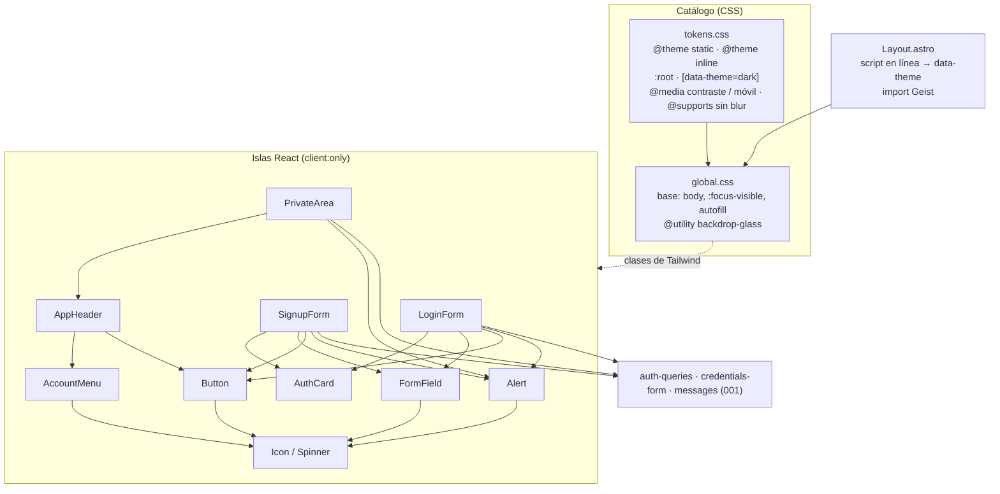

# Plan técnico · Spec 004 · Aplicar el sistema de diseño

> CÓMO se cumple `spec.md`. Cada decisión se justifica contra la spec, la constitución y `DESIGN.md`. Las incógnitas técnicas están en [research.md](research.md).

## 1. Resumen

Se crea el catálogo de valores (`apps/web/src/styles/tokens.css`) con los nombres de `DESIGN.md`. Incluye los valores que faltaban, calculados para cumplir el contraste AAA (R-2), con variantes para tema oscuro, «aumentar contraste» y navegadores sin blur. Ese fichero se expone a Tailwind 4 con `@theme`, sin la paleta por defecto. Un test impide usar en las pantallas valores que no salgan de él.

Sobre el catálogo se construyen cinco piezas pequeñas (`Button`, `Alert`, `Icon`/`Spinner`, `AuthCard` y el `FormField` existente) y la cabecera de la zona privada con su menú de cuenta. Las tres islas de la 001 se rehacen con ellas sin tocar su lógica: `auth-queries.ts`, `api.ts` y `withQueryClient.tsx` no cambian.

El tema sigue la preferencia del sistema con `data-theme` en `<html>`, que pone un script en línea antes de pintar. Las fuentes y los iconos se sirven desde la app.

## 2. Contexto técnico

- **Código existente relevante** (spec 001):
  - Islas: [LoginForm.tsx](../../apps/web/src/components/LoginForm.tsx), [SignupForm.tsx](../../apps/web/src/components/SignupForm.tsx) y [PrivateArea.tsx](../../apps/web/src/components/PrivateArea.tsx), montadas con `client:only="react"` desde `apps/web/src/pages/{login,signup,index}.astro`.
  - [FormField.tsx](../../apps/web/src/components/FormField.tsx): etiqueta, `aria-invalid` y `aria-describedby`. Se reutiliza y se le cambia el aspecto.
  - [credentials-form.ts](../../apps/web/src/lib/credentials-form.ts): estado y envío de los dos formularios. Solo cambia el tipo de `formError`.
  - [messages.ts](../../apps/web/src/lib/messages.ts): texto por `code` (C-9). Se le añade el tono de la alerta.
  - [auth-queries.ts](../../apps/web/src/lib/auth-queries.ts): `useLogin`, `useSignup`, `useLogout` y `useMe`. Sin cambios; `isPending` ya da el estado de RF-013.
  - [Layout.astro](../../apps/web/src/layouts/Layout.astro) y [global.css](../../apps/web/src/styles/global.css) (hoy solo `@import 'tailwindcss'`).
  - Tests: [test-utils.tsx](../../apps/web/src/components/test-utils.tsx) (fetch y `location` simulados, `emptyAlert`, `expectFieldError`) y [e2e/auth.spec.ts](../../e2e/auth.spec.ts) (`tabTo`, que usa Alt+Tab en WebKit).
- **Patrones del proyecto que se siguen:**
  - La zona `role="alert"` está en la página antes del error y solo cambia su texto (001, T-038).
  - Cada isla trae su `QueryClient` (`withQueryClient`, 001 D-10).
  - Los efectos solo se suscriben a eventos del navegador, como `pageshow` en la 001; aquí, `matchMedia` y `pointerdown`.
  - Tests con IDs en el nombre.
  - La política de versiones de pnpm (001 D-16).
- **Dependencias nuevas** (versiones y fechas en R-7):

| Paquete | Dónde | Por qué | Alternativa descartada |
|---------|-------|---------|------------------------|
| `@fontsource-variable/geist` 5.3.0 | web | Geist servida desde la app (`DESIGN.md` §2.1, RNF-003), con `font-display: swap` (E-4) y `unicode-range`: solo se descargan 32 KB | `woff2` copiados a mano: binarios en el repo que hay que actualizar a mano. Paquete `geist`: pide Next (R-3) |
| `lucide-react` 1.62.0 | web | Iconos de `DESIGN.md` §9; sin efectos secundarios, así que solo se empaquetan los que se importan | SVG copiados a mano: valdría para los 4 de esta spec, pero la 002 necesita unos 15 más del mismo set (R-4) |
| `culori` 4.0.2 + `@types/culori` 4.0.1 | web (dev) | Calcular en un test el contraste de los tokens: leer `oklch()`, `rgba()` y hex, componer transparencias y aplicar la fórmula WCAG (D-12). Los valores de R-2 se calcularon con esta misma librería | Unas 40 líneas propias de matemática de color, que además necesitarían sus propios tests |
| `@axe-core/playwright` 4.14.0 | raíz (dev) | Auditoría WCAG 2.2 AA en el navegador real, en los dos temas (RNF-001) | Solo Testing Library: no ve el CSS aplicado (foco, contraste calculable, regiones) |

No se añaden librerías de componentes (Radix, Headless UI) para un solo menú (D-10) ni el plugin de Prettier para ordenar clases de Tailwind.

## 3. Comprobación de constitución

| Artículo | Cumple | Nota |
|----------|--------|------|
| C-1 | ✅ | Todo en TypeScript `strict`. `@types/culori` para el test de contraste |
| C-2 | ✅ | Cuatro dependencias nuevas, justificadas en §2 |
| C-3 | ✅ | No cambia |
| C-4 | ✅ | Astro estático + Tailwind 4. La zona privada sigue siendo **una sola isla**: la cabecera y el menú de cuenta van dentro de `PrivateArea`. No hay datos de servidor nuevos ni `fetch` en efectos; los efectos nuevos se suscriben a `matchMedia` y `pointerdown` |
| C-5 | ✅ | No aplica: la API no cambia |
| C-6 | ✅ | Solo local |
| C-7 | ✅ | No cambia |
| C-8–C-15 | ✅ | No aplican: sin cambios en la API, la BD, `shared` ni la seguridad |
| C-16 | ✅ | Fuentes e iconos empaquetados por Vite y servidos desde el mismo origen. Un E2E comprueba que ninguna pantalla hace peticiones a terceros (RNF-003) |
| C-17 | ✅ | Cada RF tiene al menos un test (§6) |
| C-18 | ✅ | Vitest + Testing Library para componentes. Vitest para el catálogo (contraste y reglas). Playwright para el responsive, las preferencias del sistema, el teclado y axe |
| C-19 | ✅ | Sin excepción: cada tarea deja `pnpm test`, `pnpm lint` y `pnpm typecheck` en verde |
| C-20 | ✅ | Menú de cuenta con el patrón *Menu Button* de APG (D-10). Foco visible global (D-5). Objetivos de 44 px. axe en E2E. Sin arrastre |
| C-21 | ✅ | Solo lo que pide la spec. Las piezas de `DESIGN.md` que no se usan aquí (sage, `--pill-*`, `--signal`, sombras de acento) solo existen como **valores** del catálogo, que es lo que pide RNF-006 (b); no se crean componentes para ellas |
| C-22 | ✅ | `Button` (3 usos), `Alert` (4), `Icon`/`Spinner` (4), `AuthCard` (2) y la utilidad `backdrop-glass` (5). `AppHeader` y `AccountMenu` tienen un solo uso: no son abstracciones, se separan en ficheros por tamaño y para probar el menú por separado |
| C-23 | ✅ | Código en inglés; ficheros sin tildes |
| C-24 | ✅ | Commits con `[spec 004]` e IDs |
| C-25 | ✅ | No cambia la configuración de ESLint ni de Prettier |
| C-26 | ⚠️ | Se sigue `DESIGN.md`, con **11 desviaciones justificadas** en §4.5 (X-1–X-11). Casi todas vienen de que algunos valores de `DESIGN.md` no llegan al contraste que el propio `DESIGN.md` exige (R-2). `DESIGN.md` se actualiza en esta rama (§4.6, `DESIGN.md` §19) |

## 4. Diseño

### 4.1 Arquitectura y flujo



- **Tema (D-4).** Un script en línea en `<head>` pone `data-theme="dark"` o `"light"` en `<html>` según `matchMedia('(prefers-color-scheme: dark)')` antes de que se pinte `<body>` (E-13). También escucha el evento `change` (E-8). `tokens.css` redefine los colores bajo `:root[data-theme="dark"]`.
- **Contraste y movimiento (D-5).** «Aumentar contraste» y la falta de blur son media queries y `@supports` de `tokens.css`: no necesitan JS y se aplican en vivo (E-8). Reducir movimiento: las transformaciones solo existen con la variante `motion-safe:`.
- **Pantallas de acceso.** `AuthCard` → `<main>` en rejilla centrada con `px-4`, y una tarjeta glass `w-full max-w-105` (420 px). Por debajo de 452 px la tarjeta mide el ancho menos 16 px por lado sin ninguna media query (RF-002). Orden (RF-003): `h1` → zona `role="status"` (sesión caducada) → zona `role="alert"` (avisos del formulario) → Email → Contraseña → botón principal → enlace.
- **Zona privada.**

  ```
  <header>            fija, --surface-header + blur, --z-sticky
    «Mis tareas»          píldora glass, no es encabezado
    ≥768: EmailPill · Button glass «Cerrar sesión»
    <768: AccountMenu (botón «A» → panel: email + menu[Cerrar sesión])
  <main>
    zona role="alert"     → Alert offline (RF-008)
    <h1> Mis tareas       text-display (RF-024)
  ```

  Las dos variantes de la derecha están siempre en el DOM y se muestran u ocultan con CSS (`max-md:hidden` / `md:hidden`, D-11).
- **Envío (RF-013).** `Button` recibe `loading` (= `mutation.isPending`). Mientras dura, muestra `Spinner` + gerundio, lleva `aria-disabled="true"` y cancela la activación con `preventDefault`. Eso también corta el envío implícito con Enter desde un campo (D-9).

### 4.2 Modelo de datos: el catálogo

Sin cambios de BD ni de `shared`. El «modelo» de esta spec es `tokens.css`, con esta estructura (los valores van en la tabla de abajo y en R-2):

```css
/* apps/web/src/styles/tokens.css — fuente de verdad de DESIGN.md §18 */
@theme static {
  --color-*: initial; --text-*: initial; --radius-*: initial; --shadow-*: initial;
  --ease-*: initial; --breakpoint-*: initial;
  --font-sans: 'Geist Variable', 'Helvetica Neue', Helvetica, Arial, sans-serif;
  --font-mono: 'Geist Mono Variable', ui-monospace, monospace;
  --text-display: 3.5rem; --text-display--line-height: 1.05;
  --text-display--letter-spacing: -0.035em; --text-display--font-weight: 300;
  /* … h1, h2, h3, body, sm, xs igual (§2.2) */
  --radius-xs: 8px; /* … */ --radius-pill: 999px;
  --ease-out: cubic-bezier(.22,1,.36,1); --ease-spring: cubic-bezier(.34,1.4,.64,1);
  --breakpoint-sm: 480px; --breakpoint-md: 768px; --breakpoint-lg: 1024px;
  --breakpoint-xl: 1280px; --breakpoint-2xl: 1600px;          /* = --bp-* de §4 */
  --space-1: calc(var(--spacing) * 1); /* … */ --space-16: calc(var(--spacing) * 16);
  --animate-spin: spin var(--dur-slow) linear infinite;        /* X-9 */
}
@theme inline {                    /* nombres de clase → tokens semánticos */
  --color-canvas: var(--bg-canvas); --color-glass: var(--surface-glass);
  --color-raised: var(--surface-raised); /* … */ --color-1: var(--text-1);
  --color-on-accent: var(--text-on-accent); --color-ring-error: var(--ring-error);
  --color-contrast: var(--border-contrast); --color-rose-soft: var(--rose-soft); /* … */
}
:root { color-scheme: light; /* primitivos, acentos, semánticos claros, sombras, z, dur, retícula */ }
:root[data-theme='dark'] { color-scheme: dark; /* semánticos, sombras y retícula oscuros */ }
@media (width < 768px) { :root { /* escala tipográfica de móvil (§2.2) */ } }
@media (prefers-contrast: more) { :root { /* superficies opacas + --border-contrast */ }
                                  :root[data-theme='dark'] { /* ídem oscuro */ } }
@supports not (backdrop-filter: blur(1px)) { :root { /* glass, raised y cabecera al 92 % */ }
                                             :root[data-theme='dark'] { /* ídem */ } }
```

- **Primitivos** (`--ink-*`, acentos): variables de `:root` sin nombre de clase de Tailwind. Así no se pueden usar en un componente (`DESIGN.md` §18).
- **Sombras, capas, duraciones** (`--shadow-*`, `--z-*`, `--dur*`): fuera de `@theme` y se usan como `shadow-(--shadow-glass)`, `z-(--z-sticky)` o `duration-(--dur-fast)` (R-1, hallazgo 6).
- **Escala de espaciado:** el `--spacing: 0.25rem` de Tailwind es la base 4 de §3.1. `--space-n` se deriva de él, así que `p-4` y `--space-4` son el mismo valor.

**Valores que se proponen** (pendientes de `DESIGN.md` y tokens nuevos). Se aprueban con este plan (spec §10) y se copian a `DESIGN.md` (§4.6):

| Token | Claro | Oscuro | Nota |
|---|---|---|---|
| `--sage` · `--rose` · `--lilac` · `--amber` · `--signal` | `oklch(0.68 0.11 h)` con h = 150 · 15 · 300 · 75 · 40 | igual | §1.3; hex en R-2 |
| `--{acento}-soft` | acento `/ 0.16` | acento `/ 0.22` | Tinte de alertas e insignias |
| `--pill-{sage,rose,lilac,amber}` | `radial-gradient(120% 140% at 0 0, rgba(255,255,255,.45), transparent 55%), linear-gradient(100deg, oklch(0.80 0.10 h), oklch(0.74 0.11 h))` | igual | X-6. ≥ 7.71:1 con `--text-on-pill` |
| `--pill-ink` | `linear-gradient(100deg, #34495A, var(--ink-800))` | igual | X-6. Sin brillo: 8.86:1 con ink‑0 |
| `--grad-primary` | `linear-gradient(135deg, #34495A, var(--ink-800), var(--ink-900))` | igual | §6.4 |
| `--shadow-pill` | `inset 0 1px 0 rgba(255,255,255,.85), 0 1px 2px rgba(6,20,27,.06), 0 4px 12px -2px rgba(6,20,27,.08)` | brillo `.08`, sombras `.30` / `.30` | Tinte siempre `rgba(6,20,27,…)` (§6.2) |
| `--shadow-glass` | `inset 0 1px 0 rgba(255,255,255,.85), 0 2px 6px rgba(6,20,27,.05), 0 16px 40px -12px rgba(6,20,27,.18)` | brillo `.08`, sombras `.30` / `.45` | |
| `--shadow-float` | `inset 0 1px 0 rgba(255,255,255,.85), 0 0 0 1px var(--border-glass), 0 24px 56px -16px rgba(6,20,27,.28)` | brillo `.08`, sombra `.60` | Lleva el `--border-glass` de los flotantes |
| `--shadow-accent` | `inset 0 1px 0 rgba(255,255,255,.55), 0 6px 18px -6px rgba(6,20,27,.30)` | sombra `.55` | |
| `--border-glass` | `rgba(6,20,27,.08)` | `rgba(238,240,240,.10)` | |
| `--dot-color` · `--dot-grid` · `--dot-grid-size` | `rgba(6,20,27,.10)` · `radial-gradient(circle at 1px 1px, var(--dot-color) 1px, transparent 0)` · `22px` | `rgba(238,240,240,.10)` | §3.3. Se resuelve en `<html>` (§1.5) |
| **Nuevo** `--surface-header` | `rgba(227,230,230,.80)` | `rgba(6,20,27,.80)` | «Lienzo al 80 %» de §3.2 |
| **Nuevo** `--glass-filter` | `blur(24px) saturate(140%)` | igual | §6.3 |
| **Nuevo** `--focus-outline` | `var(--ink-800)` | `var(--ink-200)` | X-4 |
| **Nuevo** `--focus-halo` | `0 0 0 3px rgba(74,92,106,.18)` | `0 0 0 3px rgba(204,208,207,.18)` | §8 |
| **Nuevo** `--ring-error` | `oklch(0.55 0.11 15)` (`#A8545D`) | `var(--rose)` | X-5. ≥ 4.17:1 en todos los casos |
| **Nuevo** `--border-contrast` | `transparent` (con contraste: `var(--ink-600)`) | igual | §17, CA-5.2 |
| **Nuevo** `--surface-tooltip` · `--text-on-tooltip` | `var(--ink-950)` · `var(--ink-50)` | igual | §14 Tooltip; 16.34:1 |
| Radios | xs 8 · sm 14 · **md 26** · **lg 30** · xl 34 · pill 999 | — | §5 da rangos: md = alertas y menús (26), lg = tarjeta de tarea (30) |
| Escala tipográfica (rem) | display 3.5 · h1 2.5 · h2 1.875 · h3 1.25 · body 0.9375 · sm 0.8125 · **xs 0.75** | móvil (< 768): 2.5 · 2 · 1.625 · 1.125 · 1 · 0.875 · 0.75 | §2.2; xs a 12 px dentro del rango 11–12 |
| «Aumentar contraste» (opacos) | glass `#EDF0F0` · raised `#F7F9F9` · raised‑hover `#FFFFFF` · sunken `#D9DDDC` · header `#E3E6E6` | glass `#0D1C26` · raised `#1E2F3C` · raised‑hover `#394B59` · sunken `#06141B` · header `#06141B` | El mismo color que se ve con transparencia, pero opaco: el contraste no empeora (R-2) |
| Sin blur (E-3) | glass, raised y header con alfa `.92` | igual | X-11 |

**Texto por superficie** (contrato que comprueba el test de D-12; números en R-2):

| Superficie | Texto | No texto |
|---|---|---|
| Lienzo | solo `--text-1` (título «Mis tareas») | foco |
| Tarjeta glass | `--text-1` (título, enlace) · `--text-2` (etiquetas, «¿No tienes cuenta?») | foco |
| Campo (raised / raised‑hover) | `--text-1` | anillo e icono `--ring-error`, foco |
| Píldoras de la cabecera, botón glass, botón de cuenta | `--text-1` | foco |
| Menú de cuenta y sus opciones | `--text-1` | foco |
| Alertas (raised + `*-soft`) | `--text-1`, también el icono (X-7) | — |
| Botón primario (`--grad-primary`) | `--text-on-accent`, también el `Spinner` | foco |

### 4.3 Contratos

Props y firmas que consumen las islas (y la 002):

```ts
// components/Icon.tsx — Lucide con el trazo de DESIGN.md §9; siempre decorativo (aria-hidden).
import type { LucideIcon } from 'lucide-react';
export function Icon(props: { icon: LucideIcon; size?: 16 | 18 | 20 | 22; className?: string }): JSX.Element;
export function Spinner(): JSX.Element; // LoaderCircle 16 px + animate-spin (§12 «Carga de acción»)

// components/Button.tsx — DESIGN.md §14 Button. Píldora de 44 (md) o 52 (lg).
export type ButtonProps = {
  variant: 'primary' | 'glass';
  size?: 'md' | 'lg';
  fullWidth?: boolean;
  type?: 'button' | 'submit';
  onClick?: () => void;
  loading?: boolean;        // RF-013: Spinner + loadingLabel, aria-disabled, ignora la activación
  loadingLabel?: string;    // «Iniciando sesión…», «Creando cuenta…», «Cerrando sesión…»
  children: string;         // las dos etiquetas se apilan en la misma celda: el ancho no cambia (D-9)
};

// components/Alert.tsx — DESIGN.md §14 Alert. Solo aspecto: el rol lo pone la zona que la contiene (D-14).
export type AlertTone = 'error' | 'offline' | 'info';
// error → --rose-soft + CircleAlert · offline → --amber-soft + TriangleAlert · info → --lilac-soft + Info
export function Alert(props: { tone: AlertTone; children: string }): JSX.Element; // expone data-tone

// components/AuthCard.tsx — DESIGN.md §11.1.
export function AuthCard(props: { title: string; children: ReactNode; footer: ReactNode }): JSX.Element;

// components/AppHeader.tsx — DESIGN.md §3.2. Un solo uso (PrivateArea).
export type LogoutHandler = (callbacks?: { onError?: () => void }) => void;
export function AppHeader(props: { email: string; loggingOut: boolean; onLogout: LogoutHandler }): JSX.Element;

// components/AccountMenu.tsx — RF-020–RF-023, E-10–E-12, E-14. Un solo uso (AppHeader).
export function AccountMenu(props: { email: string; loggingOut: boolean; onLogout: LogoutHandler }): JSX.Element;
```

Cambios en contratos existentes:

```ts
// lib/messages.ts — RF-004: cada mensaje lleva el tono de su alerta.
export type FormMessage = { text: string; tone: AlertTone; field?: 'email' };
// INVALID_CREDENTIALS → 'error' · SESSION_EXPIRED → 'info' · UNEXPECTED (RF-010 de la 001) → 'offline'
// EMAIL_ALREADY_REGISTERED → 'error' (se muestra junto al campo; el tono no se usa)

// lib/credentials-form.ts — el formulario guarda el mensaje entero, no solo el texto.
formError: FormMessage | undefined; // antes: string | undefined

// FormField: mismas props. Cambia solo el aspecto (D-15).
```

Atributos ARIA del menú de cuenta (D-10):

| Elemento | Atributos |
|---|---|
| Botón de cuenta | `<button type="button" aria-haspopup="menu" aria-expanded aria-controls aria-label="Cuenta de {email}">` con la inicial dentro (`aria-hidden`) |
| Panel | `<div id>` (sin rol) con `<p id="…-email">{email}</p>` y `<ul role="menu" aria-labelledby="…-email">` |
| Opción | `<li role="none"><button role="menuitem" tabIndex={-1}>Cerrar sesión</button></li>` |

### 4.4 Componentes / módulos

| Módulo | Ruta | Responsabilidad | Nuevo/Modificado |
|--------|------|-----------------|------------------|
| Catálogo | `apps/web/src/styles/tokens.css` | Todos los valores con nombre de `DESIGN.md` §1–§8, más los nuevos (§4.2) | Nuevo |
| Estilos base | `apps/web/src/styles/global.css` | Importa Tailwind y `tokens.css`. Base: `body` (lienzo, retícula, `--font-sans`, `text-body`, `--text-1`), `:focus-visible` global (D-5), autofill con tokens. `@utility backdrop-glass` | Modificado |
| Layout | `apps/web/src/layouts/Layout.astro` | Script en línea de tema (D-4); importa `@fontsource-variable/geist/wght.css` | Modificado |
| `Icon`, `Spinner` | `apps/web/src/components/Icon.tsx` | Lucide a trazo 1.4, decorativo | Nuevo |
| `Button` | `apps/web/src/components/Button.tsx` | Variantes `primary` y `glass`, estado de carga (D-9) | Nuevo |
| `Alert` | `apps/web/src/components/Alert.tsx` | Tres tonos con icono | Nuevo |
| `AuthCard` | `apps/web/src/components/AuthCard.tsx` | Lienzo + tarjeta glass + `h1` + pie | Nuevo |
| `FormField` | `apps/web/src/components/FormField.tsx` | Campo de 52 px, etiqueta a 13 px con sangría de 20, anillo e icono de error (D-15) | Modificado |
| `LoginForm`, `SignupForm` | `apps/web/src/components/{Login,Signup}Form.tsx` | Usan `AuthCard`, `Alert` y `Button`; avisos encima de los campos (RF-003, RF-004) | Modificado |
| `PrivateArea` | `apps/web/src/components/PrivateArea.tsx` | `AppHeader` + alerta bajo la cabecera + `h1` display | Modificado |
| `AppHeader` | `apps/web/src/components/AppHeader.tsx` | Cabecera flotante y sus dos variantes; `EmailPill` con tooltip (D-13) | Nuevo |
| `AccountMenu` | `apps/web/src/components/AccountMenu.tsx` | Botón de cuenta y menú (D-10) | Nuevo |
| Mensajes | `apps/web/src/lib/messages.ts` · `credentials-form.ts` | Tono por mensaje; `formError` como `FormMessage` | Modificado |
| Utilidades de test | `apps/web/src/components/test-utils.tsx` | Simulación de `matchMedia` (jsdom no la tiene) | Modificado |
| Test del catálogo | `apps/web/src/styles/tokens.test.ts` | Contraste y completitud del catálogo (D-12, RNF-006 b) | Nuevo |
| Test de reglas | `apps/web/src/design-rules.test.ts` | Ningún valor fuera del catálogo (D-3, RNF-006 a) | Nuevo |
| E2E | `e2e/design-system.spec.ts` · `e2e/helpers.ts` | Responsive, preferencias, teclado, axe y terceros. `helpers.ts` recoge `tabTo`, `signup`… de `auth.spec.ts` (2 usos) | Nuevo / `auth.spec.ts` modificado (solo importaciones) |
| Documentación | `DESIGN.md` | Valores nuevos y desviaciones (§4.6) | Modificado |

### 4.5 Desviaciones de `DESIGN.md` (C-26)

| ID | `DESIGN.md` dice | El plan hace | Por qué |
|---|---|---|---|
| X-1 | §13: en móvil, el primario va «a ancho completo y fijo abajo» | Dentro de la tarjeta, a ancho completo, en todos los tamaños | Lo decidió la spec (§10). Con dos campos, un botón fijo abajo quedaría tapado por el teclado del móvil y rompería el orden de RF-003 |
| X-2 | §14 Avatar: círculo de 32/40 | Botón de cuenta de 44 | Solo existe por debajo de 768 px, donde RF-012 exige 44 × 44 |
| X-3 | §14 Menu: opciones de 42 | 44 | Supuesto de la spec (RF-012) |
| X-4 | §8: foco con `outline: 2px solid var(--ink-800)` | `var(--focus-outline)`: ink‑800 en claro, ink‑200 en oscuro | ink‑800 sobre el lienzo oscuro da 1.52:1; RF-010 pide 3:1 (R-2). Además, §18 prohíbe que un componente use un primitivo |
| X-5 | §6.2: anillo de error rose de 1.5 px | `--ring-error`: `oklch(0.55 0.11 15)` en claro, `--rose` en oscuro (mismo tono) | `--rose` en claro da 2.37–2.80:1 sobre campo y tarjeta; RF-010 pide 3:1 (R-2) |
| X-6 | §6.4: `--pill-*` con el acento y brillo radial | Acentos con L 0.74–0.80 (mismo tono y croma); `--pill-ink` sin brillo | Con L 0.68, `--text-on-pill` da 6.16:1 y §1.4 pide 7:1. El brillo sobre `--pill-ink` baja el texto claro de 8:1 (R-2). §1.3 se sigue cumpliendo en los acentos base |
| X-7 | §14 Alert: «tinte del tono e icono» (no fija colores) | Texto e icono de la alerta en `--text-1` | Un icono en el acento da 2.34–2.50:1 en claro, y `--text-2` da 6.0–6.3:1 sobre la alerta oscura (R-2). El tono se distingue por el tinte y por la forma del icono (§1.3: nunca solo el color) |
| X-8 | §3.2: la cabecera lleva «lienzo al 80 % y blur al hacer scroll» | Siempre con `--surface-header` y blur | Evita un listener de scroll. En reposo, el único cambio visible es que la retícula se difumina bajo la franja de la cabecera |
| X-9 | §8: «nada dura más de 420 ms»; reducir movimiento quita los desplazamientos | El `Spinner` da una vuelta cada 420 ms (`--dur-slow`) y sigue girando con movimiento reducido | Cumple RNF-005 al pie de la letra. Girar no es desplazar ni cambiar de tamaño (CA-5.1); el gerundio dice lo mismo aunque el anillo estuviera quieto |
| X-10 | §14: controles `sm` (32) en escritorio | Todos los controles en `md` (44) o `lg` (52) | Más simple y cumple RF-012 en cualquier ancho sin cambiar por breakpoint |
| X-11 | §6.3: sin soporte de blur, «la superficie» al 92 % | Solo glass, raised y la cabecera. `raised-hover` se queda igual | En oscuro, `raised-hover` al 92 % baja el texto a 6.53:1 (R-2) |

### 4.6 Cambios en `DESIGN.md` (RNF-006 c, `DESIGN.md` §19)

En la misma rama, durante la implementación:
- Valores de §4.2 en sus secciones: §1.3 (acentos, `*-soft`, `--pill-*`), §1.4 (tokens semánticos nuevos), §3.3 (retícula), §5 (radios concretos), §6.2 (sombras, `--border-glass`), §8 (`--focus-outline`, `--focus-halo`) y §17 (valores opacos de «aumentar contraste»).
- La equivalencia `--bp-*` ↔ `--breakpoint-*` en §4.
- Las desviaciones X-4, X-5, X-6, X-7 y X-11 pasan a ser reglas de `DESIGN.md`. Las demás (X-1–X-3, X-8–X-10) son excepciones de estas pantallas y se quedan en este plan (§19). X-1 y X-2 son de esta spec, así que no cuentan para la regla de las 3 repeticiones.
- Se quitan los puntos 1 (valores) y 2 (tema oscuro, ya aplicado) de «Pendiente de decidir».
- Versión **1.2.0-todo.1** (MINOR: se añaden tokens) y entrada en el «Historial».

## 5. Decisiones

- **D-1** Un solo catálogo, `apps/web/src/styles/tokens.css`, con los nombres de `DESIGN.md`, importado por `global.css` después de Tailwind. Tiene tres partes: `@theme static` (tipografía, radios, curvas, breakpoints, `initial` de cada espacio de nombres), `@theme inline` (nombres de clase de los colores semánticos) y variables normales (colores, sombras, capas, duraciones, retícula y sus variantes). Los primitivos no tienen clase.
  - *Por qué:* `DESIGN.md` §18 lo pide así. Así no hay referencias circulares entre los nombres de `DESIGN.md` y los de Tailwind, y la paleta genérica desaparece (R-1).
  - *Alternativas descartadas:* generar `tokens.css` desde un TS — un paso de build más para valores que solo consume CSS · todo en `@theme` — Tailwind descompone las sombras multicapa y no admite variantes por tema dentro de `@theme` (R-1).
- **D-2** Los valores pendientes y los tokens nuevos son los de la tabla de §4.2. Se aprueban con este plan y se copian a `DESIGN.md` (§4.6).
  - *Por qué:* RNF-006 (c) y el supuesto de la spec. Cada valor que lleva texto o un elemento no textual encima tiene su contraste calculado (R-2).
  - *Alternativas descartadas:* esperar a los ficheros del sistema original — no están disponibles (spec §10).
- **D-3** Un test (`design-rules.test.ts`) revisa `apps/web/src/**/*.{tsx,astro}` (sin los tests) y `global.css`, y falla si encuentra:
  - colores literales (`#hex`, `rgb(`, `hsl(`, `oklch(`);
  - valores arbitrarios de Tailwind entre corchetes (`p-[7px]`);
  - `style=`;
  - `z-`, `duration-` o `delay-` con número;
  - `scale-`, `translate-` o `rotate-` sin `motion-safe:`;
  - una referencia `(--x)` a un token que no existe en `tokens.css`.

  Solo `tokens.css` puede tener valores literales.
  - *Por qué:* RNF-006 (a) pide «0 casos». Tailwind no puede impedir los valores arbitrarios (R-1, hallazgo 7). Además, así se vigila RF-014 (D-5) y la regla de «solo tokens» de §21.
  - *Alternativas descartadas:* revisión manual en `/sdd-verificar` — no impide que la 002 meta valores sueltos · regla de ESLint propia — más código para lo mismo que una expresión regular sobre unas pocas clases.
- **D-4** El tema se fija con `data-theme` en `<html>`. Lo pone un script en línea (`<script is:inline>`) en el `<head>` de `Layout.astro` con `matchMedia('(prefers-color-scheme: dark)')`, y lo actualiza con su evento `change`.
  - *Por qué:* `DESIGN.md` §1.5 activa el tema en `<html>` con `data-theme`. El script se ejecuta antes de pintar `<body>` (E-13) y el evento cubre E-8. Si algún día hay selector, solo cambia este script.
  - *Alternativas descartadas:* solo `@media (prefers-color-scheme: dark)` en CSS, sin JS — se sale de §1.5, y un selector futuro obligaría a reescribir los bloques del tema · script en una isla — llegaría tarde y se vería primero el tema claro.
- **D-5** Las preferencias del sistema se resuelven en CSS:
  - «Aumentar contraste»: `@media (prefers-contrast: more)` en `tokens.css` cambia las superficies por sus valores opacos y `--border-contrast` por ink‑600. Las superficies llevan siempre `border border-contrast`, que por defecto es transparente, así que nada se mueve al cambiar.
  - Reducir movimiento: las transformaciones solo existen con `motion-safe:`. Las transiciones de color y sombra se mantienen.
  - Foco: un `:focus-visible` global en `global.css` con `--focus-outline`. Los campos suben a `raised-hover` y añaden `--focus-halo` al recibir el foco.
  - *Por qué:* sin JS, se aplica en vivo (E-8) y en un solo sitio.
  - *Alternativas descartadas:* clases de foco en cada componente — se repetiría en todos y alguno se quedaría sin ellas · `outline` para el borde de contraste — choca con el foco.
- **D-6** Piezas comunes en `apps/web/src/components/`, junto a las de la 001 (sin subcarpeta `ui/`): `Icon`/`Spinner`, `Button`, `Alert` y `AuthCard`. Cada una con ≥ 2 usos (C-22). Contratos en §4.3.
  - *Por qué:* son los componentes de `DESIGN.md` §14 que usan estas pantallas, y la 002 los reutiliza.
  - *Alternativas descartadas:* clases repetidas en cada isla — RNF-006 sería más difícil de revisar y la 002 las copiaría.
- **D-7** Geist con `@fontsource-variable/geist` 5.3.0, importado en `Layout.astro`. Geist Mono no se instala.
  - *Por qué:* R-3. `swap` cubre E-4; Vite sirve la fuente desde el mismo origen (RNF-003).
  - *Alternativas descartadas:* ver §2.
- **D-8** Iconos de `lucide-react` 1.62.0, usados siempre a través de `Icon`, que fija `strokeWidth={1.4}`, el tamaño de §9 y `aria-hidden`. El anillo de carga es el `LoaderCircle` de Lucide.
  - *Por qué:* R-4. Un solo sitio fija el trazo, y el anillo sale del mismo set (§9 prohíbe mezclar sets).
  - *Alternativas descartadas:* SVG propio para el anillo — sería un segundo set de iconos.
- **D-9** Botón en espera (RF-013):
  - Lleva `aria-disabled="true"` en lugar de `disabled`, y su `onClick` hace `preventDefault()` mientras `loading`. Eso también cancela el envío implícito al pulsar Enter en un campo, que el navegador hace como un clic en el botón de envío.
  - Las dos etiquetas (normal y gerundio con `Spinner`) se apilan en la misma celda de rejilla. La que no se ve lleva `invisible` + `aria-hidden`, así que el botón mide siempre lo que la más larga.
  - *Por qué:* con `disabled`, el botón pierde el foco; en el menú de cuenta eso rompería E-12 (el menú sigue abierto con «Cerrando sesión…») y Esc dejaría de funcionar. Apilar las etiquetas mantiene el ancho sin medir nada con JS.
  - *Alternativas descartadas:* `disabled` — pierde el foco · fijar el ancho medido al pulsar — más JS y falla si cambia el tamaño de la ventana.
- **D-10** Menú de cuenta escrito a mano con el patrón *Menu Button* de APG (R-6). Comportamiento:
  - Se abre al activar el botón (clic, Enter o Espacio) y lleva el foco a la primera opción (CA-2.6).
  - Las flechas arriba y abajo recorren las opciones, en bucle.
  - Se cierra con Esc (y el foco vuelve al botón), con un `pointerdown` fuera del panel, al volver a activar el botón (RF-021) y al pasar a ≥ 768 px (efecto suscrito a `matchMedia('(min-width: 768px)')`, E-10).
  - Con Tab se cierra y el foco pasa al botón antes de que el navegador mueva el foco, así que continúa desde ahí (E-14).
  - Mientras se cierra la sesión, sigue abierto con «Cerrando sesión…» (E-12). Si falla, se cierra y el foco vuelve al botón de cuenta (E-12, spec v1.1), para que no se pierda en `body` (WCAG 2.4.3).
  - *Por qué:* RF-020–RF-023 y C-20. Es un menú de una opción; una librería sería una dependencia para unas 80 líneas.
  - *Alternativas descartadas:* Radix o Headless UI — dependencia de un solo uso · `<details>`/disclosure — no tiene la navegación con flechas que pide RF-022.
- **D-11** La cabecera tiene las dos variantes en el DOM y las alterna con CSS (`max-md:hidden` / `md:hidden`). Es `sticky top-0` con `--surface-header`, `backdrop-glass` y `z-(--z-sticky)`. El contenido está limitado a 1680 px (`max-w-420`, §4).
  - *Por qué:* el responsive sin JS no parpadea ni depende de medir la ventana. `sticky` no tapa el título en reposo.
  - *Alternativas descartadas:* elegir la variante con `matchMedia` en React — un render con la variante equivocada y más estado.
- **D-12** El contraste (RF-009, RF-010, CA-3.1, CA-5.2, E-3) se comprueba en un test unitario, `tokens.test.ts`:
  - Lee `tokens.css` (cada bloque: claro, oscuro, contraste, sin blur).
  - Compone las superficies como en R-2 con `culori`.
  - Exige ≥ 7:1 (≥ 4.5:1 en el título display) y ≥ 3:1 para cada par de la tabla «Texto por superficie» de §4.2.

  En E2E, axe (`@axe-core/playwright`, etiquetas WCAG 2.2 AA + la regla `color-contrast-enhanced`) se pasa a las tres pantallas en los dos temas y con el menú abierto, y exige 0 infracciones.
  - *Por qué:* axe no sabe calcular el fondo con `backdrop-filter`, degradados o la retícula: lo deja como «incompleto», no como fallo (R-2). La matriz sí cubre todas las superficies y variantes.
  - *Alternativas descartadas:* muestrear píxeles de capturas — frágil (antialiasing, fuentes) · solo axe — dejaría sin medir la mayoría de pares.
- **D-13** E-1, email largo en la cabecera de escritorio: `EmailPill` es una píldora `truncate min-w-0 max-w-80` con `tabIndex={0}`.
  - Al pasar el ratón o llevar el foco mide si el texto está recortado (`scrollWidth > clientWidth`). Si lo está, a los 400 ms muestra el tooltip de §14 con el email completo.
  - Esc lo oculta, y el tooltip está dentro de la propia píldora para que se pueda pasar el ratón por encima (WCAG 1.4.13).
  - El tooltip es `aria-hidden`: el lector de pantalla ya lee el email completo del DOM, porque el recorte es solo CSS.
  - *Por qué:* E-1 pide ver el email completo «al pasar el ratón o al llevar el foco»; `title` no aparece con el foco.
  - *Alternativas descartadas:* `title` — no funciona con teclado · no recortar — contradice E-1.
- **D-14** Los avisos siguen el patrón de la 001:
  - La zona `role="alert"` está siempre y vacía, y dentro se pinta un `Alert` con el tono de `messages.ts`.
  - El aviso de sesión caducada sigue en su zona `role="status"`.
  - Las dos zonas van encima del campo Email, primero la de sesión caducada (E-5).
  - En la zona privada, la zona `role="alert"` es lo primero de `<main>`, debajo de la cabecera (RF-008).
  - *Por qué:* VoiceOver no anuncia una zona `alert` que se inserta ya con texto (001, T-038). Los tests actuales (`emptyAlert`) siguen valiendo, porque el icono no añade texto.
  - *Alternativas descartadas:* que `Alert` lleve el rol — se insertaría con el texto ya puesto.
- **D-15** Error de campo (RF-005):
  - Un anillo `inset` de 1.5 px en `--ring-error`, con `aria-invalid:`. Junto al foco, se combina con `--focus-halo`.
  - Un `CircleAlert` de 18 px en `--ring-error` al final del campo; el campo deja `padding-inline-end` para que no lo tape.
  - El mensaje, debajo, en `--text-1`.
  - El autofill de Chrome y Safari se reescribe con tokens (`-webkit-text-fill-color: var(--text-1)` y fondo raised), para que su azul claro no rompa el contraste en oscuro.
  - *Por qué:* §12, §13 y RF-010.
  - *Alternativas descartadas:* el anillo como `border` — se suma al borde de contraste y mueve el contenido.
- **D-16** Textos nuevos que no vienen de la 001: el nombre accesible del botón de cuenta, **«Cuenta de {email}»** (RF-023), y los tres gerundios de la spec. El menú toma su nombre del email (`aria-labelledby`).
  - *Por qué:* RF-023 pide que el nombre incluya el email. La palabra «cuenta» es el vocabulario de §9 (`user` = cuenta).
  - *Alternativas descartadas:* solo el email como nombre — no dice qué hace el botón.
- **D-17** Las utilidades E2E de `auth.spec.ts` (`tabTo`, `uniqueEmail`, `signup`, campos y botones) pasan a `e2e/helpers.ts`. `auth.spec.ts` solo cambia sus importaciones.
  - *Por qué:* `design-system.spec.ts` las necesita (2 usos, C-22).

- **D-18 (añadida en T-010)** En `tokens.css`, el bloque `@media (prefers-contrast: more)` va después del de `@supports not (backdrop-filter: blur(1px))`. Si coinciden las dos condiciones, ganan las superficies opacas.
  - *Por qué:* los dos bloques tienen la misma especificidad, así que manda el orden. Las superficies opacas dan más contraste que las del 92 % y cumplen CA-5.2.
  - *Alternativas descartadas:* el orden del esbozo de §4.2 (contraste antes que sin blur): con las dos condiciones, CA-5.2 dejaría de cumplirse.

- **D-19 (añadida en T-015)** El grosor del anillo de error es un token, `--ring-error-width: 1.5px` (`:root` de `tokens.css`), y el campo lo usa con `aria-invalid:inset-ring-(length:--ring-error-width) aria-invalid:inset-ring-ring-error`.
  - *Por qué:* Tailwind 4.3 no tiene `inset-ring-1.5`, y D-3 no admite `inset-ring-[1.5px]`. Además, `inset-ring-2` (o `ring-2`, `border-2`) se lee como el color `--color-2` (`--text-2`), no como un ancho: los nombres `1`/`2`/`3` de los colores de texto chocan con los anchos numéricos. Con `inset-ring-*`, Tailwind compone el anillo con la sombra del foco (`focus:shadow-(--focus-halo)`) en el mismo `box-shadow` (D-15).
  - *Alternativas descartadas:* un anillo de 1 px (`inset-ring`) — no es el 1.5 px de §6.2 · una `@utility` en `global.css` con `1.5px` — un valor literal fuera de `tokens.css` (D-3).

- **D-20 (añadida en T-023)** El proyecto `webkit` de `playwright.config.ts` lleva `retries: 1`.
  - *Por qué:* con los tres proyectos en paralelo, WebKit a veces pierde una conexión keep-alive con el servidor de desarrollo de Astro/Vite al pedir un módulo (`… /node_modules/.vite/deps/jsx-runtime-….js The network connection was lost`). La isla no se hidrata y el test falla sin que la app tenga la culpa. Pasaba en unas 4 de cada 10 ejecuciones; Chromium reintenta solo esas peticiones y WebKit no. Un reintento lo absorbe, y el informe lo marca como «flaky», así que sigue a la vista. Decidido por el usuario el 2026-10-29.
  - *Alternativas descartadas:* subir `keepAliveTimeout` con un plugin de Vite — se probó, siguió fallando 2 de 6 veces y no se pudo confirmar que Astro exponga el servidor HTTP · E2E contra `astro build` + preview — cambio grande en la infraestructura de la 001 (proxy de `/api`, HTTPS) · reintentos en los tres proyectos — ocultaría fallos intermitentes de Chromium.

> D-1, D-3 y D-12 son transversales: se recogen en [ADR-0003](../../docs/adr/0003-catalogo-de-tokens-vigilado-por-tests.md) (catálogo de tokens y su vigilancia automática), que aplica también a 002 y 003.

## 6. Trazabilidad

| Requisito | Cómo se cumple (decisión / módulo) | Cómo se prueba |
|-----------|------------------------------------|----------------|
| RF-001 | `AuthCard`: `<main>` en rejilla centrada, tarjeta `bg-glass backdrop-glass rounded-xl max-w-105` sobre el lienzo con retícula de `body` | E2E CA-1.1 (1280): la tarjeta mide 420 px, está centrada y tiene `backdrop-filter` |
| RF-002 | `px-4` + `w-full max-w-105`: por debajo de 452 px mide el ancho − 32 sin media query (§4.1) | E2E CA-1.2: 375 → 343 px y 320 → 288 px, sin scroll horizontal |
| RF-003 | Orden del DOM en `LoginForm`/`SignupForm` (D-14); el botón va dentro de la tarjeta en todos los anchos (X-1) | Unit: orden de título, zonas de aviso, Email, Contraseña, botón y enlace (`compareDocumentPosition`). E2E: posiciones verticales crecientes a 375 y 1280 |
| RF-004 | `messages.ts` con `tone`; `Alert` dentro de la zona `role="alert"`/`status`, encima de los campos (D-14) | Unit CA-1.3, CA-1.4, CA-1.5: `data-tone` = `error` / `offline` / `info`, icono presente, dentro de la tarjeta y antes del campo Email |
| RF-005 | `FormField`: anillo e icono `--ring-error` y mensaje debajo (D-15) | Unit CA-1.6 (`ana@`): `aria-invalid`, mensaje igual que hoy en `aria-describedby`, icono presente. E2E: `box-shadow` del campo con el color de `--ring-error` |
| RF-006 | `AppHeader` `sticky top-0` (D-11) con «Mis tareas», `EmailPill` y `Button` glass «Cerrar sesión» | Unit CA-2.1: el `banner` contiene el nombre, el email y el botón. E2E (1280): a la vista y `position: sticky` |
| RF-007 | Variantes alternadas con `max-md:hidden` / `md:hidden` (D-11); `AccountMenu` | E2E CA-2.2 a 375 y 767 px (solo nombre y «A») frente a 768 px (email y botón) |
| RF-008 | Zona `role="alert"` al principio de `<main>`, con `Alert tone="offline"` (D-14) | Unit CA-2.3: tono `offline`, después del `banner` y antes del `h1`; el test D-11 de la 001 sigue pasando |
| RF-009 | Tabla «Texto por superficie» (§4.2) y valores de R-2 | Unit `tokens.test.ts` (D-12): todos los pares ≥ 7:1 (display ≥ 4.5:1) en claro y oscuro. E2E: axe `color-contrast-enhanced` sin infracciones |
| RF-010 | `--ring-error` (X-5), `--focus-outline` (X-4), iconos de alerta en `--text-1` (X-7) | Unit `tokens.test.ts`: anillo, icono y foco ≥ 3:1 sobre sus superficies, en todas las variantes |
| RF-011 | `:focus-visible` global con `--focus-outline` y `outline-offset: 2px` (D-5) | E2E CA-3.2: recorrer el inicio de sesión con Tab (Alt+Tab en WebKit); cada elemento enfocado tiene contorno sólido de 2 px y el orden coincide con el visual |
| RF-012 | Controles de 44/52 (X-10), enlaces `inline-flex min-h-11`, opciones de menú de 44 (X-3), botón de cuenta de 44 (X-2), `gap` ≥ 2 | E2E CA-3.3 a 375 y 1023: cada botón, campo, enlace, opción y botón de cuenta mide ≥ 44 × 44 y está a ≥ 8 px del siguiente |
| RF-013 | `Button` `loading` + `loadingLabel` (D-9); opción del menú con el mismo estado | Unit CA-4.1–4.4: con respuesta pendiente, gerundio y `Spinner`, `aria-disabled`, un segundo clic no envía otra petición; tras un error vuelve el texto original. E2E: con un `page.route` que tarda 2 s, el ancho del botón no cambia |
| RF-014 | Transformaciones solo con `motion-safe:` (D-5); las alertas no se animan | Unit `design-rules.test.ts`: ninguna `scale-`/`translate-` sin `motion-safe:`. E2E CA-5.1 con `reducedMotion: 'reduce'`: botón pulsado (`mouse.down`) con `scale` = `none` |
| RF-015 | `@media (prefers-contrast: more)` en `tokens.css` + `border border-contrast` (D-5) | Unit `tokens.test.ts`: variante opaca (alfa 1) con su contraste. E2E CA-5.2 con `contrast: 'more'`: tarjeta, campos, alertas y píldoras con fondo opaco y borde de 1 px ink‑600 |
| RF-016 | Script de tema (D-4) + `:root[data-theme='dark']` | E2E CA-5.3, CA-5.4: `colorScheme` dark/light → `data-theme` y fondo de `body` = ink‑950 / ink‑100. Unit: el bloque oscuro redefine todos los tokens semánticos |
| RF-019 | `auth-queries`, `api` y `withQueryClient` sin cambios; textos de `messages.ts` sin cambios; un solo test de la 001 cambia su forma de comprobar (§7) | Toda la suite unitaria y `e2e/auth.spec.ts` de la 001 en verde |
| RF-020 | `AccountMenu` (D-10) | Unit CA-2.4: al activar el botón aparece el panel con el email y la opción «Cerrar sesión»; al elegirla se llama a logout y, con 204, se navega a `/login` |
| RF-021 | `AccountMenu`: Esc, `pointerdown` fuera y botón como interruptor (D-10) | Unit CA-2.5: cada una de las tres formas cierra el menú; con Esc, el foco vuelve al botón |
| RF-022 | `AccountMenu`: Enter/Espacio, flechas, Esc (D-10) | Unit CA-2.6 con `user-event`: Tab hasta el botón, Enter abre y enfoca la primera opción, Espacio también, las flechas mueven el foco. E2E a 375 en los tres navegadores |
| RF-023 | Inicial con `[...email][0].toLocaleUpperCase('es-ES')`; `aria-label="Cuenta de {email}"` (D-16) | Unit: `ana@…` → «A»; el nombre accesible contiene el email completo |
| RF-024 | `<h1 class="text-display">Mis tareas</h1>` en `<main>`; el nombre de la cabecera no es un encabezado | Unit: un único `heading` de nivel 1, «Mis tareas», fuera del `banner`. E2E: 56 px a 1280 y 40 px a 375 |
| RNF-001 | D-10, D-12, D-14 y ARIA de §4.3 | E2E: axe WCAG 2.2 AA en las tres pantallas × dos temas + menú abierto, 0 infracciones. Unit: roles y nombres. Manual: checklist de `DESIGN.md` §21 en `/sdd-verificar` |
| RNF-002 | Layout fluido (D-11, `AuthCard`), `truncate`/`wrap-anywhere`, sin anchos fijos | E2E: las tres pantallas a 320, 375, 768, 1024, 1280 y 1600 con `scrollWidth ≤ innerWidth` y los elementos clave dentro de la ventana. Zoom al 200 % a 1280 = ventana de 640 px CSS (CA-3.4) |
| RNF-003 | D-7, D-8: todo empaquetado por Vite | E2E: se registran todas las peticiones al abrir cada pantalla y todas son de `https://localhost:4321` |
| RNF-004 | Proyectos `chromium`, `chrome` y `webkit` (001 D-18); Edge usa Chromium | Todos los E2E en los tres proyectos |
| RNF-005 | `--dur-fast` 140, `--dur` 220, `--dur-slow` 420; `Spinner` a `--dur-slow` (X-9) | Unit `tokens.test.ts`: cada `--dur*` ≤ 420 ms. `design-rules.test.ts`: ninguna duración ni animación literal |
| RNF-006 | (a) D-3 · (b) D-1 · (c) D-2 y §4.6 | (a) `design-rules.test.ts` · (b) `tokens.test.ts`: la lista de tokens de `DESIGN.md` §1–§8 existe en `tokens.css`, y los que dependen del tema también en el bloque oscuro · (c) revisión de `DESIGN.md` en `/sdd-verificar`; el test usa los mismos valores que R-2 |
| E-1 | `EmailPill` con `truncate` y tooltip al pasar el ratón o con el foco (D-13) | Unit (`scrollWidth` simulado): con el foco aparece el tooltip con el email completo; Esc lo oculta. E2E con un email de 254 caracteres a 1280: la cabecera no se desborda y el tooltip aparece con el ratón y con el foco |
| E-2 | RNF-002 a 320 px | E2E de RNF-002 |
| E-3 | `@supports not (backdrop-filter…)`: glass, raised y cabecera al 92 % (X-11) | Unit `tokens.test.ts`: contraste de la variante sin blur (R-5: no se puede emular en E2E) |
| E-4 | `font-display: swap` (D-7) + respaldo en `--font-sans` | E2E: con `page.route('**/*.woff2', abort)`, el título y los campos se ven |
| E-5 | Zonas `status` y `alert`, en ese orden (D-14) | Unit: `?expired=1` + 401 → dos alertas, primero la informativa |
| E-6 | `Alert` sin altura fija y con ajuste de línea | E2E a 320: con sesión caducada y error, cada alerta ocupa más de una línea y no se desborda (`scrollWidth ≤ clientWidth`) |
| E-7 | `Button` ignora la activación mientras `loading` (D-9) | Unit: doble clic en inicio de sesión, registro y cierre de sesión → una sola petición |
| E-8 | Evento `change` del tema (D-4); contraste y movimiento en CSS (D-5) | E2E: con la pantalla abierta, `emulateMedia` cambia tema y contraste, y los estilos cambian sin navegar (R-5) |
| E-9 | `lang="es"`; textos nuevos en castellano (D-16) | E2E: `html[lang=es]`; los textos los cubren los tests unitarios |
| E-10 | Efecto de `matchMedia('(min-width: 768px)')` que cierra el menú (D-10) | Unit: `matchMedia` simulado lanza `change` y el menú se cierra. E2E: a 375 se abre el menú, se pasa a 768 y se ven el email y «Cerrar sesión», sin menú |
| E-11 | Inicial tal cual si no es letra (RF-023) | Unit: `1ana@example.com` → «1» |
| E-12 | El menú sigue abierto mientras se espera; se cierra si falla (D-10) | Unit: con respuesta pendiente, menú abierto con «Cerrando sesión…»; con error, menú cerrado, alerta `offline` y foco en el botón de cuenta |
| E-13 | Script en línea en `<head>` (D-4) | E2E: un `addInitScript` con `MutationObserver` comprueba que `data-theme="dark"` aparece cuando `document.body` todavía no existe |
| E-14 | Tab cierra y pasa el foco al botón antes del Tab del navegador (D-10) | Unit: `AccountMenu` seguido de un botón centinela; Tab desde la opción → menú cerrado y foco en el centinela. E2E (375, tres navegadores): menú cerrado y foco fuera del menú |

## 7. Estrategia de pruebas

- **Unitarias (Vitest + Testing Library, jsdom):**
  - Tests de las islas ampliados: avisos con tono y posición, carga de los botones, cabecera, `h1`.
  - `AccountMenu.test.tsx` nuevo: RF-020–RF-023, E-10–E-12, E-14.
  - `test-utils.tsx` añade la simulación de `matchMedia`, con la que el test puede lanzar `change`.
- **Catálogo (Vitest):**
  - `tokens.test.ts`: contraste por pares de §4.2 en las seis variantes de R-2, completitud del catálogo y duraciones.
  - `design-rules.test.ts`: reglas de D-3.

  Leen ficheros con `node:fs` y no necesitan navegador.
- **E2E (Playwright, `chromium`, `chrome` y `webkit`):** `e2e/design-system.spec.ts` con las utilidades de `e2e/helpers.ts`. Cubre:
  - medidas y orden a varios anchos;
  - preferencias con `emulateMedia` (R-5);
  - teclado del menú;
  - estados lentos y de error con `page.route` (retraso de 2 s, `abort`);
  - peticiones a terceros, fuentes bloqueadas y axe.

  El flujo de `auth.spec.ts` no cambia.
- **Pruebas de la 001 que cambian (RF-019):**
  - `SignupForm.test.tsx`, «E-8 el botón queda desactivado mientras se envía»: comprueba `aria-disabled="true"` en lugar de `disabled`, y que un segundo clic no hace otra petición. Lo que verifica (un solo envío a la vez) no cambia (D-9).
  - Ningún otro test de la 001 cambia lo que comprueba. `auth.spec.ts` solo cambia sus importaciones (D-17).
- **Manual:** la checklist de `DESIGN.md` §21 en las tres pantallas, en los dos temas, con «aumentar contraste» y a 375 / 768 / 1280. Se hace en `/sdd-verificar`, porque el aspecto (que el vidrio, las sombras y la retícula se vean como pide §0) no se puede automatizar.

## 8. Riesgos y mitigaciones

| Riesgo | Probabilidad | Impacto | Mitigación |
|--------|--------------|---------|------------|
| Un componente pone un texto sobre una superficie que no está en la tabla de §4.2 (p. ej. `text-2` en una alerta) y el test de contraste no lo ve | Media | Medio | La tabla es el contrato que se revisa en cada tarea de UI; axe `color-contrast-enhanced` lo detecta donde puede calcular el fondo; checklist §21 en `/sdd-verificar` |
| Con Tab en el menú, el foco cae en `body` en algún navegador (E-14, R-6) | Media | Medio | E2E en los tres navegadores. Plan B: poner el panel antes del botón en el DOM, para que el Tab desde el botón no pueda entrar en él |
| axe da falsos positivos con el vidrio o los degradados | Baja | Bajo | axe marca esos casos como «incompletos», no como infracciones. El contraste real lo mide `tokens.test.ts` (D-12) |
| La barra de herramientas de Astro en `pnpm dev` hace peticiones a terceros y el E2E de RNF-003 falla sin que la app tenga la culpa | Baja | Bajo | Se comprueba en la primera tarea E2E. Si pasa, se desactiva con `devToolbar: { enabled: false }` y se anota la decisión |
| Un giro cada 420 ms (X-9) parece demasiado rápido | Media | Bajo | Se revisa en la checklist manual. Si molesta, se cambia RNF-005 con `/sdd-cambiar-spec` (los bucles de carga como excepción), no en el código |
| El cambio de fuente al cargar mueve el texto | Media | Bajo | Aceptado: E-4 prefiere texto visible con la fuente de respaldo. La fuente pesa 32 KB y se sirve en local |
| jsdom no tiene `matchMedia` y los tests del menú fallan | Alta | Bajo | Simulación en `test-utils.tsx`, en la misma tarea que el menú |

## 9. Despliegue y operación

- Feature flag: no (solo uso local, C-6).
- Migraciones / datos: ninguna.
- Observabilidad: no aplica.
- Rollback: revertir los commits de la rama `feat/004-sistema-de-diseno`. `DESIGN.md` vuelve a la v1.1.0-todo.1 en el mismo revert. No hay datos que deshacer.

## 10. Preguntas abiertas

Ninguna. Los valores de §4.2 (tonos de los acentos, sombras, radios elegidos dentro de los rangos de §5, `--ring-error` y el resto) y el texto de D-16 se aprueban con este plan, como fija la spec (§10).
